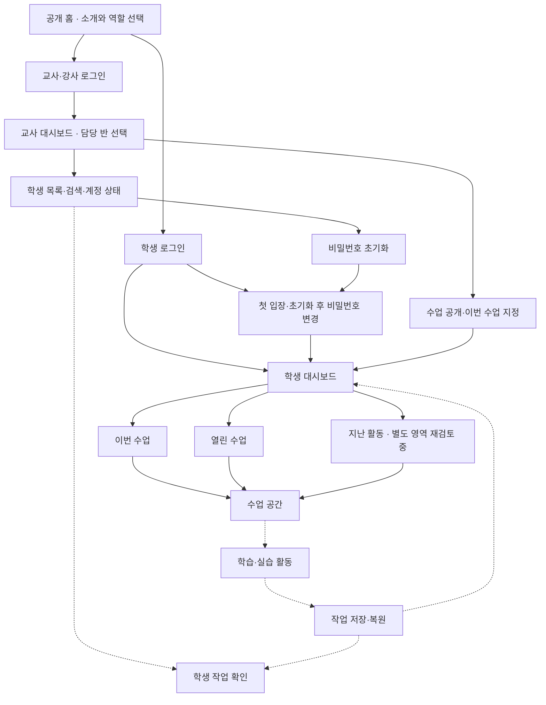

# CS Class 제품 방향

갱신: 2026-09-28. 기존 합의를 통합한 문서이며, 합의와 구현 완료는 다릅니다. 실제 구현 상태는 [README](README.md)에 있습니다.

## 목적과 첫 범위

**CS Class · 즐거운 정보 교실**은 설치 없이 브라우저로 시작하는 중학교 정보 학습 공간입니다. 학생이 생각을 표현하고 실행·수정하며 완성의 경험을 얻고, 교사는 불필요한 입력·채점 부담 없이 수업을 운영하도록 돕습니다.

현재 개발 우선순위는 공개 홈·학생/교사 입장 첫 화면과 실제로 동작하는 플랫폼입니다. 수업 콘텐츠는 나중에 채웁니다. 향후 첫 적용은 한 반의 일반 학습, 첫 모듈 후보는 순서도 연구소입니다. 수행평가의 도움·채점 기준과 기존 평가 자료 이관은 후속 논의입니다. 수업 시간이나 단계 수를 고정하지 않고 실제 화면과 수업 경험으로 다듬습니다.

## 개발 순서와 명세 진행

- **사용자 방향:** 계정·입장·반 관리·수업 배정 등 플랫폼 기능을 완성도 있게 마련한 뒤 수업을 순차적으로 추가합니다. 현재는 구현보다 전체 화면 지도를 보며 기능을 구체화하는 단계입니다. 교사가 수업 준비·운영을 병행할 수 있는 개발·유지보수 규모를 고려합니다.
- **개발 순서 제안:** 플랫폼 동작 규칙 → 수업을 식별하고 작업을 저장·복원하는 최소 연결 규칙 → 실제 계정·권한·대시보드 → 작은 활동으로 전체 흐름 검증 → 기반 안정화 → 정식 수업 순차 추가입니다. 작은 검증용 활동은 빈 화면만으로 저장·이어하기 기반을 완성했다고 판단하지 않기 위한 제안이며, 활동 내용과 세부 로드맵은 아직 확정하지 않았습니다.
- 학생·교사의 수업 준비 → 입장 → 활동 → 저장·이어하기 → 교사 확인 흐름을 기준으로 범위를 정합니다. 수업마다 공통 계정·반·저장을 다시 만들지 않되, 모든 수업을 위한 범용 편집기나 고정된 세 단계를 미리 강제하지 않습니다.
- 기능 명세에는 진입 목적, 표시 정보, 사용자 행동, 저장·반영 결과, 빈 상태·오류·권한 경계를 기록합니다. 확정 정책은 이 문서에 모으고, 제안·미결정·구현 상태는 구분합니다. 다음 논의 지점은 [HANDOFF](docs/HANDOFF.md)에 연결합니다.

## 논의용 화면 지도

대화에서 사용한 전체 지도를 보존합니다. 실선은 현재 체험 시안의 화면·조작 연결이며 실제 인증이나 다른 PC 사이의 데이터 반영을 뜻하지 않습니다. 점선은 실제 학습·저장·교사 작업 조회의 후속 연결입니다. 각 상자는 별도 페이지일 수도 있고 화면 안의 영역·상태일 수도 있습니다. **지난 활동의 별도 영역 유지 여부는 아래에서 재검토 중입니다.**

공개 수업 소개 경로 `/explore/[id]`도 현재 시안에 있으나 준비 안내 수준입니다. 공개 홈에서의 연결과 역할은 추후 검토합니다. 현재 코드 위치와 실행 상태는 [README](README.md)와 HANDOFF를 따릅니다.

## 합의한 첫 경험

| 영역 | 방향 |
|---|---|
| 공개 화면 | 주제와 예시를 둘러보며 호기심을 느끼는 공간 |
| 로그인 후 | 학생은 본인 학습 대시보드, 교사는 담당 반 관리 화면 |
| 학생 홈 | 교사가 지정한 **이번 수업**을 우선 안내하고 기존 작업 이어하기 제공. 별도 지난 활동 영역 여부는 재검토 중 |
| 이번 수업 지정 | 교사가 반별로 직접 지정하며 바꾸기 전까지 유지 |
| 수업 공개·복습 | 반 전체에 공개하고, 이미 열린 수업은 자유롭게 복습 |
| 초기 제외 | 학생별 보충·심화 배정, 공지, 교사 수업 내용 편집기 |

## 학생 대시보드와 수업 전환

2026-09-28 기능 명세 논의에서 합의한 방향입니다. 실제 수업 변경 알림·작업 저장은 아직 미구현입니다.

- 교사가 이번 수업을 바꾸면 학생 대시보드의 우선 안내가 새 수업으로 바뀝니다. 이번 수업 변경만으로 이전 수업의 공개를 해제하거나 학생 작업을 삭제하지 않습니다. 이전 수업은 열린 수업에 유지하고 기존 작업도 이어갈 수 있게 합니다. 이어하기를 별도 지난 활동 영역에서 제공할지 수업 카드에 통합할지는 아래 논의를 따릅니다.
- 학생이 다른 수업을 진행 중이면 작은 변경 안내와 새 수업으로 이동하는 버튼을 제공합니다. 강제로 화면을 전환하지 않고 학생이 직접 이동합니다.
- 수업을 이동해도 기존 작업을 보존합니다. 활동 중 저장 원칙에 더해, 이동 전 최신 변경 내용의 서버 저장 성공을 확인합니다. 변경이 없고 최신 저장이 확인된 경우 같은 내용을 다시 저장하지 않습니다. 저장에 실패하면 현재 작업을 유지하고 재시도를 안내하며, 저장 완료로 표시하거나 작업을 버린 채 이동하지 않습니다.
- **표시 명칭은 `이번 수업`으로 확정했습니다.** `실시간 수업`·`지금 수업`으로 바꾸지 않습니다. 수업 시작·종료를 관리하는 실시간 진행 기능을 뜻하지 않습니다.
- **목록 구성은 재검토 중:** 사용자는 열린 수업과 지난 활동을 별도 영역으로 나누기보다, 열린 수업에서 본인의 진행 상태를 보고 자율적으로 이어가는 구성을 제안했습니다. 별도 지난 활동 영역의 통합 여부, 진행률 표시와 완료 기준은 아직 확정하지 않았습니다. 기존 작업 보존·이어하기 기능은 유지하며 그 진입 위치를 논의합니다. 현재 시안의 방문 기록을 실제 학습 진행률로 간주하지 않습니다.

### 열린 수업과 지난 활동 통합안 — 다음 대화에서 검토

- **사용자 문제의식:** 두 영역에 같은 수업이 중복되고, 어떤 수업을 지난 활동에 넣을지 기준이 모호합니다. 학생은 열린 수업에서 진행률이 100%가 아닌 수업을 골라 자율적으로 이어가는 흐름이 더 자연스럽다고 제안했습니다. 진행률 표시를 최종 확정한 것은 아닙니다.
- **에이전트 제안:** `이번 수업 + 진행 상태가 있는 열린 수업 목록`으로 구성하고 별도 지난 활동 영역을 통합합니다. 수업별 카드에서 `시작 전 / 진행 중 / 완료`와 `수업 시작 / 이어하기 / 다시 보기`를 제공하는 안입니다. 마지막 작업과 이어갈 위치는 계속 보존합니다. 이 상태·버튼 명칭과 통합안은 사용자 확인 전입니다.
- **완료 기준 선행:** 설명 열람, 퀴즈 수행, 자유 제작 활동에서 무엇을 완료로 볼지 먼저 정합니다. 방문 횟수나 페이지를 연 비율을 이해도·완료율로 표시하지 않습니다. 기준이 명확해지면 `활동 5개 중 3개 완료`처럼 근거를 보여주고 퍼센트 병기 여부를 판단하는 안을 제안했습니다. 이는 모든 수업을 다섯 활동으로 정하는 뜻이 아닙니다.
- **대안·미결 사항:** 여러 프로젝트를 가진 수업이나 많은 수업에서 특정 작업으로 바로 돌아갈 필요가 생기면 별도 최근 활동이 유용할 수 있습니다. 이번 수업과 전체 목록의 중복 배치, 필터·정렬, 수업 미지정·빈 상태, 완료 후 수정 시 상태 변화, 수업 공개를 별도로 해제했을 때 기존 작업 접근은 아직 정하지 않았습니다. 완료한 수업도 복습할 수 있다는 기존 방향은 유지합니다.
- **다음 대화:** 통합안에 대한 사용자 의견부터 듣고, 동의하면 수업별 진행·완료 기준을 하나씩 구체화합니다. 수업 콘텐츠와 관계없이 일괄 100% 규칙을 만들거나 화면을 먼저 변경하지 않습니다.

## 학생 계정과 반 배정 — UI 시안 구현, 실제 인증 미구현

- 교사가 준비한 스프레드시트의 시트별 명단으로 계정을 등록하고 반을 함께 배정합니다. 학생의 직접 회원가입·반 코드 입력 없이 배정된 반으로 입장합니다.
- 로그인 아이디는 전체 학생 사이에서 중복되지 않는 학번입니다. 실명·이메일 없이 사용하는 사전 발급 계정이며, 학습 기록은 학생별로 구분합니다.
- 최초 발급과 교사 초기화에는 서로 다른 공통 비밀번호를 사용합니다. 첫 로그인 및 교사 초기화 후에는 새 비밀번호 설정을 완료해야 학생 홈으로 진입합니다. 초기화해도 기존 학습 기록은 보존합니다. 구체적인 동작은 아래 [로그인 정책](#로그인-정책)을 따릅니다.
- **등록 양식 초안:** 학생 계정 등록 엑셀(초기 비밀번호가 있어 Git 제외, 원래 PC의 위치는 HANDOFF 참고). 한 파일에 한 학년, 시트명은 `1반`, `2반` 형식이며 첫 행은 `번호`, `학번`, `비밀번호`입니다. 2학년 1~11반에 각각 27명(총 297명), 학번은 학년 1자리·반 2자리·번호 2자리로 채웠고 비밀번호 열은 요청한 공통 초기값을 사용합니다. 학번은 앞자리 0을 보존하는 텍스트로 입력합니다. 초기 비밀번호는 파일에서 읽습니다. 학년도·학년은 초기 등록 시 확인하는 방향입니다.

- **초기 일괄 등록 기준 제안:** A~C열을 등록 자료로 읽고 안내 영역은 제외합니다. 완전히 빈 행은 건너뛰되 번호·학번·비밀번호 중 하나라도 빠지면 누락으로 표시합니다. 반 안의 번호 중복·파일 전체 학번 중복·기존 계정 충돌을 미리 보여주며, 재실행으로 기존 계정이나 비밀번호를 덮어쓰지 않습니다. 관리용 스크립트로 미리 등록하고 교사 명단 업로드 화면은 초기 범위에서 제외하는 방향이며, 아직 미구현입니다. 비밀번호 원문은 일반 DB·로그에 보관하지 않으며 계정 자료 파일은 Git에서 제외합니다. Firebase의 비밀번호 없는 익명 인증과 학번·비밀번호 로그인은 구분하며 인증 구현 방식은 후속 설계합니다.

## 교사 인증과 권한 — UI 시안 구현, 서버 권한 미구현

- 선생님은 본인 Google 계정으로 로그인하고 전체 반을 관리하는 방향입니다. 지정된 계정만 관리자 권한을 받습니다.
- 강사님은 고정된 일반 계정에 비밀번호만 입력하는 로그인 방향입니다. **접근 가능 범위는 2학년 10·11반으로 확정**했습니다.
- 강사님의 학생 조회·학습 기록 조회·수업 운영·비밀번호 초기화는 모두 담당 두 반에 한정합니다. 다른 반 접근과 교사 권한 변경은 허용하지 않습니다.
- 화면뿐 아니라 서버와 직접 DB 접근에서도 동일한 범위를 강제합니다. 초기화는 서버에서 권한·대상 반을 확인한 뒤 처리하고 학생의 다음 로그인에 비밀번호 변경을 요구합니다.
- **인증 구현 제안:** Firebase Authentication에 Google 및 비밀번호 계정을 두고, 학생 학번·고정 강사 계정을 내부 이메일 형식 식별자에 연결합니다. Firestore는 반·역할·변경 필요 상태를 보관합니다. 실제 계정 등록·권한 설정은 아직 수행하지 않았습니다.

## 로그인 정책

2026-09-28 대화에서 합의한 제품 요구사항입니다. **실제 인증·세션·서버 권한은 미구현이며 현재 체험 시안의 동작과 구분합니다.** 기존 시안의 8자 조건이나 새로고침 시 초기화 동작을 아래 정책의 구현으로 간주하지 않습니다.

### 학생 비밀번호와 초기화

| 항목 | 확정 정책 |
| --- | --- |
| 개인 비밀번호 | 6자 이상이며 영문과 숫자를 각각 1개 이상 포함합니다. 특수문자는 필수가 아닙니다. |
| 공통 비밀번호 | 최초 발급용과 초기화용을 서로 다른 값으로 관리합니다. 개인 비밀번호로 두 공통값을 재사용할 수 없습니다. |
| 최초 입장 | 최초 발급용 비밀번호로 인증한 뒤 개인 비밀번호 설정을 완료해야 학생 대시보드로 진입합니다. |
| 분실·초기화 | 교사·강사가 권한 범위 안의 해당 학생만 초기화용 공통 비밀번호로 변경합니다. 학생별 임시 비밀번호 발급 방식은 채택하지 않습니다. |
| 기존 접속 | 초기화 성공 시 해당 학생의 기존 로그인을 종료하고 서버 접근 권한도 무효화합니다. |
| 초기화 후 입장 | 초기화용 비밀번호로 인증한 뒤 개인 비밀번호를 새로 설정해야 합니다. |
| 교사 화면 상태 | 초기화 후에는 `비밀번호 변경 필요`를 표시합니다. 학생의 실제 변경 성공 후 표시를 해제하고 정상 상태로 갱신합니다. 로그인하거나 변경 화면을 여는 것만으로 해제하지 않습니다. |
| 기록·비밀번호 표시 | 비밀번호 초기화와 변경은 학습 기록을 삭제하지 않습니다. 교사에게 학생의 개인 비밀번호를 표시하지 않습니다. |

공통 초기화 방식은 전달 편의성을 우선한 합의입니다. 공통값이 알려지면 초기화된 계정에 다른 학생이 먼저 입장할 위험은 남습니다. 실제 비밀번호와 대화에서 나온 예시 문자열은 이 문서·코드·로그에 기록하지 않고 별도 설정으로 관리합니다. 초기화용 실제 값은 아직 확정하지 않았습니다.

### 로그인 유지와 종료

학생은 공용 공간의 학교 PC를 번갈아 사용합니다. 학교 PC의 롤백 기능이 있더라도 컴퓨터를 켜 둔 경우의 접속은 아래 정책으로 처리합니다.

| 상황 | 확정 정책 |
| --- | --- |
| 화면 이동·새로고침 | 로그인 상태를 유지합니다. |
| 브라우저 종료 후 다시 접속 | 다시 로그인을 요구합니다. 브라우저의 이전 세션 복원에 대한 구현·검증 사항은 아래에 별도 기록합니다. |
| 학생 무활동 | 마지막 실제 활동부터 10분이 지나면 자동 로그아웃합니다. 쉬는시간표와 연동하지 않습니다. |
| 학생 종료 예고 | 9분 무활동 시 `1분 후 자동 로그아웃돼요.` 안내와 `계속 사용하기` 버튼을 표시합니다. 계속 사용하거나 실제 조작을 하면 시간을 갱신합니다. |
| 교사·강사 무활동 | 마지막 실제 활동부터 4시간이 지나면 자동 로그아웃합니다. 로그인 후 고정 4시간이 아니라 무활동 기준이며 사용 중에는 시간을 갱신합니다. |
| 활동의 의미 | 클릭·입력·스크롤·터치 등 사용자의 실제 조작입니다. 애니메이션·자동 저장·백그라운드 통신은 활동으로 계산하지 않습니다. |
| 명시적 로그아웃 | 로그인 화면으로 이동하고 이전 사용자의 화면·작업 내용이 다음 사용자에게 노출되지 않도록 처리합니다. |
| 저장된 기록 | 로그아웃해도 서버에 저장된 작업은 유지하며 본인이 다시 로그인하면 이어갈 수 있습니다. 미전송 작업까지 저장됐다고 간주하지 않습니다. |

### 동일 계정의 중복 로그인

- 학생·교사·강사 모두 동일 계정의 동시 접속은 허용하지 않습니다. **새로운 로그인에 성공하면 새 접속을 유지하고 기존 접속을 종료합니다.** 로그인 실패는 기존 접속에 영향을 주지 않습니다.
- 기존 접속에는 `다른 곳에서 로그인되어 로그아웃됐어요.`를 안내하고 로그인 화면으로 이동합니다. 화면 전환뿐 아니라 기존 세션의 서버 조회·저장 권한도 무효화합니다.
- 서버에 저장된 학습 기록은 보존합니다. 중복 로그인 종료 시 미저장 작업 처리와 같은 브라우저의 여러 탭을 한 세션으로 다루는 구체적인 방식은 후속 설계합니다.

### 구현 전 확인과 검증

- 브라우저 종료 후 재로그인은 제품 요구사항입니다. 세션 쿠키 등 종료 시 삭제되는 저장 방식만으로 브라우저의 이전 세션 복원까지 항상 차단된다고 가정하지 않습니다. 학교에서 쓰는 브라우저의 일반 종료·창 복원·비정상 종료 후 복원을 확인하고, 요구사항을 충족하지 못하는 경우 보완 방식과 한계를 명시합니다. [브라우저 세션 복원 참고](https://developer.mozilla.org/en-US/docs/Web/HTTP/Guides/Cookies#creating_removing_and_updating_cookies)
- 반복 로그인 실패에 대한 시도 제한을 설계합니다. 구체적인 횟수·대기 시간, 교사·강사 만료 전 안내 방식, 여러 탭의 활동 시간 공유는 아직 미정입니다.
- 타이머나 화면 표시만으로 권한을 판단하지 않습니다. 초기화·만료·중복 로그인 후 서버와 직접 DB 접근 경로에서도 권한이 종료되는지 확인합니다.
- 실패한 비밀번호 변경은 변경 필요 상태를 해제하지 않아야 합니다. 초기화·변경 성공 여부와 교사 화면 상태가 일치하고 학습 기록이 유지되는지 확인합니다.
- 새로고침 유지, 역할별 무활동 만료, 종료 예고와 연장, 자동 저장이 만료 시간을 연장하지 않는 경우, 새 로그인 성공·실패의 기존 접속 영향, 재접속 후 작업 복원을 검증합니다.

## 작업 저장과 통신 비용

2026-09-28 합의한 설계 기준입니다. **종료 순간에만 저장하지 않고 활동 중에 저장하며, 저장 안정성과 서버 통신 비용을 함께 고려합니다.** 유료 요금제 사용 가능성은 열어 두되 Vercel·Firebase의 불필요한 사용량을 줄입니다. 요금제 선택이나 서비스 연결을 승인한 것은 아닙니다.

- 변경된 작업만 저장하고, 연속 입력·블록 이동은 모아서 처리합니다. 같은 내용의 반복 저장과 모든 조작마다의 서버 요청을 피합니다.
- 통신을 줄이더라도 미저장 상태가 무한히 길어지지 않도록 합니다. 저장 간격·최대 미저장 시간은 활동 특성과 예상 비용을 함께 비교해 정하며 아직 수치를 확정하지 않았습니다.
- 교사 화면의 불필요한 전체 작업 반복 조회를 줄입니다. 무활동 시간 계산이나 세션 확인도 사용자 조작마다 서버·DB에 기록하는 방식으로 정하지 않습니다.
- 학생 한 명의 수업당 저장·조회 횟수를 측정하고 예상 사용 규모로 비용을 계산합니다. 서비스별 실제 과금 기준은 설계 시점에 확인합니다.
- 저장 완료 표시는 서버의 실제 처리 결과와 일치해야 합니다. 저장 실패·네트워크 단절 중 무활동 만료, 교사 초기화, 다른 곳의 로그인으로 접속이 종료될 때 미전송 작업을 어떻게 복구하고 다음 사용자에게 노출되지 않게 할지는 저장 명세에서 구체화합니다.

## 디자인 합의

- 공개 홈은 사용자 만족을 확인했습니다. 토스 메인의 색·여백·사용 과정을 보여주는 전개를 참고하며 구체적인 색·글꼴·문구·배치·모션은 [DESIGN](DESIGN.md)에 통합했습니다. 대시보드의 기존 Designo LMS 참고는 보조 자료이며 현재 홈 스타일을 우선 계승합니다.
- 감성 과잉·상투적인 교육 홍보 문구를 줄이고 사용 방법을 담백한 존댓말로 소개합니다. Pretendard, 흰색·옅은 회색·은은한 파랑, 절제된 하늘색·살구·라일락을 사용합니다. 민트·네온은 비선호입니다.
- 개념학습 → 퀴즈 → 실습은 한 수업의 예시이며 전체 수업의 단계 수·진입 순서를 강제하지 않습니다. 순서도 등 한 단원을 플랫폼 전체의 정체성으로 내세우지 않습니다.
- 공개 홈의 움직임은 기본 켜짐이고 사용자가 상단에서 줄일 수 있습니다. 로그인 후에는 수업·관리에 집중합니다. 참고 화면에 있는 통계·달력·알림 등의 기능은 자동 도입하지 않습니다.
- **로그인은 중앙 집중형으로 확정:** 무엇을 어디에 입력하는지 직관적으로 보이게 합니다. 학생·교사 로그인부터 홈 스타일에 맞추고, 대시보드 배치는 사용자와 대화하며 정합니다. 상세 컴포넌트·배치 초안은 DESIGN을 따릅니다.
- 특정 수업 콘텐츠를 구현할 때 순서도 기호 색은 단말 보라·자료 초록·판단 주황·처리 파랑을 출발점으로 검토합니다. 외부 자산 재사용 시 라이선스를 확인합니다.
## 기존 기능 구상 — 상세 구현 전 재검토

아래는 이전 논의를 보존한 구상입니다. 확정된 세부 명세나 일괄 구현 목록으로 취급하지 않습니다.

| 영역 | 논의한 내용 |
|---|---|
| 개념·응용 | 순서도 기호, 개념 퀴즈 4문항, 순차·선택·반복·흐름 오류 해석 4문항, 불빛 시뮬레이터 |
| 실습 | 라면·놀이기구·비밀번호·등교·백지 콘텐츠. 학생이 조립·실행·수정을 주도 |
| 학습 이동·기록 | 열린 수업 안에서는 자유 이동. 퀴즈는 정답 완료 여부만 기록하고 답안·점수·시도 횟수는 추가 수집하지 않는 방향 |
| 교사 관리 | 담당 반의 열린 수업, 진행·제출 상태, 마감·재개방 |
| 학생 변경 | 전입·비밀번호 재발급 시 작업 보존. 같은 번호의 학생 교체는 새 식별자로 구분 |
| 초안·제출 | 서버 자동 저장, 초안과 제출본 분리, 마감 전 재제출과 이전 제출본 조회 |
| 기록 조회 | 연도·반·번호로 조회·내보내기 검토. 보관·삭제 기간은 학교 규정과 협의로 결정 |

**학생용 AI:** 간단한 문답형 챗봇을 출발점으로 검토합니다. 학생의 사고를 돕는 역할이며, 정답·힌트 제공 범위는 미정입니다. 이전의 ‘AI 설계 검사 통과 후 제출’ 구상은 재검토 대상으로 남깁니다. 검사 기능을 채택한다면 초안 변경 후 이전 검사 결과를 재사용하지 않습니다.

## 실제 사용 전 지킬 기준

- 공유 PC에서 학생의 세션·작업이 섞이지 않도록 인증 지속성·복구·사용 종료를 설계합니다. 실제 학생 자료의 지속적 브라우저 저장은 기본으로 삼지 않습니다.
- 인증·권한은 서버와 직접 DB 접근 경로에서 강제합니다. 비밀번호·비공개 평가 자료·학생 개인정보를 노출하지 않습니다.
- 저장·제출·AI 결과 표시는 실제 처리와 일치해야 합니다. 실패하면 작성 내용을 보존하고 다음 행동을 안내합니다.
- 기존 답안·제출본·확정 성적을 보존합니다. 실제 자료·평가 기준 변경 전 호환성·영향·복구 방법을 확인합니다.

## 다음에 결정할 것

- 학생 홈: [수업 전환 합의](#학생-대시보드와-수업-전환)를 바탕으로 열린 수업·지난 활동 통합 여부, 진행 상태·완료 기준과 미지정·빈 상태를 구체화합니다. `이번 수업` 명칭은 확정했으며 예시 수업 3개는 UI 확인용으로 콘텐츠 확정이 아닙니다.
- 후속 로그인: 확정된 [로그인 정책](#로그인-정책)을 바탕으로 중앙 집중형 화면의 세부 문구·오류 상태·구현 방식을 정합니다. 홈 스타일·로그인 중앙 배치·합의한 주요 정책을 다시 미정으로 돌리지 않습니다.
- 작업 저장: [저장·통신 비용 기준](#작업-저장과-통신-비용)에 따라 활동별 저장 간격, 최대 미저장 시간과 접속 종료 시 복구 방식을 정합니다.
- 기술·운영: 채택한 Next.js 기반에서 인증·저장·AI 제공자와 비용 한도, 데이터 모델·보관·복구 정책.
