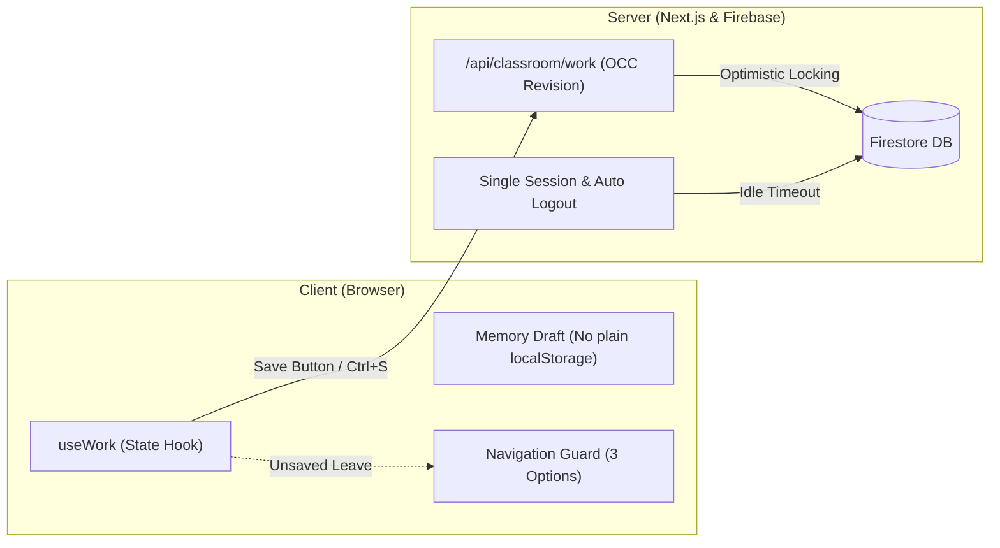

# CS Class · 즐거운 정보 교실

> **설치 없이 브라우저로 시작하는 중학교 정보 수업 웹 플랫폼**<br>
> `Next.js 16 (App Router)` · `React 19` · `TypeScript` · `Firebase Auth & Firestore` · `EntryJS 4.0` · `Upstage Solar AI`

[](https://nextjs.org/)
[](https://react.dev/)
[](https://firebase.google.com/)
[](https://playentry.org/)
[](https://tailwindcss.com/)

[🚀 운영 사이트 열기](https://cs-class-donghyunt.vercel.app)

---

## 1. 프로젝트 개요 (Overview)

**CS Class**는 프로그램 설치나 복잡한 환경 설정 없이, 웹 브라우저 접속만으로 학생이 주도적으로 문제를 해결하고 교사는 행정 부담 없이 수업을 운영하도록 돕는 디지털 정보 교실입니다.

* **타깃 규모:** 서울 금옥중학교 2학년 11개 반(반별 최대 27명, 계정 297개)의 정규 수업을 대상으로 합니다.
* **학습 흐름:** 모든 수업은 `개념(Concept) → 퀴즈(Quiz) → 실습(Practice)` 3단계 라이프사이클을 따르며, 차시 번호에 구애받지 않고 활동 주제 중심으로 운영됩니다.
* **학교 현장 맞춤 설계:** 공용 학교 컴퓨터 환경을 고려한 메모리 세션 격리, 네트워크 트래픽을 최소화하는 수동 저장 아키텍처, 교사의 11개 학급 진도 모니터링을 제공합니다.

---

## 2. 주요 기능 및 학습 공간 (Features & Curriculum)

수업별 개념·퀴즈·미션과 완료 기준은 [PRD §4](docs/PRD.md#4-수업-카탈로그-명세), 화면별 기능·한도는 [PRD §5](docs/PRD.md#5-핵심-서비스-기능-요구사항)가 기준입니다. 여기에는 큰 그림만 둡니다.

* **📘 정규 수업:** 브라우저 안 **EntryJS 4.0.23** 작업실에서 미션을 조립·실행하고, 서버 채점을 통과한 뒤 학생이 직접 제출합니다. 공개 수업 목록은 `src/lib/classroom/catalog.ts`의 `RELEASED_LESSONS`입니다.
* **🧪 선택 복습(성적 미반영):** 문제 추상화·알고리즘 설계·순서도 연구소. 일부 활동은 Upstage Solar AI와 연동됩니다.
* **📊 학생 공간:** 정규 수업 합산 진도와 수업별 남은 활동, 완료 알림과 배지(`내 배지`), 내 할 일, 시간표 자동 연동, 우리 반 질문. 손들기 운영 여부는 [PRD §5.5](docs/PRD.md#설정과-손들기)를 따릅니다.
* **🧑‍🏫 교사 공간:** 관리자·강사 권한 분리, 이번 수업 지정·수업 열고 닫기, 반 진도와 제출 작품 보기·인라인 실행, 학생 계정 관리(임시 비밀번호·반 공통 첫 입장 코드·명단에서 빼기), 학생 기록에 쓰지 않는 실제 수업 미리보기.

---

## 3. 핵심 아키텍처 원칙 (Architecture Highlights)



1. **무부하 수동 저장 체계 (Manual Save SSOT):**
   - 저장 버튼·`Ctrl+S`와 [PRD §3.2](docs/PRD.md#학생-수업의-수동-저장-정책)의 명시적 예외(채점·제출·AI 요청·손들기 등)에서만 서버에 보관하고 debounce 자동 저장을 두지 않으며, 미저장 이탈은 3선택 모달로 막습니다.
2. **학교 공용 PC 보안 및 세션 격리:**
   - 평문 학생 답안을 브라우저 로컬 스토리지에 영구 보관하지 않으며, 로그아웃·자동 로그아웃·계정 전환 시 메모리 초안을 지웁니다. 브라우저 세션 복원이 있어 공용 PC에서는 로그아웃해야 합니다.
   - 동일 계정의 다중 동시 접속을 전면 차단(단일 세션 강제)하며, 무활동 시 자동 로그아웃됩니다(시간은 [PRD §6.2](docs/PRD.md#62-세션-및-다중-접속-제어)).
3. **선별 검증 (Scoped CI):**
   - 단일 수업 수정 시 해당 수업의 E2E 및 공통 스모크만 선별 실행하며, 순수 마크다운 문서 커밋은 짧게 끝나는 경량 CI 모드로 자동 전환됩니다.

---

## 4. 빠르게 시작하기 (Quick Start)

### 사전 요구사항
* **Node.js:** `24.x` 중 24.12 이상(`firebase` 13 요구, CI·Vercel은 24의 최신판)
* **Java:** `JDK 21+` (Firebase Local Emulator 실행용)

### 로컬 개발 환경 실행
```powershell
# 1. 의존성 설치 및 EntryJS 자산 준비
npm ci

# 2. 로컬 에뮬레이터(Auth 9099 / Firestore 8080)와 개발 서버 동시 실행
npm run dev:emulator
```

서버가 구동되면 브라우저에서 `http://localhost:3000`으로 접속합니다.
* 로그인 화면 하단의 **게스트 학생**(`21099`) 또는 **게스트 교사** 버튼을 누르면 별도 인증 설정 없이 주요 기능을 바로 체험할 수 있습니다(게스트 교사는 2학년 1~11반 담당).
* Windows PowerShell 환경에서 스크립트 실행이 차단되는 경우 `npm.cmd` 및 `npx.cmd`를 사용합니다.

---

## 5. 프로젝트 문서 색인 (Documentation Map)

모든 설계와 운영 원칙은 **단일 진실 공급원(SSOT)** 원칙에 따라 고유한 담당 문서에 체계적으로 분리되어 있습니다.

| 문서 | 핵심 내용 및 담당 영역 | 대상 독자 |
| :--- | :--- | :--- |
| **[`AGENTS.md`](AGENTS.md)** | AI 에이전트 작업 지침, 핵심 실행 명령, 엄격한 가드레일 (절대 규칙) | 모든 AI 에이전트 |
| **[`docs/PRD.md`](docs/PRD.md)** | 확정 제품 요구사항, 수업 카탈로그 규약, 도메인 상태 머신, Non-Goals | 선생님(제품 결정)·에이전트 |
| **[`docs/DESIGN.md`](docs/DESIGN.md)** | 시각 디자인 기준, 시맨틱 색상 토큰, 반응형 기준(820px), LessonShell 명세 | 에이전트(화면 작업) |
| **[`docs/DEVELOPMENT.md`](docs/DEVELOPMENT.md)** | 로컬 에뮬레이터 설정, 반영 경로·검증, 신규 수업 추가 체크리스트, 문서 작성 기준 | 에이전트 |
| **[`docs/FIREBASE_SETUP.md`](docs/FIREBASE_SETUP.md)** | Vercel 서버 설정, Firestore 인덱스/규칙, AI 환경변수, 장애 복구 절차 | 선생님(운영 승인·콘솔 작업)·에이전트 |
| **[`docs/HANDOFF.md`](docs/HANDOFF.md)** | 현재 작업 상태, 최근 반영과 검증, 다음 작업, 남은 한계 | 선생님·다음 에이전트 |

문서를 고칠 때의 주제별 위치와 쓰기 규칙은 [문서 작성 기준](docs/DEVELOPMENT.md#문서-작성-기준)에 있습니다. `docs/plans/`에는 진행 중인 작업 계획만 두고, 끝난 계획과 지난 원문은 [`docs/archive/`](docs/archive/README.md)에 보관합니다. `docs/reference/`는 보관 원문이 가리키는 근거 자료(화면 캡처 등)입니다.

선생님이 직접 할 일은 [HANDOFF의 다음 작업·남은 한계](docs/HANDOFF.md#다음에-이어갈-작업), 수업 당일 순서는 [첫 실제 수업 확인 순서](docs/DEVELOPMENT.md#첫-실제-수업-확인-순서)에 있습니다. 교사가 투사하는 3차시 개념 수업 자료는 [내일, 축제에서 만나](teaching-materials/festival-romance/README.md)를 참고하세요. 독립 HTML 완성본과 수정 소스가 함께 있습니다.

---

## 6. 저장소 구조 (Directory Structure)

```text
cs-class/
├─ README.md              # 프로젝트 소개 및 문서 색인 (대문)
├─ AGENTS.md              # 에이전트 작업 규칙·승인 범위·금지사항
├─ src/
│  ├─ app/                # Next.js App Router (페이지 및 서버 API)
│  ├─ components/         # 앱 전체 틀(app-shell, 세션, 이동, 로그인)은 바로 아래에 둠
│  │  ├─ home/            # 공개 랜딩 페이지 및 수업 시연
│  │  ├─ ui/              # 버튼, 입력창 등 공통 디자인 컴포넌트 (Base UI)
│  │  ├─ dashboard/       # 공통 대시보드, 개인 할 일, 반 일정
│  │  ├─ student/         # 수업 전용 틀 (LessonShell), 학습 뷰어, 수동 저장 (useWork)
│  │  ├─ teacher/         # 교사 대시보드, 학생 관리, 수업 공개, 미리보기
│  │  ├─ community/       # 우리 반 질문(Q&A)
│  │  ├─ classroom/       # 손들기
│  │  ├─ explore/         # 공개 홈의 수업 소개(데모) 화면
│  │  └─ settings/        # 닉네임·비밀번호 설정
│  └─ lib/
│     ├─ classroom/       # 도메인 타입, 진도 측정, 수업 메타데이터
│     └─ server/          # 인증 장부, Firestore 서비스, Q&A 서버 로직
├─ tests/                 # Playwright E2E 검증 및 단위 테스트 스위트
├─ public/entryjs/        # EntryJS 4.0.23 편집기 및 브라우저 정적 자산 (sprites/library: 엔트리 공식 오브젝트 묶음)
├─ public/concepts/       # 개념 화면 정적 그림(엔트리 블록 이미지 캡처)
├─ scripts/               # 에뮬레이터 시드, 선별 검증기, 문서 검사 스크립트
├─ teaching-materials/    # 교사가 투사하는 독립 수업 자료 (로그인·DB 미사용, 자료 자체 빌드 build.cjs가 public/festival-romance.html도 만듦)
├─ docs/                  # PRD, DESIGN, DEVELOPMENT, FIREBASE_SETUP, HANDOFF 핵심 문서
│  ├─ plans/              # 진행 중인 작업 계획 (필요할 때 만들고, 끝나면 보관)
│  ├─ archive/            # 지난 문서 원문 스냅샷 (수정 금지)
│  └─ reference/          # 보관 원문이 가리키는 근거 자료
├─ outputs/design-review/ # 보관 원문이 가리키는 초기 화면 캡처 (수정 금지)
└─ archive/               # V1 최신 소스 참고본 (실행·배포 대상 아님, 수정 금지)
```

---

## 7. 글꼴 및 라이선스 (Credits & License)

* **타이포그래피:** 본 프로젝트의 한글 기본 서체는 [Pretendard](https://github.com/orioncactus/pretendard) (SIL Open Font License 1.1)를 로컬 패키징하여 사용합니다.
* **학습 도구 엔진:** 정규 프로그래밍 실습은 오픈소스 [EntryJS](https://playentry.org/) 4.0.23을 활용합니다.
