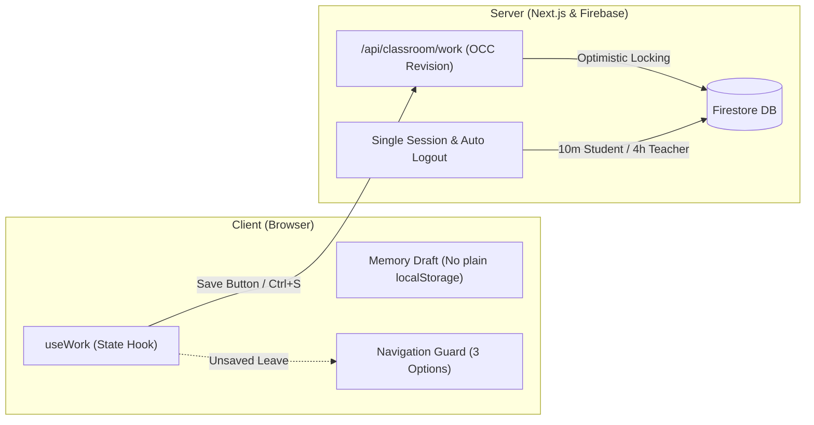

# CS Class · 즐거운 정보 교실

> **설치 없이 브라우저로 시작하는 중학교 정보 수업 웹 플랫폼**<br>
> `Next.js 16 (App Router)` · `React 19` · `TypeScript` · `Firebase Auth & Firestore` · `EntryJS 4.0` · `Upstage Solar AI`

[](https://nextjs.org/)
[](https://react.dev/)
[](https://firebase.google.com/)
[](https://playentry.org/)
[](https://tailwindcss.com/)

[🚀 운영 사이트 열기](https://cs-class-donghyunt.vercel.app)

---

## 1. 프로젝트 개요 (Overview)

**CS Class**는 프로그램 설치나 복잡한 환경 설정 없이, 웹 브라우저 접속만으로 학생이 주도적으로 문제를 해결하고 교사는 행정 부담 없이 수업을 운영하도록 돕는 디지털 정보 교실입니다.

* **타깃 규모:** 서울 금옥중학교 2학년 11개 반, 반별 최대 27명(전체 최대 297명 동시 접속 한도)의 정규 수업을 안정적으로 지원합니다.
* **학습 흐름:** 모든 수업은 `개념(Concept) → 퀴즈(Quiz) → 실습(Practice)` 3단계 라이프사이클을 따르며, 차시 번호에 구애받지 않고 활동 주제 중심으로 운영됩니다.
* **학교 현장 맞춤 설계:** 공용 학교 컴퓨터 환경을 고려한 메모리 세션 격리, 네트워크 트래픽을 최소화하는 수동 저장 아키텍처, 교사의 11개 학급 진도 모니터링을 제공합니다.

---

## 2. 주요 기능 및 학습 공간 (Features & Curriculum)

### 📘 정규 수업: 프로그래밍의 기초 (`programming-13`)
실제 **EntryJS 4.0.23** 블록 코딩 환경과 실행 무대를 브라우저 안에 통합했습니다.
* **개념 학습 (5개):** 프로그래밍의 개념, 언어의 표현, 입출력, 변수와 연산, 시작 신호 인터랙티브 실험.
* **퀴즈 (5문항):** 핵심 개념 즉각 채점 및 오답 재도전 라운드.
* **실습 미션 (기본 4):** `이름 짓기`(대화 입출력), `곱셈 계산기`(변수 조작), `시작 버튼 이동`(좌표 이동), `방향키 개선`(네 방향키 이동).
  - 조건 검증 통과 후 학생이 명시적으로 제출해야 완료 처리되는 3단계 검증 파이프라인.

### 📘 정규 수업: 조건에 따라 달라지는 프로그램 (`conditionals`)
* **개념 학습 (5개):** 산술·비교·논리 연산자, 세 가지 제어 구조, 만일 ~(이)라면·아니면(개념마다 작은 그림 포함).
* **퀴즈 (5문항):** 코드를 읽고 결과를 예측하는 문제.
* **실습 미션 (기본 3 + 선택 1):** `평균 계산기`, `시험 합격/불합격`, `자유투 평가`, 선택 도전 `방탈출`(‘또는’ 사용).

### 📘 정규 수업: 반복으로 똑똑하게 (`loops`)
* **개념 학습 (5개):** 반복이 필요한 이유, 횟수 반복, 정다각형과 360°, 조건·계속 반복, 변수로 세기와 모양 바꾸기(개념마다 작은 그림 포함).
* **퀴즈 (5문항):** 코드를 읽고 결과를 예측하는 문제.
* **실습 미션 (기본 3 + 선택 1):** `정사각형 그리기`, `정다각형 그리기`, `나무 키우기`(엔트리 공식 자료 그림), 선택 도전 `비밀번호 금고`.

### 🧪 선택 복습: 알고리즘 스튜디오
컴퓨팅 사고력의 핵심 원리를 탐구하는 전용 복습 공간으로, Upstage Solar AI(`solar-pro4`) 모델과 연동됩니다. (성적 미반영)
* **문제 추상화 (`review-abstraction`):** 노선도 지도 비교 맛보기 및 상태·조건·핵심·계획 4단계 워크북 완성.
* **알고리즘 설계 (`review-sandwich`):** 샌드위치 로봇에게 자연어로 명령을 내리고, 서버 원본 룰 재실행을 통해 명확성을 검증받는 인터랙티브 조리대.
* **순서도 연구소 (`review-flowchart`):** 순차·선택·반복 3가지 퍼즐 자동 판정 및 나만의 순서도를 기획·배치·연결하는 자유 공방.

### 📊 학생 대시보드 & 학급 커뮤니티
* **3구간 원형 진도 게이지:** 정규 수업의 필수 개념·퀴즈·실습 활동 합산 완료율을 120도 구간으로 시각화.
* **내 할 일 (개인 체크리스트):** 계정당 최대 50개, 낙관적 UI(Optimistic UI) 기반의 빠른 반응 속도.
* **시간표 자동 연동:** 컴시간(학교코드 `74022`) 서울 금옥중 2학년 정보 수업 시간표 매일 저녁 자동 동기화.
* **우리 반 Q&A:** 같은 반 학생과 교사가 소통하는 질문·답변 게시판 (작성자·담당 교사의 해결 완료 토글과 질문 삭제).
* **손들기 (도움 요청):** 작업 저장 시점의 스냅샷을 교사에게 전달하는 기능입니다. 운영 여부는 [PRD §5.5](docs/PRD.md#설정과-손들기)를 따릅니다.

### 🧑‍🏫 교사 대시보드 & 학급 관리
* **권한 분리:** 관리자(선생님, 1~11반 전체 관리) 및 강사(`instructor`, 10반·11반 전담 관리)의 엄격한 역할 격리.
* **실시간 진도 집계:** 이번 수업 지정, 열린 수업 관리, 반 전체 학생의 필수 활동 완료 현황 파악.
* **계정 관리:** 개별 학생의 임시 비밀번호 1회 발급(30분 유효) 및 초기화 지원.
* **교사 실제 수업 미리보기:** 학생과 같은 수업 화면을 메모리에서만 사전 체험 (실제 학생 기록에 쓰지 않음).
* **제출 작품 시각화 및 인라인 실행:** 학생이 제출한 엔트리 작품을 오브젝트 요약과 카테고리 색상 블록 조립도로 확인하고, 모달 안 인라인 작업실에서 바로 실행·검증 (학생 제출 원본은 불변 유지).

---

## 3. 핵심 아키텍처 원칙 (Architecture Highlights)



1. **무부하 수동 저장 체계 (Manual Save SSOT):**
   - 상단 저장 버튼 클릭 또는 단축키 `Ctrl+S` (Mac: `Cmd+S`) 실행 시에만 서버에 snapshot을 보관합니다.
   - 학생 수업 컴포넌트 내부에 타이핑 감지형 debounce 자동 저장 타이머를 일절 두지 않습니다.
   - 미저장 작업이 있을 때 수업 외부로 이탈 시 `저장 후 나가기`, `저장하지 않고 나가기`, `취소`의 3선택 모달을 강제합니다.
2. **학교 공용 PC 보안 및 세션 격리:**
   - 평문 학생 답안을 브라우저 로컬 스토리지에 영구 보관하지 않으며, 세션 종료 시 메모리 초안을 완전히 소멸시킵니다.
   - 동일 계정의 다중 동시 접속을 전면 차단(단일 세션 강제)하며, 무활동 시 자동 로그아웃(학생 10분, 교사 4시간)됩니다.
3. **선별 검증 (Scoped CI):**
   - 단일 수업 수정 시 해당 수업의 E2E 및 공통 스모크만 선별 실행하며, 순수 마크다운 문서 커밋은 짧게 끝나는 경량 CI 모드로 자동 전환됩니다.

---

## 4. 빠르게 시작하기 (Quick Start)

### 사전 요구사항
* **Node.js:** `24.x` (CI·Vercel과 같은 버전)
* **Java:** `JDK 21+` (Firebase Local Emulator 실행용)

### 로컬 개발 환경 실행
```powershell
# 1. 의존성 설치 및 EntryJS 자산 준비
npm ci

# 2. 로컬 에뮬레이터(Auth 9099 / Firestore 8080)와 개발 서버 동시 실행
npm run dev:emulator
```

서버가 구동되면 브라우저에서 `http://localhost:3000`으로 접속합니다.
* 로그인 화면 하단의 **게스트 학생**(`21099`) 또는 **게스트 교사** 버튼을 누르면 별도 인증 설정 없이 주요 기능을 바로 체험할 수 있습니다(게스트 교사는 2학년 1~11반 담당).
* Windows PowerShell 환경에서 스크립트 실행이 차단되는 경우 `npm.cmd` 및 `npx.cmd`를 사용합니다.

---

## 5. 프로젝트 문서 색인 (Documentation Map)

모든 설계와 운영 원칙은 **단일 진실 공급원(SSOT)** 원칙에 따라 고유한 담당 문서에 체계적으로 분리되어 있습니다.

| 문서 | 핵심 내용 및 담당 영역 | 대상 독자 |
| :--- | :--- | :--- |
| **[`AGENTS.md`](AGENTS.md)** | AI 에이전트 작업 지침, 핵심 실행 명령, 엄격한 가드레일 (절대 규칙) | AI 코딩 어시스턴트 |
| **[`docs/PRD.md`](docs/PRD.md)** | 확정 제품 요구사항, 수업 카탈로그 규약, 도메인 상태 머신, Non-Goals | 기획자, 개발자 |
| **[`docs/DESIGN.md`](docs/DESIGN.md)** | 시각 디자인 기준, 시맨틱 색상 토큰, 반응형 기준(820px), LessonShell 명세 | 디자이너, UI 개발자 |
| **[`docs/DEVELOPMENT.md`](docs/DEVELOPMENT.md)** | 로컬 에뮬레이터 설정, 반영 경로·검증, 신규 수업 추가 체크리스트, 문서 작성 기준 | 개발자 |
| **[`docs/FIREBASE_SETUP.md`](docs/FIREBASE_SETUP.md)** | Vercel 서버 설정, Firestore 인덱스/규칙, AI 환경변수, 장애 복구 절차 | 인프라/서버 엔지니어 |
| **[`docs/HANDOFF.md`](docs/HANDOFF.md)** | 현재 작업 상태, 최근 반영과 검증, 다음 작업, 남은 한계 | 인수인계자, 개발자 |

문서를 고칠 때의 주제별 위치와 쓰기 규칙은 [문서 작성 기준](docs/DEVELOPMENT.md#문서-작성-기준)에 있습니다. `docs/plans/`에는 진행 중인 작업 계획만 두고, 끝난 계획과 지난 원문은 [`docs/archive/`](docs/archive/README.md)에 보관합니다. `docs/reference/`는 보관 원문이 가리키는 근거 자료(화면 캡처 등)입니다.

---

## 6. 저장소 구조 (Directory Structure)

```text
cs-class/
├─ README.md              # 프로젝트 소개 및 문서 색인 (대문)
├─ AGENTS.md              # 에이전트 작업 규칙·승인 범위·금지사항
├─ src/
│  ├─ app/                # Next.js App Router (페이지 및 서버 API)
│  ├─ components/         # 앱 전체 틀(app-shell, 세션, 이동, 로그인)은 바로 아래에 둠
│  │  ├─ home/            # 공개 랜딩 페이지 및 수업 시연
│  │  ├─ ui/              # 버튼, 입력창 등 공통 디자인 컴포넌트 (Base UI)
│  │  ├─ dashboard/       # 공통 대시보드, 개인 할 일, 반 일정
│  │  ├─ student/         # 수업 전용 틀 (LessonShell), 학습 뷰어, 수동 저장 (useWork)
│  │  ├─ teacher/         # 교사 대시보드, 학생 관리, 수업 공개, 미리보기
│  │  ├─ community/       # 우리 반 질문(Q&A)
│  │  ├─ classroom/       # 손들기
│  │  ├─ explore/         # 공개 홈의 수업 소개(데모) 화면
│  │  └─ settings/        # 닉네임·비밀번호 설정
│  └─ lib/
│     ├─ classroom/       # 도메인 타입, 진도 측정, 수업 메타데이터
│     └─ server/          # 인증 장부, Firestore 서비스, Q&A 서버 로직
├─ tests/                 # Playwright E2E 검증 및 단위 테스트 스위트
├─ public/entryjs/        # EntryJS 4.0.23 편집기 및 브라우저 정적 자산 (sprites/library: 엔트리 공식 오브젝트 묶음)
├─ scripts/               # 에뮬레이터 시드, 선별 검증기, 문서 검사 스크립트
├─ docs/                  # PRD, DESIGN, DEVELOPMENT, FIREBASE_SETUP, HANDOFF 핵심 문서
│  ├─ plans/              # 진행 중인 작업 계획 (필요할 때 만들고, 끝나면 보관)
│  ├─ archive/            # 지난 문서 원문 스냅샷 (수정 금지)
│  └─ reference/          # 보관 원문이 가리키는 근거 자료
├─ outputs/design-review/ # 보관 원문이 가리키는 초기 화면 캡처 (수정 금지)
└─ archive/               # V1 최신 소스 참고본 (실행·배포 대상 아님, 수정 금지)
```

---

## 7. 글꼴 및 라이선스 (Credits & License)

* **타이포그래피:** 본 프로젝트의 한글 기본 서체는 [Pretendard](https://github.com/orioncactus/pretendard) (SIL Open Font License 1.1)를 로컬 패키징하여 사용합니다.
* **학습 도구 엔진:** 정규 프로그래밍 실습은 오픈소스 [EntryJS](https://playentry.org/) 4.0.23을 활용합니다.
