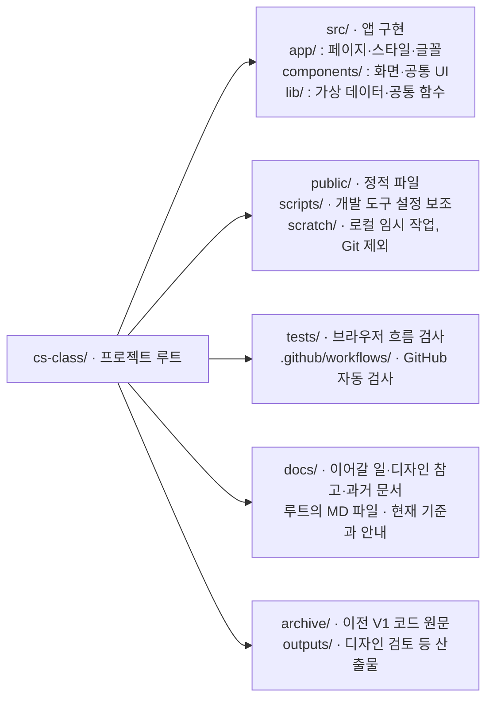

# CS Class · 즐거운 정보 교실

중학교 정보 수업을 위한 온라인 교실입니다. 학생은 이번 수업을 시작하고 지난 활동을 이어가며, 교사는 반별 수업을 준비합니다.

## 현재 기준 문서

| 문서 | 읽는 목적 |
| --- | --- |
| [HANDOFF](docs/HANDOFF.md) | 다른 PC·새 대화에서 이어갈 상태와 바로 다음 작업 |
| [PRD](PRD.md) | 확정된 제품·계정·권한 요구사항과 미결정 사항 |
| [DESIGN](DESIGN.md) | 승인된 홈 스타일, 로그인·대시보드 후속 기준, UI 컴포넌트 활용 |
| [AGENTS](AGENTS.md) | 개발·검증 절차와 프로젝트 주의사항 |
| 이 README | 폴더 구조·실행·체험 계정·도구 설정 |

과거 프롬프트와 중간 검토 기록은 [원문 보관함](docs/archive/README.md)에 있습니다. 현재 지침으로 적용하지 않습니다.

## 저장소 한눈에 보기

**`cs-class/` 하나가 앱의 실행·개발 기준 폴더입니다.** 예전의 `platform/`으로 이동할 필요가 없습니다.



| 주요 파일·하위 경로 | 역할 |
| --- | --- |
| `src/app/page.tsx`, `login/`, `student/`, `teacher/` | 홈·역할별 로그인·학생/교사 대시보드 |
| `src/app/classroom/`, `explore/` | 수업 활동과 둘러보기 화면 |
| `src/app/layout.tsx`, `globals.css`, `experience.css`, `public-home.css` | 공통 틀·기본 스타일·체험 화면·홈 스타일 |
| `src/app/icon.svg`, `fonts/` | 사이트 아이콘·한국어 글꼴과 라이선스 |
| `src/components/ui/`, `demo-provider.tsx` | 공통 UI 부품·새로고침하면 초기화되는 체험 상태 |
| `docs/HANDOFF.md`, `docs/reference/`, `docs/archive/` | 다음 작업·승인된 화면과 UI 예제·과거 문서 원문 |
| `package.json`, `package-lock.json` | 실행 명령·의존성 목록과 다른 PC에서도 동일하게 설치할 버전 |
| `next.config.ts`, `tsconfig.json` | Next.js 실행·빌드 설정과 TypeScript 검사 범위·경로 별칭 |
| `eslint.config.mjs`, `playwright.config.ts` | 코드 검사와 브라우저 검사 설정 |
| `postcss.config.mjs`, `components.json` | Tailwind 스타일 처리와 shadcn UI 생성 설정 |
| `.gitignore`, `.vercelignore`, `.gitattributes` | Git 제외·배포 업로드 제외·보관 원문과 라이선스 보존 규칙 |
| `AGENTS.md`, `PRD.md`, `DESIGN.md` | 에이전트 작업 규칙·제품 요구사항·디자인 기준 |

`public/`은 현재 비어 있어 `.gitkeep`으로 위치만 보존합니다. `node_modules/`는 설치한 패키지, `.next/`는 빌드·개발 캐시, `next-env.d.ts`·`*.tsbuildinfo`는 자동 생성 타입 정보, `test-results/`·`playwright-report/`는 검사 결과입니다. 모두 Git에서 제외하며 직접 수정하지 않습니다.

`outputs/`는 과거 검토 산출물이며 현재 화면 기준은 `docs/reference/`와 DESIGN입니다. 산출물 전체를 일괄 추가하지 않습니다. 로컬 학생 계정 자료·Stitch 검토 폴더는 별도 제외 규칙으로 보호하고, `archive/`·`docs/archive/`는 현재 앱에서 실행하지 않습니다.

## 다른 PC에서 시작

**진행 중인 기능 명세 대화(2026-09-28)는 `codex/login-policy-spec` 브랜치에 있습니다.** 집에서 논의를 이어갈 때는 main 대신 [HANDOFF의 브랜치 전환 절차와 재개 문장](docs/HANDOFF.md#집에서-재개할-위치)을 먼저 확인합니다. 아래는 기본 main 설치 절차이며, 기능 명세의 합의가 앱에 구현됐다는 뜻은 아닙니다.

Git과 Node.js 24를 준비하고, 이 비공개 저장소에 접근할 수 있는 GitHub 계정으로 실행합니다.

```powershell
git clone https://github.com/DonghyunT/cs-class.git
cd cs-class
git switch main
npm ci
npm run dev -- --hostname 127.0.0.1 --port 3000
```

이미 복제한 PC라면 먼저 `git status`로 로컬 작업을 확인합니다. 작업 트리가 깨끗할 때 `git switch main`, `git pull --ff-only` 후 의존성을 설치합니다. 다음 개발은 `codex/` 작업 브랜치에서 진행합니다. Windows PowerShell에서 npm 스크립트 실행이 차단되면 `npm.cmd`·`npx.cmd`를 사용합니다.

루트 통합 전부터 사용한 PC에서는 이전 개발 서버를 종료하고 **저장소 루트에서 `npm ci`로 다시 설치**합니다. 편집기 작업 폴더·터미널 시작 위치가 `platform/`으로 지정되어 있다면 `cs-class/`로 바꿉니다. Git에 없던 옛 `platform/node_modules/`·`.next/` 캐시가 남을 수 있으며, 계속 Git·코드 검사에서 제외됩니다. 더는 사용하지 않지만 `.env`·개인 파일·미커밋 소스가 섞여 있지 않은지 확인하기 전에는 `platform/` 전체를 삭제하지 않습니다.

[로컬 앱](http://127.0.0.1:3000/)을 열고 [HANDOFF](docs/HANDOFF.md)를 읽으면 이어갈 수 있습니다. VS Code/Codex의 과거 대화가 없어도 이 문서와 저장소의 스크린샷을 기준으로 작업합니다.

## 현재 구현과 체험

- 앱은 루트에서 실행하는 Next.js·TypeScript 시안입니다. 홈의 픽셀 그래픽·스크롤 수업 미리보기·역할 선택 입장과 기존 학생·교사 화면을 체험할 수 있습니다.
- **가상 계정·변경 사항은 메모리에만 유지되며 새로고침하면 초기화됩니다.** Firebase 인증·서버 권한·저장·실제 수업 콘텐츠는 미구현입니다. Google 버튼도 실제 OAuth가 아닌 화면 체험입니다.
- 학생 `20101` / `class-demo`, 빈 교실 학생 `21101` / `class-demo`. 첫 입장에는 시안용 새 비밀번호를 설정합니다. 실제 비밀번호를 입력하지 않습니다.
- 교사는 Google 로그인 화면 체험 버튼, 강사는 `teacher-demo`로 들어갑니다. 강사의 화면 범위는 10·11반입니다.
- 한국어 글꼴 [Pretendard 1.3.9](https://github.com/orioncactus/pretendard)은 로컬 제공하며 [SIL OFL](src/app/fonts/OFL.txt)을 포함합니다. 실제 패키지 버전은 [package.json](package.json)과 잠금 파일을 따릅니다.
- 이전 정적 시안은 정리했습니다. 순서도 수업 예시 등 원본이 필요하면 Git의 `c7bc397:web/`에서 확인할 수 있습니다. 현재 실행·개발 대상은 루트의 앱 하나입니다.

## 검증

저장소 루트에서 실행합니다. 최초 E2E 실행 전에 `npx playwright install chromium`이 필요합니다.

```powershell
npm run lint
npm run typecheck
npm run build
npm run test:e2e
```

GitHub Actions는 `main`·`codex/**` push와 PR에서 위 네 검사를 실행하며 E2E는 빌드된 앱을 `next start`로 실행해 검사합니다. 로컬 E2E는 개발 서버를 사용합니다. UI 확인 기준은 [AGENTS](AGENTS.md)를 따릅니다.

## Stitch 연결

Codex의 **StitchDesign 플러그인과 MCP 설정은 PC별로 준비**합니다. 저장소 복제로 사용자 도구 설정이나 API 키가 옮겨지지는 않습니다. 기존 프로젝트는 [CS Class 랜딩페이지 디자인](https://stitch.withgoogle.com/projects/9952170337891001891)이며 ID·화면 조회 주의사항은 [HANDOFF](docs/HANDOFF.md#stitch-상태)에 있습니다.

Codex 사용자 설정 `~/.codex/config.toml`의 기존 설정을 보존하면서 다음 서버 항목을 사용합니다. 같은 이름의 서버가 있으면 중복 추가하지 않습니다.

```toml
[mcp_servers.stitch]
url = "https://stitch.googleapis.com/mcp"
env_http_headers = { "X-Goog-Api-Key" = "STITCH_API_KEY" }
enabled_tools = ["get_project", "list_screens", "get_screen", "edit_screens"]
startup_timeout_sec = 30
tool_timeout_sec = 180
```

### Stitch 키 입력

Windows PowerShell에 아래 블록을 붙여넣고 입력 안내가 나오면 본인의 키를 입력합니다. 입력은 숨겨지고 현재 Windows 사용자 환경변수에만 저장합니다. 실행 정책을 바꾸거나 키를 채팅·명령 인자·저장소에 적지 않습니다.

```powershell
& {
    $stitchSecret = Read-Host 'Stitch API 키' -AsSecureString
    try {
        $stitchValue = [Net.NetworkCredential]::new('', $stitchSecret).Password.Trim()
        if ($stitchValue.Length -lt 20 -or $stitchValue -match '\s') { throw '키 형식을 확인해 주세요.' }
        [Environment]::SetEnvironmentVariable('STITCH_API_KEY', $stitchValue, 'User')
        '등록 완료. Codex를 완전히 종료한 뒤 다시 열어 주세요.'
    }
    finally { $stitchValue = $null; $stitchSecret.Dispose() }
}
```

macOS·Linux에서는 Codex를 시작하는 환경에 같은 이름의 환경변수를 안전하게 설정합니다. 재시작 후 `codex mcp get stitch --json`으로 URL·환경변수 참조를 확인하고 프로젝트를 조회합니다. 현재 허용 도구는 조회·기존 화면 수정이며, 새 시안 작업에서 필요한 도구의 가용성은 다시 확인합니다.

## 외부 환경과 로컬 전용 자료

- 연결된 Vercel 프로젝트는 `cs-class`입니다. **Root Directory는 비워 둡니다(저장소 루트).** Framework Preset은 Next.js, Node.js는 24.x이며 빌드·설치·출력 경로는 프레임워크 기본값을 사용합니다. Git 연동으로 작업 브랜치는 Preview, main은 Production에 배포됩니다. Vercel SSO 보호는 유지하며 배포된 앱도 가상 계정 시안입니다.
- Firebase 후보 `cs-class-f74c4`는 미연결입니다. 실제 인증·저장은 개발 대상을 정한 뒤 진행합니다.
- 키·환경변수·학생 계정 엑셀·`백업용/`은 Git에 포함하지 않습니다. 학생 자료가 필요한 작업은 원래 PC의 자료를 별도 안전한 경로로 준비해야 합니다. UI 작업은 이 자료 없이 가능합니다.
- 최신 공개 홈 참고 이미지와 제공받은 [UI Component Lab](docs/reference/ui-component-lab/index.html)은 저장소에 포함했습니다. 외부 PC에서도 사용할 수 있으며 학생 개인정보가 들어 있지 않습니다.

## 협업 방식

선생님과 주요 화면을 대화하며 정하고, 합의한 범위 안에서는 실행·검증·수정을 자율적으로 진행합니다. 중요한 질문은 하나씩 묻습니다. 제품 결정은 PRD, 디자인 기준은 DESIGN, 작업 상태는 HANDOFF에 기록해 중복을 줄입니다. 비용·실제 데이터·접근 범위·전체 기술 전환은 협의합니다.
