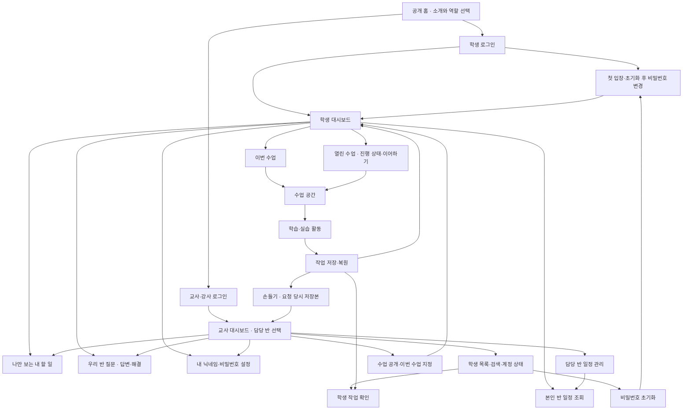

# CS Class 제품 방향

갱신: 2026-10-13(Asia/Seoul). 확정된 제품 정책과 제안·미결정을 구분해 기록합니다. 구현·검증·배포 상태와 날짜별 실행 기록은 [HANDOFF](HANDOFF.md#현재-작업-상태), 화면 표현과 디자인 토큰은 [DESIGN](DESIGN.md)을 따릅니다.

## 목적과 첫 범위

**CS Class · 즐거운 정보 교실**은 설치 없이 브라우저로 시작하는 중학교 정보 학습 공간입니다. 학생이 생각을 표현하고 실행·수정하며 완성의 경험을 얻고, 교사는 불필요한 입력·채점 부담 없이 수업을 운영하도록 돕습니다.

- **1차 완성형 대상:** 서울 금옥중학교 정보 수업을 깊게 완성하는 공간을 목표로 합니다. 여러 학교가 참여하는 범용 플랫폼 확장은 장기 구상입니다.
- **수업 대상 규모:** 2학년 11개 반, 반별 최대 27명(전체 최대 297명)의 일반 수업 적용과 프로그래밍 13차시 완성을 기준으로 합니다. 여러 반이 동시에 수업하는 경우는 거의 없으며 학생의 몰입과 UX 완성도를 우선합니다.
- **기본 수업 틀:** `개념–퀴즈–실습`의 3단계 구성을 기본 틀로 유지합니다. 각 단계의 활동·소단위 구성과 수업 시간은 실제 수업 경험을 반영해 다듬습니다. 수행평가의 채점 기준과 기존 평가 자료 이관은 후속 논의 항목입니다.
- **수업 카탈로그:** 정규 수업인 「프로그래밍의 기초」(13차시)와 세 가지 선택 복습(문제 추상화, 알고리즘 설계, 순서도 연구소)으로 구성됩니다. 초기 순서·순서도·엔트리봇 테스트 수업은 기존 기록 호환성을 유지합니다.

### 공통 수업 탐색

정규·복습·추가 수업은 공통 `LessonShell`의 일관된 헤더와 개념/퀴즈/실습 탭을 사용합니다.

- **완료 수 집계:** 탭의 완료 수와 진행 막대는 개념 확인·퀴즈 해결·필수 실습 제출만 계산하며 저장·검증·선택 도전은 제외합니다.
- **안내 및 이동:** 별도의 복잡한 펼침 안내 대신 간결한 구성을 취하며, 저장 실패·충돌 해결 조작은 유지합니다. 교사가 지정한 다른 이번 수업이 있을 때는 제목 아래 이동 링크로 안내하며, 기존 입력의 자동 저장과 미저장 이동 보호를 거칩니다.
- **작업실 폭과 집중 모드:** 본문과 실습 작업실의 폭은 활동 특성에 맞게 제공되며, 상세 레이아웃 수치와 반응형 기준선은 [DESIGN](DESIGN.md#수업-전용-공통-틀)을 따릅니다. 실습 본문에는 중복 제목을 두지 않으며, 상단 `실습 집중 모드`가 안내 접기와 전체 폭을 함께 제공합니다. 집중 모드를 해제하면 기본 배치로 복귀합니다.
- **교사 미리보기 연계:** 교사 미리보기도 같은 화면 흐름을 사용하되, 자동 완료 및 학습 기록은 메모리에서만 다룹니다.

### 알고리즘 선택 복습

기존 Algorithm Studio의 문제 추상화·알고리즘 설계·순서도 연구소를 CS Class의 선택 복습 공간으로 통합합니다. 원본 수업 활동과 전용 AI 역할을 계승하며, 실습은 원작의 배치·그림·색·동작을 충실히 재사용하고 로그인·저장·교사 조회는 CS Class 플랫폼을 따릅니다.

- **성적 반영 제외:** 복습 수업의 활동은 정규 성적·평가 점수에는 반영하지 않습니다.
- **수업 식별자:** 기존 테스트 ID의 기록을 보존하며, 정식 복습 ID는 `review-abstraction`, `review-sandwich`, `review-flowchart`를 사용합니다. 강아지 수업과 공개 프로토타입은 유지합니다.

| 수업 | 실습 활동과 완료 기준 |
| --- | --- |
| 문제 추상화 (`review-abstraction`) | 최초 1회 필수 맛보기 → 이전/다음으로 이동하는 4단계 워크북. 완료 후 재접속 시 이어하기 지원. 현재·목표·조건·핵심·해결 계획의 최소 요건을 검증하고 학생이 제출해 저장. 후보·조건·핵심/노이즈·계획 추천은 학생이 선택하며 처방전·채택 결과를 보관. |
| 알고리즘 설계 (`review-sandwich`) | 자연어로 준비·재료·조립 명령을 내리고 오류를 수정해 재실행. 여러 레시피를 인정하며 서버가 서명된 명령 기록을 원본 규칙으로 재실행해 완성 판정 후 제출·저장. |
| 순서도 연구소 (`review-flowchart`) | 순차·선택·반복 3개 퍼즐과 자유 작품을 각각 검증·제출. 예시 공방은 선택 연습. 자유 작품은 목표·필수 조건·실제 연결을 리뷰하며 타당한 단계 묶음·표현·배치 차이는 조언으로 안내. |

#### 추상화·샌드위치 복원 명세
- **문제 추상화:** 최초 1회 필수 맛보기(`tutorialDone`)와 상태 정의 → 조건 목록 → 생각 다이어트 → 처방전의 4단계를 제공합니다. 관측할 맥락 요소 7개는 처음에는 모두 남기며, 학생이 선택한 단어만 버리고 다시 눌러 복구할 수 있습니다. 처방전은 남긴 핵심 정보를 활용한 3~5단계 실천 계획 초안을 명시적으로 요청해 직접 수정합니다. 기존 요소·계획과 미완성 직접 입력은 재추천으로 자동 대체하지 않습니다. 맛보기 완료 뒤에는 미완료 옛 작품도 원래 단계와 내용으로 복귀합니다.
- **알고리즘 설계(샌드위치):** 큰 조리대, 오른쪽 명령 대화, 누적 실행 기록, 완성 결과 다시보기/복사 기능을 제공합니다. 글 입력, Enter(실행), Shift+Enter(줄바꿈), 한글 조합(IME) 확인 구분을 유지하며 음성 기능은 추가하지 않습니다.
- **단계 왕복 및 상태 보존:** 같은 수업 내 단계 왕복 시 임시 상담, 오류, 확인 질문, 읽던 스크롤 위치를 유지합니다. 자유 상담 전문은 서버에 영구 저장하지 않습니다.

#### 순서도 실습의 V1 UI 및 기능 명세
- **단계 구성:** 순차(라면) · 선택(놀이기구) · 반복(비밀번호) · 예시 공방 · 나만의 백지의 5단계로 구성됩니다. 퍼즐 조각은 한 칸에 배치·이동·제거하며, 올바른 배치에서 종료까지 실행하면 기존 서버 검증과 제출을 순서대로 수행해 복습 기록을 자동 저장합니다. (1~3번 퍼즐의 AI 진단과 별도 제출 버튼은 제거).
- **실행 및 제출 검증:** 입력 대기·오류·중지된 실행은 기록하지 않으며, 서버 검증 통과와 동일 작품의 제출 확인 뒤에만 완료 및 다음 이동을 표시합니다. 응답 유실 시 기존 결과 확인으로 복구하며, 편집·단계 변경·중지·나가기 뒤에 도착한 늦은 검증 결과로 오제출되지 않도록 방어합니다.
- **자유 공방:** 기획서 접기, 순차/선택/반복 카드 편집, 기호 추가, 내부 텍스트 인라인 편집, 이동, 포트 연결, 캔버스 팬/줌 이동, 정렬, 휴지통 삭제를 제공합니다. 키보드로도 편집과 연결이 가능하며, 반복은 참인 동안의 지속 조건과 반복 행동으로 구분합니다.
- **처방전 모달:** 추천 문제/나만의 문제 탭에서 5가지 예시, 빠른 시작, 직접 작성, 추상화 정의 가져오기, 명시적 AI 제안 후보를 확인·수정한 뒤 채택합니다. 후보 생성만으로 작업 중인 순서도를 임의 변경하지 않으며 기호·화살표 초기화는 별도로 선택합니다. 늦은 제안이 새 수정을 덮어쓰지 않습니다.
- **실행 모니터 및 내보내기:** 실행/일시정지, 한 단계, 초기화/중지, 속도 조절(1×, 2×, 0.5×), 변수의 현재값/직전값 표, 출력 콘솔을 제공합니다. 자유 작품은 숫자·문자 입력/비교/출력을 지원합니다. 문제 정의·기획서·순서도·점검 상태를 PNG 이미지로 미리보기·복사·다운로드할 수 있습니다.
- **포트 연결 규칙:** 기호 문구의 줄바꿈을 보존하며, 입력 포트에서 새 연결을 시작하지 않습니다. 이미 사용 중인 논리 출구는 기존 화살표를 먼저 삭제한 뒤 연결할 수 있습니다. 시작·종료 기호는 빠진 역할을 복원하며 중복 추가 시 안내를 표시합니다.
- **데이터 소유권:** 답안과 저장은 기존 `useWork`가 소유하며, 단순 보기·배치·연결점 위치 변경만으로 논리 검증을 무효화하지 않습니다.

#### 복습 전용 AI 모델 및 호출 정책
- **모델:** Upstage Solar `solar-pro4`를 사용합니다.
- **출력 토큰 한도:** 순서도 기획 제안 1,600토큰, 나머지 요청 800토큰.
- **타임아웃:** AI 제공자 25초 / 서버 함수 45초 / 브라우저 클라이언트 50초.
- **Rate Limit:** 학생 계정당 분당 15회, 한국 날짜 기준 하루 70회로 제한하며, 실제 호출 시도만 차감합니다. 중복 캐시 결과는 차감하지 않으며 자동 재시도하지 않습니다.
- **예산 및 저장 정책:** 자유 상담 전문은 서버에 영구 보관하지 않고, 채택 결과·검증 피드백·호출 통계(토큰, 지연, 실패)만 집계합니다. 범용 튜터, 자동 채점 평가, 띵커보드 연동은 지원하지 않습니다.
- **교사 확인 예외 경로:** 기본 검사를 통과했으나 AI가 보완·불확실·오류를 반환하면 학생은 `교사 확인 요청`을 보낼 수 있습니다. 담당 교사는 고정된 요청본을 확인해 승인하거나 수정 안내를 남기며, 학생은 요청본을 유지한 채 계속 수정할 수 있습니다.

세부 시각 레이아웃은 [DESIGN](DESIGN.md#알고리즘-선택-복습), 운영 반 설정 및 복구 절차는 [DEVELOPMENT](DEVELOPMENT.md#알고리즘-복습-수업), 이식 근거는 [참고 자료](reference/algorithm-review-integration.md)를 따릅니다.

### 프로그래밍 13차시 — 실제 수업 구성

운영 학습 경로 `/classroom/programming-13`의 실제 수업 구성입니다. 학습 목표를 중심으로 학생의 실험·실행·수정 경험을 유기적으로 연결합니다.

- **개념 학습 (5개 활동):**
  - 활동 구성: 프로그래밍이란?(pc4), 언어의 표현(pc0), 입력→처리→출력(pc1), 변수·연산(pc2), 시작 신호(pc3).
  - 필수 개념 분모는 5이며, 기존 pc0~pc3 기록을 보존하고 신규 활동을 pc4로 연결합니다.
  - 실험값과 무대 실행은 임시 UI 상태로 관리되며 확인 답안은 서버에 저장합니다.
- **퀴즈 (5문항):**
  - 한 문제씩 풀고 회차별 채점을 거치며 틀린 문제만 다시 풀 수 있습니다.
- **실습 미션 (기본 4 + 선택 1):**
  - 기본 미션: 이름 짓기, 곱셈 계산기, 시작 버튼 이동, 방향키로 움직임 개선 (총 4개, 필수).
  - 선택 도전: 평균 계산기 (기본 실습 완료율 계산에서 제외).
  - 수업 전체 필수 활동 분모는 14(개념 5 + 퀴즈 5 + 기본 실습 4)입니다.
  - 모든 미션에 실제 EntryJS 4.0.23 편집기, 실행 무대, 해당 목표 블록 팔레트를 제공합니다.
- **작품 독립성 및 코드 계승:**
  - 이름, 곱셈, 시작 버튼 이동, 평균은 완전히 독립된 작품으로 저장됩니다.
  - 방향키 개선 미션을 처음 열면 저장된 '시작 버튼 이동' 작품을 복사해 코드를 이어받습니다. 이후 두 작품은 각각 독립 저장되어 서로 덮어쓰지 않습니다.
- **미션별 검증 조건:**
  - 이름 짓기: 질문·대답·말하기 블록을 조립하고 서로 다른 이름으로 2회 실행(0/2 → 1/2 → 2/2)하여 대답을 활용한 출력을 확인합니다. 상수 문자열 출력은 거절합니다. 질문 대기는 15초 실행 제한에서 제외합니다.
  - 곱셈 계산기: 변수 A, B에 입력을 저장하고 곱을 출력해야 합니다.
  - 시작 버튼 이동: 시작하기 버튼 클릭 시 오른쪽으로 10 이동해야 합니다.
  - 방향키 개선: 시작 버튼 동작을 유지하면서 상·하·좌·우 네 방향키로 각 방향 10씩 움직여야 합니다.
- **검증과 제출 분리:**
  - 최신 작품의 조건 검증 통과 후 학생이 명시적으로 제출해야 완료 처리됩니다.
  - 작품을 수정하면 해당 미션의 검증 통과는 무효화되지만, 이전 제출본과 완료 기록은 안전하게 보존됩니다.
- **미션 전환 안내:**
  - 현재 작품의 수동 제출이 성공하면 하단 다음 미션 버튼이 강조되며 초점이 이동합니다. 강제 자동 이동은 하지 않습니다.
- **지원 범위:**
  - 목표 안내, 작은 실험, 접힌 블록 힌트, 조건 검증 피드백, [저장본 손들기](#설정과-손들기)를 제공합니다. 자동 평가나 작품 파일 다운로드는 후속 과제입니다.

### 프로그래밍 13차시 — 경험 검토용 프로토타입

공개 경로 `/prototype/programming`에서 수업 PPT를 바탕으로 개념–퀴즈–실습 흐름을 사전 검토할 수 있는 프로토타입입니다.

- **저장 격리:** 답안, 실습 초안, 완료 표시는 브라우저 `sessionStorage`에만 보관하며 실제 학생 운영 DB와 완전히 격리됩니다.
- **실습 구성:** 이름 짓기(실제 EntryJS), 곱셈 계산기·방향키 움직임(미니 작업실), 추가 평균 계산기로 구성됩니다.
- **도움 흐름 체험:** 힌트 → 요청 문맥 고정(`mini | entry`) → 피드백 → 재시도의 흐름을 시뮬레이션하며 실제 네트워크 전송이나 AI 처리는 연결하지 않습니다.
- 세부 교육 자료와 차시 배경은 [13차시 자료](reference/programming-13.md)를 따릅니다.

### 학교 수업 완성형의 경험 후보

현재 구현된 기반 기능과 향후 검토할 후속 후보의 경계입니다.

| 장면 | 만들고 싶은 경험 | 현재 구현 기반 | 후속 검토 후보 |
| --- | --- | --- | --- |
| 학생이 실습하다 막혔을 때 | 하던 작품과 실행 결과를 보며 도움을 받고 스스로 수정해 제출 | 저장·실행·검증·제출, [저장본 손들기](#설정과-손들기), [우리 반 질문·답변](#대시보드-탐색과-우리-반-질문) | 작품 내 직접 교사 첨삭 피드백, AI 힌트 경계, 평가 시 도움 차등 |
| 기본 활동을 마쳤을 때 | 심화 도전 → 자유 제작 → 설명·공유 → 작품집 | 기본 완료와 선택 활동 구분, 프로그래밍 평균 계산기 도전 | 심화 과제 반별 배정, 자유 제작 갤러리, 학급 내 작품 공유 |
| 선생님이 반 전체와 수업할 때 | 수업 오픈 → 도움 상황 파악 → 학생 작품 확인 → 좋은 질문 공유 | 반별 수업 지정, 진행 상황 모니터링, 손들기 확인·완료, Q&A 교류 | 실시간 학생 화면 미러링, 교사 수업 내용 직접 편집기 |

---

## 개발 순서와 명세 진행

- **핵심 원칙:** 계정·입장·반 관리·수업 배정의 기반 플랫폼을 견고하게 완성한 뒤 수업 콘텐츠를 순차적으로 확장합니다. 교사가 수업 준비와 운영을 병행할 수 있는 지속 가능한 유지보수 규모를 유지합니다.
- **공통 기반 재사용:** 계정·권한·수업 지정·저장·복원·교사 조회를 공통 인프라로 공유합니다. 모든 수업을 위한 무거운 범용 편집기를 미리 만들지 않고, `개념–퀴즈–실습`의 틀 안에서 차시별 요구에 맞게 구성합니다.

### 1차 구현 완료 목표 — 실제 계정과 저장 연결

- **완료 흐름:** 계정 입장 → 교사의 담당 반 수업 지정 → 학생 활동 → 서버 저장 → 재접속 복원 → 교사 확인의 전체 라이프사이클을 실제 DB 연결로 완결합니다.
- **클라우드 환경:** Firebase 프로젝트 `cs-class-f74c4`를 사용합니다.

---

## 시스템 화면 지도

---

## 학생 대시보드와 수업 전환

- **이번 수업 명칭:** 화면 표시 명칭은 반드시 `이번 수업`으로 통일합니다. (실시간 진행 제어 기능이 아니므로 `실시간 수업`, `지금 수업` 등으로 부르지 않음).
- **이번 수업 변경 시 보호:** 교사가 이번 수업을 변경하면 학생 대시보드의 메인 바로가기가 새 수업으로 갱신됩니다. 기존 수업의 공개가 해제되거나 학생의 작업이 삭제되지 않으며, 열린 수업 목록에서 계속 이어갈 수 있습니다.
- **수업 진행 중 이동 보호:** 학생이 다른 수업을 진행 중일 때 강제로 화면을 전환하지 않고 안내와 이동 버튼만 제공합니다. 이동 전 최신 작업의 서버 저장 성공을 반드시 확인하며, 저장 실패 시 현재 화면에 머무르고 재시도를 안내합니다.
- **목록 구성:** 대시보드 메인의 작은 이번 수업 카드와, 별도 `/student/lessons`의 열린 수업 목록으로 분리합니다.

### 열린 수업과 목록·격자 보기

- **목록 정렬:** 이번 수업을 최우선으로 배치하고, 진행 중 → 시작 전 → 완료 순으로 정렬합니다. 저장된 단계와 프로그래밍 미션을 바탕으로 구체적인 이어갈 위치를 안내합니다.
- **보기 방식:** 기본 보기는 작은 행 형태의 목록이며 격자 보기로 전환할 수 있습니다. 목록은 정규 수업의 개념·퀴즈·실습 3개 막대를 가로로 표시하고, 격자는 [필수 활동 합산 완료율](#대시보드의-전체-필수-활동-완료율) 원형 게이지를 표시합니다.
- **선택 복습 처리:** 선택 복습 수업에는 정규 수업의 완료율 수치를 매기지 않으며 복습 안내를 제공합니다.
- **필터 및 영속성:** 전체·미완료·완료 필터를 제공합니다. 보기 방식과 필터는 재조회 실패 시에도 화면 내에서 유지되며, 화면을 새로 진입하면 기본 목록 보기에서 시작합니다. (브라우저 영구 저장은 하지 않음).

---

## 대시보드 탐색과 우리 반 질문

- **데스크톱 및 모바일 탐색:** 데스크톱은 좌측 사이드바 메뉴, 넓은 본문, 상단 반/계정 맥락 바로 구성됩니다. 모바일(820px 이하)에서는 메뉴를 서랍형으로 접고 본문을 1열로 전환합니다.
- **메뉴 구성:**
  - 학생: `대시보드 / 열린 수업 / 우리 반 질문 / 설정`
  - 교사·강사: `대시보드 / 학생 현황·계정 / 수업 관리 / 우리 반 질문 / 설정`
- **우리 반 질문 (Q&A) 정책:**
  - 질문 작성 시 해당 반에 열린 수업을 연결할 수 있습니다. 학생 개인 작업 검토 요청(손들기)은 비공개이므로 게시판에 자동 노출하지 않습니다.
  - **답변 주체:** 같은 반 학생과 교사가 모두 답변할 수 있습니다. 교사 답변은 뱃지로 구분합니다.
  - **해결 상태 토글:** 질문을 작성한 학생과 해당 반 권한이 있는 교사 모두 `해결됨`으로 전환하거나 다시 열 수 있습니다. 답변 등록만으로 자동 해결되지 않으며, 해결됨은 질문자의 궁금증 해소를 의미합니다.
  - **필터 및 조회 한도:** 현재 누적 조회한 질문 목록에 필터(전체, 미해결, 답변 대기, 해결됨)를 적용합니다. 답변 대기는 답변 수 0개이면서 미해결인 질문입니다.
  - **본인 질문 삭제:** 작성자 본인(학생/교사)만 삭제할 수 있습니다. 삭제 시 질문과 딸린 모든 답변이 함께 영구 삭제되며 복구할 수 없습니다. 교사가 타인의 질문을 임의 삭제하는 권한은 두지 않습니다.
  - **한도 및 보안:** 질문 제목 80자, 본문 2,000자, 답변 1,500자, 질문당 40개 답변, 계정당 분당 30회 작성으로 제한합니다. 동일 요청 재전송 시 중복 생성을 방지합니다. 작성 실패 초안은 현재 탭 메모리에 보관합니다.

### 설정과 손들기

- **개인 설정:** 닉네임(20자 이내)과 본인 비밀번호를 변경합니다. 학번·반·역할은 학생이 수정할 수 없습니다. 비밀번호 변경은 현재 비밀번호 확인을 거치며 15분에 8회로 시도를 제한합니다. 성공 시 세션 토큰을 갱신하고 학습 기록을 유지합니다. Google 로그인 계정은 Google 관리로 안내합니다.
- **손들기 (학생):** 수업 상단에서 도움을 요청합니다. 학습 작업이 정상 저장된 상태에서만 요청할 수 있습니다. 요청 시점의 저장된 작품·단계 스냅샷을 보관하며, 동영상 화면 중계나 교사의 초안 직접 수정은 지원하지 않습니다. 계정당 분당 10회로 제한하며 요청 번호를 검증해 이전 요청의 늦은 응답이 새 요청을 덮어쓰지 않도록 방어합니다.
- **손들기 확인 (교사):** 요청 목록에 수업·단계·미션과 마지막 확인 시각을 표시합니다. 교사는 요청 당시 저장본을 읽기 전용으로 확인하며, 도움 완료 처리를 지원합니다.

### 교사 대시보드와 수업 관리

- **반 선택과 유지:** 교사·강사는 담당 반 권한 내에서 반을 선택하며, 동일 세션 동안 메뉴 이동 및 새로고침에서 유지됩니다.
- **진도 및 집계:**
  - `이번 수업` 카드: 반 전체 필수 활동 합산 원형과 시작 전/진행 중/완료 학생 수를 표시합니다.
  - `교사가 확인할 일` 막대: **해당 단계의 필수 활동을 모두 완료한 학생 수 / 전체 등록 학생 수**를 집계합니다. 선택 도전은 제외합니다.
  - 제출 학생은 해당 수업에 작품이 하나 이상 저장된 학생 수이며, 제출 작품은 각 미션의 최신 제출본 수입니다.
- **학생 현황 및 계정 관리:** 학생별 3개 단계 막대(목록) 또는 원형(격자), 학번/닉네임 검색, 비밀번호 변경 필요 필터, 개별 비밀번호 초기화, 제출 작품 조회를 제공합니다.
- **수업 관리 및 공개 설정:**
  - 이번 수업 강조와 열린 수업 전체 목록을 관리합니다.
  - 담당 반 준비표: 담당 반별 이번 수업·열린 수업 수를 표시하고 설정 모달로 연결합니다.
  - 공개 설정 요약: 체크한 수업은 저장 성공 시 공개되며, 신규 공개 수업 목록과 이번 수업 변경 사항을 저장 전에 명시합니다. (1차 범위에서 공개 취소는 미지원).

### 교사 실제 수업 미리보기

교사·강사는 수업을 학생에게 공개하기 전에 동일한 화면 흐름으로 직접 체험할 수 있습니다.

- **메모리 전용 격리:** 답안, 작품, 판정 결과는 현재 브라우저 메모리에만 유지되며 새로고침이나 화면 이탈 시 초기화됩니다. 실제 학생 학습 기록이나 제출을 생성하지 않습니다.
- **표시 구분:** `교사 미리보기 · 이 창에서만 체험` 안내를 상시 노출해 실제 저장/제출과 명확히 구분합니다.
- **기능 제한:** 서버 순수 판정을 재사용하되 AI 추천/리뷰 및 선생님 확인 요청은 지원하지 않으며 비활성 안내를 표시합니다.

---

## 대시보드 기능 명세

첫 화면의 정보 밀도를 조절하고 다음 학습 행동을 안내하는 대시보드 상세 기능입니다.

### 내 할 일 (개인 체크리스트)
- **용도:** 학생·교사 본인만 조회하고 관리하는 개인용 체크리스트입니다. 할 일 완료 여부는 수업 진도나 제출 기록에 영향을 주지 않습니다.
- **데이터 한도:** 계정당 최대 50개, 한 줄 180자.
- **낙관적 UI:** 추가, 텍스트 수정, 완료 체크, 취소선, 삭제 행을 화면에 즉시 반영하고 백그라운드에서 저장합니다. 저장 실패 시 입력 내용을 보존하고 복원하며 명시적 재시도를 지원합니다.
- **키보드 조작:** Enter로 추가/편집 확정, 한국어 IME 조합 중 Enter는 글자 확정 우선, Esc는 편집 취소, Tab/Space로 목록과 체크박스를 탐색합니다.

### 반 일정과 다가오는 일정

- **권한 및 범위:** 교사·강사가 담당 반에 등록·수정·삭제하며, 학생은 본인 반의 일정을 조회합니다. 반당 최대 50개, 제목 120자, 유효 연도 2000~2100년.
- **안내 성격:** 일정 등록이나 날짜 경과만으로 수업 공개 여부나 제출 마감 권한을 강제로 차단하지 않습니다.
- **화면 표시:** 대시보드 미니 달력에 오늘과 일정이 있는 날을 표시하고, 다가오는 일정 최대 5개를 안내합니다. 전체 일정 목록에서는 오늘 포함 이후 일정을 먼저 보여주고 지난 일정은 접힌 세부정보(`details`)로 제공합니다.

### 금옥중학교 정보 시간표 일일 갱신
- **연동 정보:** 컴시간 학교코드 `74022`, 서울 금옥중학교 2학년 1~11반 정보 수업 주간 시간표를 매일 저녁 1회(약 19시경) 자동으로 가져와 반 일정 및 달력에 반영합니다.
- **동작 원칙:** 공통 저장본에서 본인/담당 반 일정만 조회합니다. 사용자가 직접 등록한 `csSchedules`와 충돌하지 않으며 시간표 갱신이 사용자 일정을 덮어쓰지 않습니다.
- **수동 갱신:** 교사·강사는 담당 반 일정 화면에서 `학교 시간표 지금 갱신`을 실행할 수 있으며, 학교 전체 단위 5분 간격 및 동시 실행 제한이 적용됩니다.

---

## 수업 단계와 완료 기준

기본 수업 틀은 `개념 – 퀴즈 – 실습`이며, 각 단계의 완료율을 각각 측정하고 모든 단계가 100%일 때 단원 완료로 판정합니다. 단계별 수치의 평균을 단원 전체 퍼센트로 사용하지 않습니다.

### 대시보드의 전체 필수 활동 완료율

- **계산식:** **현재 열린 정규 수업에서 완료한 필수 활동 수 / 전체 필수 활동 수** (개념 확인 1개, 퀴즈 해결 1문항, 기본 실습 제출 1개를 각각 활동 1개로 합산).
- **제외 대상:** 선택 복습 수업과 선택·심화 도전은 분모와 분자 모두에서 제외합니다. 초안 저장이나 단순 실습 검증 통과만으로 완료 수를 올리지 않습니다.
- **3구간 원형 게이지:** 동일한 각도(120도)의 개념(파랑)·퀴즈(보라)·실습(청록) 구간으로 분할해 각 단계별 완료율을 시각화합니다. 가운데 숫자는 전체 합산 비율입니다.

### 단원 완료와 심화 도전
- **단원 완료:** 해당 수업의 필수 기본 활동이 모두 100% 완료되어야 단원 완료입니다. 퀴즈를 남겨두고 실습만 마친 경우 실습 완료일 뿐 단원은 진행 중입니다.
- **심화 도전:** 기본 활동 완료 후 참여할 수 있는 선택 과제이며, 기본 완료율 집계에 영향을 주지 않습니다.

### 개념 학습
- **개념 확인 문항:** 개념 설명 바로 아래에 짧은 확인 문항을 둡니다.
- **해결 기준:** 필수 개념 확인 문항을 모두 맞히면 개념 단계가 100%로 자동 완료됩니다. 오답 시 감점 없이 재도전할 수 있으며, 단순 읽음 버튼은 두지 않습니다.
- **단계 이동:** 마지막 문항 해결 시 자동으로 다음 단계로 넘기지 않고 학생이 해설을 확인한 뒤 직접 다음 행동을 선택합니다.

### 퀴즈

- **풀이 및 채점:** 전체 문항을 풀고 `이번 회차 결과 확인`으로 채점합니다. 이후에는 틀린 문항만 모아서 다시 풀 수 있습니다.
- **힌트:** 재도전 힌트는 기본으로 접어두고 필요 시 학생이 열어봅니다. 힌트 사용에 따른 감점은 없습니다.
- **완료 판정:** 전체 문항 중 정답으로 해결한 문항의 누적 비율이 100%가 되면 자동 완료됩니다. 채점 전 미답변 문항을 오답으로 단정하지 않으며 진행 중인 풀이를 보존합니다.

### 실습 검증과 제출

- **공통 완료 조건:** `과제 조건 검증 통과 → 학생이 명시적 제출 → 서버 제출 저장 성공` 3단계를 모두 거쳐야 완료됩니다. 검증 통과만으로 완료 처리되지 않습니다.
- **순서도 퍼즐 예외:** 선택 복습의 순서도 퍼즐 1~3은 [퍼즐 실행 및 제출 기준](#순서도-실습의-v1-ui-및-기능-명세)에 따라 종료까지 실행한 뒤 서버 검증·제출을 자동 수행합니다. 별도 제출 버튼 없이 동일 작품의 서버 제출 저장 성공을 확인해야 완료됩니다.
- **제출 후 수정 및 재제출:**
  - 이미 제출을 마친 후에도 작품을 자유롭게 수정할 수 있습니다.
  - 작품을 수정하더라도 기존 제출본과 실습 완료 기록은 그대로 유지됩니다.
  - 수정본을 다시 제출하려면 변경된 작품으로 재검증을 통과하고 제출 저장을 마쳐야 새 제출본으로 갱신됩니다.
  - 수정본의 검증 실패나 저장 오류로 인해 이전 완료 기록이 취소되거나 이전 제출본이 손상되지 않습니다.
- **예외 경로 (선생님 확인 요청):** AI 검증 서비스 장애나 판단 곤란 시 학생은 작품 스냅샷을 첨부해 교사 확인을 요청할 수 있으며, 담당 교사가 승인하면 완료 처리됩니다.

### EntryJS 실습
- **현재 과제 (`entry-bot-lab`):** 시작하기 신호 후 엔트리봇을 오른쪽으로 10만큼 이동시키고 "안녕!"을 2초 동안 말하기.
- **검증 기준:** 시작 블록 연결, 이동 거리, 인사말 문구, 말하기 시간, 실행 순서를 서버에서 종합 검사합니다. 좌표(위치)와 이동 거리를 혼동하지 않도록 안내합니다.

---

## 인증·계정·로그인 정책

### 학생 계정과 반 배정

- **계정 체계:** 학년(1자리) + 반(2자리) + 번호(2자리)의 5자리 학번을 고유 ID로 사용합니다. 이메일이나 실명 없이 사전 일괄 등록합니다.
- **발급 및 초기화:** 학생별 30분 만료의 일회성 임시 비밀번호로 최초 입장합니다. 첫 로그인 즉시 영문·숫자를 포함한 8~128자의 개인 비밀번호를 설정해야 학생 홈으로 진입할 수 있습니다.

### 교사 인증과 권한

- **선생님 (관리자):** 본인 Google 계정으로 로그인하며 전체 반(1~11반)의 관리 권한을 가집니다.
- **강사님:** 고정 ID(`instructor`)와 비밀번호로 로그인하며, 담당 범위는 **2학년 10반·11반으로 엄격히 제한**됩니다. 다른 반 접근, 교사 권한 변경, 타 반 비밀번호 초기화는 화면과 서버 양쪽에서 차단됩니다.

### 로컬 게스트 체험

- 로컬 에뮬레이터 환경에서만 표시되며, 게스트 학생(`21099`) 및 게스트 교사(10반 관리)로 사전 승인 없이 즉시 기능을 체험할 수 있습니다. Vercel 배포 환경에서는 차단됩니다.

### 운영 테스트 계정

- 배포 사이트 사전 점검용으로 반별 99번 합성 학생 11개(`20199`~`21199`)와 전 반 관리 교사 테스트 계정을 운영합니다. 실제 학생 계정과 완전히 분리됩니다.

### 학생 비밀번호와 초기화 정책

| 항목 | 정책 내용 |
| --- | --- |
| 개인 비밀번호 | 영문과 숫자를 포함한 8~128자. 흔한 비밀번호 및 임시값 재사용 거부. |
| 임시 비밀번호 | 학생별 무작위 난수로 생성되며 30분 동안만 유효. 성공 시 즉시 폐기. |
| 비밀번호 초기화 | 교사·강사가 초기화 시 학생별 새 임시값을 1회 확인해 학생에게 직접 전달. 초기화 즉시 기존 세션 종료. |
| 초기화 후 상태 | 교사 화면에 `비밀번호 변경 필요`로 표시되며, 학생이 새 개인 비밀번호를 등록해야 해제. |
| 보안 및 기록 | 비밀번호 초기화·변경 시에도 기존 학습 기록은 완전히 보존됨. 교사에게 학생의 개인 비밀번호를 노출하지 않음. |
| 브루트포스 방어 | IP당 분당 600회, 계정·입력값 조합당 15분 12회 실패 시 잠금. |

### 세션 및 중복 로그인 방어
- **단일 세션 정책:** 동일 계정의 동시 접속은 전면 차단합니다. 새로운 로그인이 발생하면 이전 접속은 즉시 종료되고 `다른 곳에서 로그인되어 로그아웃됐어요.` 안내와 함께 세션 권한이 무효화됩니다.
- **무활동 자동 로그아웃:**
  - 학생: 마지막 조작(클릭, 입력, 터치 등) 후 10분 경과 시 자동 로그아웃. 9분 경과 시 1분 예고 알림 및 연장 버튼 제공.
  - 교사·강사: 마지막 조작 후 4시간 경과 시 자동 로그아웃.
  - 자동 저장, 애니메이션, 백그라운드 폴링은 사용자 활동 시간으로 계산하지 않습니다.

---

## 작업 저장과 통신 비용

종료 순간에만 저장하지 않고 활동 중에 변경 사항을 주기적으로 직렬화해 서버에 안전하게 보관합니다.

- **통신 절감:** 변경된 작업만 저장하며, 연속 입력은 디바운스/스로틀을 거쳐 모아서 저장합니다. 동일한 내용의 반복 저장과 불필요한 전체 폴링을 지양합니다.
- **저장 안정성:** 서버 저장 성공이 확인된 경우에만 완료 상태로 표시합니다. 저장 실패나 충돌 시에는 화면 입력을 메모리에 보존하고 명시적인 재시도 안내를 제공합니다.
- **공용 PC와 복구 경계:** 평문 초안을 브라우저에 영구 저장하지 않으며, 메모리 초안은 세션 종료·계정 교체 때 지웁니다. 새로고침·종료 시 미저장 경고를 제공하지만 강제 종료 등으로 서버에 전송하지 못한 작업의 영구 복구는 보장하지 않습니다. 서버에 저장된 작업은 본인이 다시 로그인하면 이어갈 수 있습니다.
- **참고 예산:** 297명 기준 월 4만 원의 인프라 및 AI 운영 예산을 기본 지침으로 삼으며 불필요한 호출을 제한합니다. Upstage Solar 호출 결과는 캐시를 활용해 재차감을 방지합니다.

---

## 실제 사용 전 지킬 보안 및 데이터 기준

1. **학생 세션 및 개인정보 보호:** 공용 학교 PC 환경에서 학생 간 세션 및 초안이 섞이지 않도록 세션 종료 시 브라우저 메모리 초안을 완전히 정리합니다.
2. **서버 및 DB 권한 강제:** 모든 권한 경계(담당 반, 학생 본인 데이터 접근, 교사 권한)는 화면 UI뿐 아니라 서버 API 및 Firestore Rules에서 이중으로 강제합니다.
3. **학습 기록 영속성:** 비밀번호 초기화, 반 이동, 수업 변경, 오류 복구 과정에서도 학생의 기제출 작품과 완료 기록은 절대 손실되지 않아야 합니다.
4. **테스트 데이터 격리:** 운영 DB에 임의의 합성 계정이나 테스트 시드를 넣지 않으며, 에뮬레이터 환경과 운영 환경을 엄격히 분리합니다.
