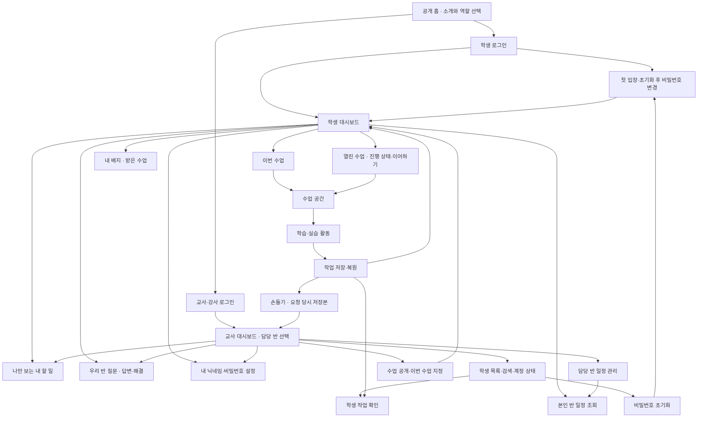

# CS Class 제품 요구사항 명세서 (PRD)

갱신: 2026-10-26(Asia/Seoul). 확정된 제품 정책과 기능 요구사항의 단일 진실 공급원(SSOT)입니다. 구현·검증 절차는 [DEVELOPMENT](DEVELOPMENT.md), 화면 시각 디자인과 토큰은 [DESIGN](DESIGN.md), 인프라·서버 배포는 [FIREBASE_SETUP](FIREBASE_SETUP.md), 현재 작업 상태는 [HANDOFF](HANDOFF.md)를 따릅니다.

## 1. 목적과 대상 규모

**CS Class · 즐거운 정보 교실**은 별도 프로그램 설치 없이 브라우저로 접속하는 중학교 정보 학습 웹 플랫폼입니다. 학생이 직관적으로 사고를 표현하고 실행·수정하며 성취감을 얻고, 교사는 불필요한 행정·채점 부담 없이 수업을 운영하도록 돕습니다.

- **1차 완성형 대상:** 중학교 정보 수업의 완전한 디지털 전환을 목표로 합니다.
- **수업 대상 규모:** 한 학년 여러 반의 일반 수업 운영을 지원합니다. 반 수·반별 번호 범위는 [명부 도구 기준](DEVELOPMENT.md#51-학생-명부-및-계정-관리-도구)을 따릅니다.
- **기본 수업 모델:** `개념 – 퀴즈 – 실습` 3단계 체계를 기본 틀로 유지하며, 차시 번호에 종속되지 않고 활동 주제를 중심으로 구성합니다.
- **완료 라이프사이클:** 계정 입장 → 교사의 반별 수업 지정 → 학생 활동 및 수동 저장 → 재접속 복원 → 교사 대시보드 확인의 전체 사이클을 서버 API 및 DB로 완결합니다.

---

## 2. 시스템 화면 지도 및 사용자 여정

### 사용자 역할 및 권한 모델

| 역할 | 인증 방식 | 관리 범위 | 주요 권한 |
| :--- | :--- | :--- | :--- |
| **학생** | 5자리 학번 + 비밀번호 | 본인 계정 및 본인 반 | 수업 학습, 작업 수동 저장·제출, 본인 질문/답변, 개인 할 일, 손들기(일시 중지 중, §5.5) |
| **선생님 (관리자)** | Google 계정 인증 | 2학년 전체 반 (1~11반) | 수업 공개 및 이번 수업 지정, 학생 계정 관리·비밀번호 초기화, 손들기 확인(일시 중지 중), 학급 일정/Q&A 관리, 교사 미리보기 |
| **강사님** | 교사 입장의 `교사 비밀번호 로그인`에서 비밀번호만 입력(계정 `instructor` 고정) | 2학년 10반·11반 (엄격 제한) | 10반·11반 수업 관리, 담당 반 학생 계정 관리, 담당 반 일정/Q&A 관리 (타 반 접근 차단) |

---

## 3. 수업 공통 시스템 프레임워크

정규·복습을 포함한 모든 수업은 공통 `LessonShell`을 기반으로 하며, 일관된 탐색 흐름과 라이프사이클을 공유합니다.

### 3.1 수업 3단계 라이프사이클 및 진도 측정

모든 수업은 `개념(concept)`, `퀴즈(quiz)`, `실습(practice)` 3단계(`Stage`)로 구성되며 단계별 완료율(0~100%)을 독립적으로 계산합니다.

1. **개념 학습 (Concept):**
   - 개념 설명 직하단에 필수 개념 확인 문항을 배치합니다.
   - **완료 기준:** 모든 필수 확인 문항을 정답으로 해결하면 개념 단계가 100%로 완료됩니다. 오답 시 감점 없이 재도전 가능하며 단순 스크롤/읽음 완료 처리는 허용하지 않습니다.
   - 마지막 문항 해결 시 자동으로 다음 단계로 강제 전환하지 않고, 학생이 해설을 확인한 후 직접 이동합니다.
   - **확인 피드백:** 오답이면 `다시 생각해 보기`로 표시하고, 미리 보이는 힌트보다 한 단계 구체적으로 되묻되 정답은 드러내지 않습니다. 정답이면 그 개념의 설명을 보여 줍니다.
2. **퀴즈 풀이 (Quiz):**
   
   - 회차별 채점을 지원하며, 1회 채점 후 틀린 문항만 모아서 재도전(`retry-quiz`)할 수 있습니다. 모든 문항을 해결하면 마지막 회차가 아니라 퀴즈 전체 문항을 고른 답·결과와 함께 다시 볼 수 있습니다.
   - 재도전 힌트는 기본 접힘 상태로 제공되며 힌트 열람에 따른 감점은 없습니다.
   - **채점 피드백:** 회차 채점 뒤 정답에는 그 문항의 풀이를, 오답에는 고른 답이 왜 맞지 않는지와 다시 볼 곳을 1~3문장으로 보여 줍니다. 재도전 전에는 정답·정답 규칙을 밝히지 않고, 답하기 전 힌트는 어디를 볼지만 알려 줍니다.
   - **완료 기준:** 전체 문항 중 정답으로 해결한 문항의 누적 비율이 100%가 되면 자동 완료됩니다. 채점 전 미답변 문항을 오답으로 처리하지 않고 풀이 상태를 보존합니다.
3. **실습 검증과 제출 (Practice):**
   
   - **완료 3단계 요건:** `과제 조건 검증 통과 → 학생이 명시적 제출 → 서버 제출 저장 성공`의 3단계를 모두 완결해야 실습 완료로 인정됩니다. 단순 검증 통과나 로컬 실행만으로 완료되지 않습니다.
   - **수정 및 재제출:** 제출 완료 후에도 자유롭게 수정할 수 있으며, 기존 제출본과 완료 기록은 보존됩니다. 수정본을 새 제출본으로 갱신하려면 다시 검증을 통과하고 제출 저장을 완료해야 합니다.
   - **순서도 퍼즐 예외:** 순서도 퍼즐 1~3은 올바른 배치 후 종료까지 실행 시 서버 검증과 제출 저장을 연속으로 자동 완결합니다.
   - **안내와 채점:** 미션 목표·힌트·조립 순서가 말하는 블록과 검증 규칙은 같아야 하며, 안내대로 만든 작품이 검증을 통과하는지 자동 검사로 확인합니다.
4. **수업 완료 상태 (`LearningStatus`):**
   - `not-started` (시작 전): 학습 및 저장 이력이 없음.
   - `in-progress` (진행 중): 저장 이력이 있으나 3단계 모두 100%에 도달하지 않음.
   - `completed` (완료): 필수 기본 활동(개념+퀴즈+실습)이 모두 100% 완료된 상태.
5. **진도 측정의 두 가지 경계 (중요):**
   - **수업 내부 진도 (Lesson-Level):** 모든 수업(정규 및 복습)은 화면 헤더 및 카드에서 본인 수업의 개념/퀴즈/실습 달성도를 독립적으로 표시합니다.
   - **대시보드 전체 합산 진도 (Classroom-Level):** 대시보드의 3구간 원형 게이지는 **열린 정규 수업(`mode !== 'review'`)의 필수 활동만 합산**하여 전체 완료율을 계산합니다. 복습 수업은 자율 학습이므로 대시보드 합산 분모/분자에서 제외됩니다.

### 3.2 수동 저장 정책 (Manual Save SSOT) 및 상태 머신

네트워크 트래픽 절감과 학생의 명시적 작업 결정권을 보장하기 위해 자동 저장을 배제하고 엄격한 수동 저장을 적용합니다.

- **작업 저장 상태 (`SaveState`):**
  - `saved`: 서버와 로컬 작업 내용이 일치함.
  - `dirty`: 로컬 편집으로 인해 미저장 변경사항이 존재함.
  - `saving`: 서버로 저장 요청이 진행 중임.
  - `failed`: 네트워크 장애 등으로 저장이 실패함 (화면 입력 유지).
- **저장 트리거:** 상단 저장 버튼 클릭 또는 단축키 `Ctrl+S` (Mac: `Cmd+S`) 실행 시에만 현재 snapshot을 서버에 보관합니다.
- **자동 저장 타이머 배제:** 개별 컴포넌트에 타이핑 감지형 debounce 자동 저장 타이머를 신설하지 않습니다.
- **저장 예외 행동:** 채점, 최종 제출, AI 피드백 요청, 교사 확인 요청, 퍼즐 성공 완료, 손들기는 필요한 현재 작품/결과를 서버에 즉시 영속화하는 명시적 예외입니다.
- **낙관적 잠금(Revision OCC) 및 충돌 해결:**
  - 작업 문서에는 정수형 `revision` 번호가 부여되며, 동시 수정 충돌(409 Conflict) 발생 시 로컬 입력을 덮어쓰지 않고 서버 기록과 비교한 뒤 `현재 입력을 새 버전으로 저장`과 `서버 기록으로 이어하기` 중 하나를 고르게 합니다.
- **미저장 이탈 방어 (Navigation Guard):**
  - `SaveState === 'dirty'` 상태에서 수업 외부로 이동하거나 로그아웃을 시도할 경우, `저장 후 나가기`, `저장하지 않고 나가기`, `취소`의 3가지 선택 모달을 제공합니다.
  - 수업 내부의 단계(개념/퀴즈/실습)나 미션 간 이동 시에는 불필요한 경고 모달을 띄우지 않고 메모리에 입력을 보존하며, 다음 명시적 저장 시 위치를 함께 영속화합니다.
- **데이터 소유 및 복원 (`useWork`):**
  - 학생 작업 데이터의 소유권은 공통 훅 `useWork`가 전담합니다.
  - 공용 학교 PC의 보안을 위해 평문 초안을 브라우저 로컬 스토리지에 영구 보관하지 않으며, 세션 종료 또는 계정 전환 시 메모리 초안을 완전히 정리합니다.
  - 서버에 정상 저장된 작업은 학생이 재로그인 시 온전히 복원됩니다.
- **운영 예산 기준:** 1차 기본 플랫폼은 월 4만 원을 참고 예산으로 합니다(2026-09-28 사용자 수용). 통신 비용은 Firestore Standard 무료량(일일 읽기 50,000회·쓰기 20,000회, 2026-09-28 공식 요금표 기준)을 기준으로 판단하며, 요금제를 정할 때 가격·조건을 다시 확인합니다.

### 3.3 교사 실제 수업 미리보기

교사는 수업을 학생에게 공개하기 전 동일한 화면과 상호작용 흐름을 직접 체험할 수 있습니다.

- **메모리 전용 격리:** 교사 미리보기 중의 모든 답안, 작품, 판정 결과는 브라우저 메모리에만 유지되며 새로고침이나 화면 이탈 시 초기화됩니다. 실제 학생 학습 DB나 제출 기록을 오염시키지 않습니다.
- **표시 구분:** 상단에 `교사 미리보기 · 이 창에서만 체험` 안내를 상시 표시하여 실제 작업과 명확히 구분합니다.
- **기능 제한:** 서버 순수 판정 로직을 재사용하되, 실제 AI 추천/리뷰 및 교사 확인 요청은 비활성화합니다.

### 3.4 수업 내용 기준

- **같은 대상, 같은 이름과 값:** 개념 본문·그림·그림 설명·퀴즈·미션·힌트에서 같은 대상은 같은 이름·값·클릭 대상·블록 이름으로 씁니다. 특정 오브젝트를 가정한 문구를 쓰지 않고, 판단 대상이 바뀌면 그 화면의 첫 두 문장에서 밝힙니다.
- **기준값과 새 규칙은 먼저 예시로:** `이상`·`초과`는 말로 정의하고 확인 사례와 실험 안내에 경계값을 넣습니다. 나머지·연산 순서·회전 각도 같은 새 규칙은 문제보다 먼저 본문 예시로 보입니다.
- **같은 배경과 같은 작품은 다릅니다:** 미션은 각각 독립 작품이며, 배운 것을 옮겨 쓰는지는 다른 상황·다른 값의 문항으로 확인합니다.
- **정답 위치를 고르게:** 객관식 정답이 한 자리(예: 늘 첫 보기)에 몰리지 않게 화면의 보기 순서를 섞습니다. 저장되는 답 ID는 데이터 순서를 그대로 둡니다.
- **한 차시 40분:** 설명·사례·안내를 더할 때는 수업별 시간 배분(§4.1.1) 안에서 고르고, 실제 수업에서 시간을 잽니다.

---

## 4. 수업 카탈로그 명세

CS Class의 모든 수업은 아래 표준 메타데이터 규격을 준수합니다. 향후 추가되는 모든 신규 수업은 차시 번호 없이 직관적인 주제명으로 등록됩니다.

| 수업 ID | 구분 | 수업명 | 활동 분모 (개념 + 퀴즈 + 실습) | 실습 과제 및 완료 판정 요건 | 실습 데이터 구조 |
| :--- | :--- | :--- | :--- | :--- | :--- |
| `programming-13` | 정규 | 프로그래밍의 기초 | 개념 5 + 퀴즈 5 + 실습 4 (총 14) | EntryJS 4개 기본 미션(이름 짓기, 곱셈 계산기, 시작 버튼 이동, 방향키 개선) 블록 조립 및 실행 조건 통과 후 제출. 선택 도전(거스름돈 계산기) 제공. | 다중 미션 (`work.missions[id]`) |
| `conditionals` | 정규 | 조건에 따라 달라지는 프로그램 | 개념 5 + 퀴즈 5 + 실습 3 (총 13) | EntryJS 3개 기본 미션(평균 계산기, 시험 합격/불합격, 자유투 평가) 실행 조건 통과 후 제출. 선택 도전(놀이기구 탑승) 제공. | 다중 미션 (`work.missions[id]`) |
| `loops` | 정규 | 반복으로 똑똑하게 | 개념 5 + 퀴즈 5 + 실습 3 (총 13) | EntryJS 3개 기본 미션(정사각형, 정다각형, 나무 키우기) 실행 조건 통과 후 제출. 선택 도전(비밀번호 금고) 제공. | 다중 미션 (`work.missions[id]`) |
| `review-abstraction` | 선택 복습 | 문제 추상화 | 개념 3 + 퀴즈 4 + 실습 1 (총 8) | 최초 맛보기 후 상태 정의 → 조건 목록 → 생각 다이어트 → 처방전의 4단계 요건 검증 통과 후 학생 수동 제출. | 단일 실습 (`work.submission`) |
| `review-sandwich` | 선택 복습 | 알고리즘 설계 | 개념 3 + 퀴즈 4 + 실습 1 (총 8) | 자연어 명령 실행 후 서버가 서명된 명령 기록을 원본 룰로 재실행하여 완성 판정 후 제출. | 단일 실습 (`work.submission`) |
| `review-flowchart` | 선택 복습 | 순서도 연구소 | 개념 3 + 퀴즈 4 + 실습 4 (총 11) | 순차·선택·반복 3개 퍼즐 자동실행 검증 및 자유 공방 기획서/포트연결/실행 리뷰 완료 후 제출. | 다중 미션 (`work.missions[id]`) |

### 4.1 정규 수업: 프로그래밍의 기초
- **개념 학습 (5개):** 프로그래밍이란?(pc4), 언어의 표현(pc0), 입력→처리→출력(pc1), 변수·연산(pc2), 시작 신호(pc3).
- **퀴즈 (5문항):** 프로그래밍 핵심 개념 객관식/단답형 문항.
- **실습 미션 (기본 4 + 선택 1):**
  - 기본 4개 미션(이름 짓기, 곱셈 계산기, 시작 버튼 이동, 방향키 개선)은 필수 완료 대상입니다.
  - 선택 도전 거스름돈 계산기: 낸 돈과 물건값을 A·B에 저장하고 ‘거스름돈은 1800원’처럼 한 문장으로 말합니다. 채점은 정해진 네 쌍(물건값이 낸 돈과 같은 경우 포함)으로, 입력으로 계산한 마지막 줄이 낸 돈 − 물건값이고 그 줄에 ‘원’이 있어야 통과합니다(빼는 순서가 바뀌거나 숫자만 말하면 실패). 진도·완료 판정에는 들어가지 않습니다.
  - 선택 도전이던 평균 계산기는 [조건 수업](#411-정규-수업-조건에-따라-달라지는-프로그램)의 첫 미션으로 옮겼습니다. 이 수업에 남은 평균 작품·제출 기록은 지우지 않으며, 저장은 되지만 검증·제출·진도·교사 집계에는 쓰지 않고 교사 작품 보기에 ‘이전 수업 기록’으로만 보입니다. 마지막으로 평균 미션을 보던 학생은 첫 미션에서 다시 시작합니다.
  - 모든 미션은 실제 EntryJS 편집기 및 실행 무대를 독립적으로 제공합니다.
  - 작업실은 미션과 관계없이 같은 수업 팔레트(시작·흐름·움직임·생김새·붓·판단·계산·자료 8개 분류)를 보여 줍니다. 소리·글상자·신호·리스트·함수·AI·확장·하드웨어는 제공하지 않습니다.
  - 팔레트의 모든 블록(기본 미션 12종 + 확장 94종, 총 106종)은 저장·복원·교사 열람이 되며, 교사 열람 시 각 블록의 입력값·드롭다운·연산자가 채워진 자연스러운 한국어 문장으로 표시됩니다. 검증은 미션 신호(시작하기 버튼, 방향키 미션의 방향키)로 시작하는 줄만 보며, 그 줄에 미션 블록 밖의 블록이 있으면 해당 블록을 빼라고 안내하고 통과시키지 않습니다. 시작 신호가 없는 블록 더미와 다른 이벤트 줄은 채점에서 무시합니다. 결과를 바꾸지 않는 블록(기다리기·말풍선 지우기·보이기/숨기기·대답 보이기·붓 색/굵기/채우기/도장·효과·크기·뒤집기)은 모든 미션에서 받고 채점에서 건너뜁니다. 같은 뜻의 블록도 받습니다: 초가 없는 ‘말하기’, 움직임 미션의 ‘x·y 좌표를 ( )만큼 바꾸기’·‘( )초 동안 x·y만큼 움직이기’·‘( ) 방향으로 ( )만큼 움직이기’. 절대 위치로 옮기는 블록과 오브젝트 방향을 정하는 ‘방향을 ( )(으)로 정하기’는 움직임 미션에서 받지 않습니다. ‘x: ( ) 위치로 이동하기’·‘y: ( ) 위치로 이동하기’·‘방향을 ( )(으)로 정하기’는 바꿀 블록(‘x·y 좌표를 ( )만큼 바꾸기’·‘이동 방향을 ( )(으)로 정하기’)을 안내하고, ‘x·y 위치로 이동하기’ 같은 나머지 절대 위치 블록은 빼라고 안내합니다(이유는 [개발 안내 §4.1](DEVELOPMENT.md#41-entryjs-4023-실습-환경)의 '채점 범위').
  - 실행은 무대 아래 엔트리 자체 "시작하기"(실행 중 "정지하기")로 합니다. 키·마우스·오브젝트 클릭으로 시작하는 줄이 있으면 시작 줄이 끝난 뒤에도 대기 상태를 유지해 이벤트를 시험할 수 있습니다. 15초 강제 종료는 코드가 실제로 실행된 시간만 셉니다. 대답·이벤트를 기다리는 시간은 세지 않고, 학생이 키보드·마우스·터치로 조작하면 다시 0부터 셉니다.
  - "오브젝트 추가하기"로 수업에 포함된 그림 8종(공·별·하트·사과·구름·돌·깃발·나무) 중에서 강아지 말고 최대 5개를 더할 수 있습니다. 추가 오브젝트의 이름·위치·크기·코드는 저장·복원·교사 열람이 되며, 검증은 강아지 코드만 봅니다. 강아지는 지울 수 없습니다.
  - **변수 직접 만들기(세 엔트리 수업 공통):** ‘속성’ 탭의 ‘변수 추가하기’로 변수를 10개까지 만들 수 있습니다(모든 오브젝트용·이 오브젝트용, 이름 10자까지). 만든 변수의 기본값·보이기·무대 위치는 저장·복원·교사 열람이 됩니다. 수업이 준비한 A·B(나무 키우기는 ‘클릭 수’)는 지우거나 이름을 바꿀 수 없습니다. 엔트리 서버가 필요한 공유·실시간 변수와 저장되지 않는 슬라이드는 보이지 않습니다. 채점은 학생 변수를 기본값에서 시작해 엔트리처럼 실행하되, 목표가 ‘A와 B에 기억’하라고 한 입력은 계속 A·B로 확인합니다. 지운 변수를 가리키는 블록(엔트리 표시 ‘대상 없음’)은 저장은 되고, 그 블록이 실행되면 조건 검증이 변수를 다시 고르라고 안내합니다.
  - 방향키 개선 미션도 다른 미션처럼 시작 블록에서 새로 시작하는 독립 작품입니다(앞 미션 작품을 가져오지 않음). 이미 저장된 작품은 그대로 유지됩니다. 검증은 네 방향키 줄만 보며, 시작하기 줄은 두거나 지워도 됩니다. 무대에서처럼 한 강아지에 네 키를 두 가지 순서로 차례로 눌러 키마다 그 방향으로 10만큼 움직이는지 보므로, 다른 키가 방향을 바꾼 뒤에도 맞게 움직여야 합니다.

### 4.1.1 정규 수업: 조건에 따라 달라지는 프로그램
연산(산술·비교·논리)과 선택 구조를 배우는 두 번째 엔트리 수업(`conditionals`)입니다. 40분 수업 기준 도입 3분 → 개념 10분 → 퀴즈 5분 → 실습 20분 → 한 줄 정리 2분입니다.
- **개념 학습 (5개):** 산술 연산자(몫·나머지, 같은 형태끼리 계산), 비교 연산자(참·거짓), 논리 연산자(그리고·또는·아니다), 세 가지 제어 구조, 만일 ~(이)라면·아니면과 다중 조건. 공통 개념 화면(설명·예시·확인 문제)을 쓰고, 개념마다 작은 정적 그림 하나가 붙습니다([DESIGN §4.1](DESIGN.md#41-수업-전용-공통-틀-lessonshell)).
- **퀴즈 (5문항):** 코드 줄을 읽고 결과를 예측하는 객관식입니다(계산 순서, 합격 판정, ‘그리고’, 다중 조건, `>`와 `≥` 버그).
- **실습 미션 (기본 3 + 선택 1):** 평균 계산기(두 수를 A·B에 저장해 평균을 말하기), 시험 합격/불합격(60점 이상 ‘합격’), 자유투 평가(8개 이상·5개 이상·그 밖의 세 갈래), 선택 도전 놀이기구 탑승(키·나이를 A·B에 저장하고, 키 130 이상 ‘그리고’ 나이 10 이상이면 ‘탈 수 있어요’, 아니면 ‘탈 수 없어요’). 이 미션이 대신한 예전 선택 도전 방탈출(A·B의 1/0을 ‘또는’으로 판단)의 작품·제출 기록은 지우지 않으며, 저장은 되지만 검증·제출·배지 집계에는 쓰지 않고 교사 작품 보기에 ‘이전 수업 기록’으로만 보입니다.
- **채점:** 서버 해석기가 정해진 입력과 학생에게 보이지 않는 입력을 넣어 실행하고, 말한 줄 전체를 결과별 핵심어로 봅니다. 글자와 숫자만 남겨 비교하므로 띄어쓰기·문장부호·이모지는 상관없습니다. 핵심어는 합격/불합격 `합격`·`불합격`, 자유투 `훌륭`·`잘했`·`연습`, 놀이기구 `있어`·`없어`입니다. 마지막 질문 뒤에 결과가 있는 줄이 하나 이상이고 모두 기대한 결과여야 통과하며, 인사·마무리 말처럼 핵심어가 없는 줄과 질문 전에 한 말(‘합격 기준은 60점이야’)은 무시합니다. 다른 결과를 함께 말하거나 한 줄에 두 결과가 있으면 통과하지 않고, ‘불합격’은 ‘합격’으로 보지 않습니다. 평균은 입력으로 계산한 마지막 줄을 보며, A·B는 처음 저장한 입력값으로 확인합니다(결과를 A에 다시 저장해도 됨). ‘+’는 엔트리처럼 숫자가 아닌 글자와 만나면 글자를 이어 붙입니다(‘평균은 ’ + 평균). 비교는 엔트리처럼 숫자 글자를 숫자로 보고, 몫·나머지는 버림 나눗셈입니다. 놀이기구 탑승은 실행된 조건식에서 A·B를 보는 논리 블록(‘그리고’·‘또는’·‘아니다’)을 써야 하며(만일을 두 번 겹친 풀이는 통과하지 않음), 맞는지는 기준값(130·10)과 하나만 모자란 값을 포함한 일곱 입력 조합으로 확인합니다(예: ‘(A < 130 또는 B < 10)이면 못 탐’도 통과). 기대한 말이 ‘생각하기’ 말풍선에만 있으면 ‘말하기’로 바꾸라고 안내합니다. 갈래는 맞는데 결과를 알리는 말에 다른 결과의 낱말이 섞여 떨어지면(‘연습 잘했어’, 결과 뒤 늘 하는 ‘그땐 탈 수 있어요’) 블록 힌트 대신 목표의 결과 말(예: ‘훌륭해요’·‘잘했어요’·‘더 연습해 보자’) 중 맞는 말 하나만 넣으라고 안내합니다. 이 안내는 갈래가 맞을 때만 냅니다(판정 방법은 [개발 안내 §4.1](DEVELOPMENT.md#41-entryjs-4023-실습-환경)의 '채점 범위'). 만일 없이 대답과 결과 낱말을 함께 말하거나, 구간 없이 만일 셋을 따로 두어 9개에 ‘훌륭해요!’와 ‘잘했어요!’를 둘 다 말하거나, 기준 점수가 틀리면 미션의 실패 문구를 보여 줍니다. 한 번 실행이 [개발 안내 §4.1](DEVELOPMENT.md#41-entryjs-4023-실습-환경) '해석기 의미'의 실행 한도를 넘으면 통과시키지 않습니다.
- 팔레트·실행 방식은 [§4.1](#41-정규-수업-프로그래밍의-기초)과 같고, 작업실의 오브젝트는 아래 [강아지 없는 작업실](#413-조건반복-수업의-강아지-없는-작업실)을 따릅니다.

### 4.1.2 정규 수업: 반복으로 똑똑하게
반복 구조를 배우는 세 번째 엔트리 수업(`loops`)입니다. 40분 수업 흐름은 [§4.1.1](#411-정규-수업-조건에-따라-달라지는-프로그램)과 같습니다.
- **개념 학습 (5개):** 반복이 필요한 이유, 횟수 반복, 정다각형과 360°, 조건 반복·계속 반복, 변수로 세고 모양 바꾸기. 조건 수업처럼 개념마다 작은 정적 그림이 붙습니다.
- **퀴즈 (5문항):** 코드를 읽고 이동 거리·회전 각도·변수 값·질문 횟수·도장 수를 예측합니다.
- **실습 미션 (기본 3 + 선택 1):** 정사각형 그리기(4번 반복, 한 변 100), 정다각형 그리기(변의 수를 묻고 360 ÷ 대답만큼 회전), 나무 키우기(PPT 15차시·엔트리 공식 자료 「클릭! 나무 키우기」), 선택 도전 비밀번호 금고(1234가 될 때까지 묻기).
- **나무 키우기:** 물뿌리개·성장 단계 6개인 나무·흙과 ‘클릭 수’ 변수가 들어 있는 시작 작품으로 엽니다(‘시작 블록으로 다시 만들기’도 이 작품으로 되돌립니다). 클릭할 때마다 클릭 수를 1씩 늘리고 5·10·15·20·25에서 다음 모양으로 바꾼 뒤 다 자라면 말하는 것이 목표입니다. 이 미션은 강아지가 아니라 모든 오브젝트의 시작·마우스 클릭·오브젝트 클릭 줄을 채점합니다. 채점기는 클릭을 30번 흉내 내며, 각 클릭 뒤와 클릭 없이 기다리는 동안 계속 반복을 몇 번씩 실행해 나무가 클릭으로만 한 단계씩 자라는지, 클릭 수가 1씩 느는지, 다 자랐을 때 처음 말하는지를 봅니다. 기준 조건(5, 10, …)은 정확한 숫자가 아니어도 됩니다.
- **오브젝트 그림:** 나무·물뿌리개·흙 그림은 엔트리 공식 자료(네이버 커넥트재단, 교육 목적 출처 표시 조건)에서 가져와 `public/entryjs/sprites/`에 두었습니다. 나무와 물뿌리개는 지울 수 없고, 흙은 바꾸거나 지울 수 있습니다.
- **채점:** 엔트리처럼 이동 방향과 오브젝트 방향을 더한 쪽으로 움직이고, 그리기 중인 선을 기록합니다. 도형은 반복 안에서 그린 닫힌 정다각형(같은 변 길이·같은 회전각, 요청한 변 수)이어야 하며, 모든 변이 두 바퀴 이상 선을 그린 반복 안에서 그려져야 하고 반복의 두 번째 바퀴부터 그린 변이 있어야 하므로, 풀어 쓴 코드를 1번 반복으로 감싸거나 일부 변만 반복으로 그리면 통과하지 않습니다. 정다각형은 학생에게 보이지 않는 변의 수(3~8)도 확인합니다. 한 변을 나누어 그리거나 한 바퀴 더 돌아 같은 선을 다시 그어도 화면에 보이는 선으로 합쳐 판정하며(나눈 변은 모든 조각이 두 바퀴 이상 선을 그린 반복 안에서 그려져야 하고, 반복 밖에서 다시 그은 선은 반복 밖 그리기로 봄), 정다각형은 반복 횟수가 대답에서 와야 하므로 온 바퀴로만 다시 그은 선을 합칩니다(‘대답 + 1’번이나 ‘10번’ 고정은 통과하지 않음). 그리기 미션에서도 말하기와 결과를 바꾸지 않는 블록을 쓸 수 있습니다(학생에게 보이는 블록 목록에는 말하기를 넣지 않음). 금고는 시도 횟수를 바꿔 가며 반복 안에서 묻는지(첫 질문은 반복 앞에 있어도 됨)와, 마지막 질문 뒤에 ‘열렸’이 든 말을 한 번만 하는지를 봅니다(틀린 번호에 하는 ‘안 열렸어요’나 마무리 말은 상관없음). 맞힌 뒤에도 반복 안에서 또 물으면 ‘반복 중단하기’나 반복 조건을 확인하라고 안내합니다. 한 번 실행이 [개발 안내 §4.1](DEVELOPMENT.md#41-entryjs-4023-실습-환경) '해석기 의미'의 실행 한도를 넘으면 통과시키지 않습니다.

### 4.1.3 조건·반복 수업의 강아지 없는 작업실
`conditionals`·`loops`의 작업실은 강아지 없이 시작합니다. 「프로그래밍의 기초」(§4.1)는 강아지로 시작합니다.
- **시작 작품:** 무대 가운데 공식 엔트리봇 하나(나무 키우기는 물뿌리개·나무·흙)입니다. 수업을 처음 여는 학생의 첫 미션(평균 계산기·정사각형)도 같습니다. 엔트리봇도 다른 오브젝트처럼 지우거나 바꿀 수 있지만 무대에는 오브젝트가 하나 이상 남아야 합니다.
- **오브젝트 추가하기:** 엔트리와 비슷한 분류형 창(엔트리봇·사람·동물·식물·탈것·건물·음식·환경·물건·판타지·인터페이스·배경)과 이름 검색으로, 앱에 미리 넣어 둔 공식 엔트리 오브젝트 214개(모양 506장, 그리기용 연필·크레파스와 배경 20개 포함)에서 고릅니다. 작품 하나에 오브젝트는 12개까지입니다. 배경은 무대를 채우고 맨 뒤에 놓입니다. 창 아래에 출처(엔트리, 네이버 커넥트재단, CC BY-NC 2.0)를 표시합니다. 그림은 수업 중 엔트리 사이트에 접속하지 않고 `public/entryjs/sprites/library/`에서 불러옵니다.
- **모양 탭:** 오브젝트의 모양을 보고 고를 수 있습니다. 그림판·‘새로 그리기’·모양 추가·복제·삭제는 막고 안내합니다(그린 그림은 저장할 곳이 없음). 소리 탭은 열지 않고, 속성 탭은 변수 만들기만 씁니다([§4.1](#41-정규-수업-프로그래밍의-기초)).
- **채점:** 어떤 오브젝트로 짜든 코드가 맞으면 통과합니다. 정답이 정해진 미션은 시작하기 줄을 가진 **한 오브젝트**의 코드를 채점하며, 시작하기 코드가 두 오브젝트 이상에 나뉘어 있으면 막지 않고 바로 경고 알림(토스트)을 띄우고 조건 검증에서 통과시키지 않습니다. 다른 이벤트(오브젝트 클릭·키 등)로 만든 꾸미기 코드는 채점하지 않습니다. 나무 키우기는 지금처럼 모든 오브젝트의 이벤트 줄을 함께 실행합니다.
- **이전 작품:** 10/18~19에 강아지로 저장한 두 수업의 작품은 그대로 열리고 강아지 코드로 채점됩니다(강아지는 지울 수 없음). 옛 작품을 새 시작 작품으로 바꾸는 버튼은 없습니다(‘시작 블록으로 다시 만들기’는 저장본을 읽지 못할 때만 나타남).
- **제출 뒤 꾸미기:** 제출한 뒤 작품을 바꾸면 다른 수업처럼 ‘제출 후 수정’이 되고, 다시 검증·제출하면 교사가 꾸민 작품을 봅니다.

### 4.2 프로그래밍 프로토타입 (삭제)

공개 체험 경로 `/prototype/programming`은 2026-10-18에 삭제했습니다. 수업 흐름은 정식 수업([§4.1](#41-정규-수업-프로그래밍의-기초))과 [교사 실제 수업 미리보기](#교사-실제-수업-미리보기--2026-10-09-구현)로 검토합니다.

### 4.3 선택 복습 수업 공통 정책
- **성적 미반영:** 복습 수업의 활동과 결과는 정규 교과 성적 및 평가 점수에 반영하지 않습니다.
- **진도 집계 제외:** 대시보드의 정규 수업 전체 필수 활동 완료율 계산 분모/분자에서 제외됩니다.
- **복습 전용 AI 모델:** Upstage Solar `solar-pro4`를 사용하며, 순서도 기획 제안 1,600토큰, 기타 800토큰 한도로 제한합니다. 학생 계정당 분당 15회, 한국 날짜 기준 하루 70회로 호출을 제한하며 자유 상담 전문은 서버에 영구 보관하지 않습니다.

### 4.4 신규 수업 메타데이터 스키마 규약 (Lesson Metadata Contract)
향후 10~100개 수업 확장을 위해 신규 수업은 아래 규약을 만족해야 합니다.
- **ID 명명:** 차시 번호 대신 영문 케밥케이스 주제명을 씁니다(예: `conditional-loop`, `data-list`).
- **모드 구분:** 복습 수업은 `mode?: "review"`를 둡니다. 생략하면 정규 수업으로 분류되어 대시보드 합산 진도에 들어갑니다.
- **데이터 소유:** 다중 미션 수업은 `missions` 맵을, 단일 실습은 최상위 `submission`을 씁니다.
- **코드 및 검증 위임:** 세부 인터랙션 로직은 `src/lib/classroom/`에 배치하고, E2E 검증과 선별 검증기 등록은 [수업 추가 체크리스트](DEVELOPMENT.md#신규-수업-추가-및-선별-검증-연동-체크리스트)를 따릅니다.

---

## 5. 핵심 서비스 기능 요구사항

### 5.1 학생 대시보드 및 이번 수업 전환

- **명칭 통일:** 화면 표시 명칭은 반드시 `이번 수업`으로 통일합니다. (실시간 원격 제어 기능이 아니므로 `실시간 수업` 등으로 표기하지 않음).
- **수업 전환 보호:** 교사가 이번 수업을 변경해도 기존 수업이 비공개되거나 학생 작업이 삭제되지 않으며, 열린 수업 목록에서 계속 이어갈 수 있습니다.
- **수업 진행 중 이동 보호:** 다른 수업 진행 중 강제 화면 이동을 하지 않으며, 안내와 이동 버튼만 제공합니다. 이동 전 최신 작업의 서버 저장 성공을 검증합니다.
- **목록 및 격자 보기:** 기본 행 목록과 격자 보기를 제공하며, 전체·미완료·완료 필터를 지원합니다.
- **수업 순서:** 열린 수업 목록과 대시보드 `수업별 학습 진도`는 이번 수업을 맨 위에 두고, 정규 수업은 최신 수업부터(수업 목록 순서의 역순), 선택 복습은 맨 아래 `선택 복습` 소제목 아래에 둡니다. 진행 상태로 자리를 옮기지 않아 완료한 수업도 같은 자리에 초록으로 남습니다.
- **전체 필수 활동 완료율:** 지금 열린 정규 수업들의 필수 활동 합계를 분모로, 그중 완료한 수를 분자로 계산합니다. 수업을 닫으면 그 수업은 분모·분자에서 함께 빠지고, 다시 열면 기록 그대로 다시 포함됩니다.
- **수업 완료 알림:** 수업을 보는 동안 필수 활동(개념·퀴즈·기본 실습)이 모두 끝나 진도가 100%가 되는 순간, 마지막 활동이 무엇이든 화면 오른쪽 위(헤더 아래)에 완료 안내(단계별 완료 개수·이번 완료로 받은 수가 늘어난 배지·`내 배지 보기`·`계속 둘러보기`)를 한 번 띄웁니다. 초점을 빼앗거나 화면을 막지 않으며, 닫거나 나가면 다시 뜨지 않습니다. 완료한 수업에 다시 들어오면 단계 탭 아래에 `이 수업은 완료했어요.` 띠를 늘 보여 주고(실습 집중 모드에서는 숨김), 대시보드·수업 목록의 완료 수업은 초록색으로 구분합니다. 완료한 선택 복습은 `복습 완료`로 표시합니다. 교사 미리보기도 같은 안내를 `체험` 문구로 보여 줍니다.
- **남은 활동:** 진행 중인 정규 수업은 대시보드 `수업별 학습 진도`와 수업 목록에 `남은 활동: 개념 1개 · 퀴즈 2문제 · 미션 1개`처럼 남은 것만 적습니다.
- **성취 배지:** 지금 열린 수업의 저장 기록에서 계산하며 새로 저장하거나 더 읽지 않습니다(새로 받은 표시만 기기 브라우저에 학생별로 기억). 수업을 닫으면 그 수업은 없었던 셈으로 빠졌다가 다시 열면 돌아옵니다. 본인만 보며 반 순위·비교는 두지 않고, 셀 대상이 없는 배지는 숨깁니다. **수업 도장:** 정규 수업마다 개념(개념 모두)·첫 회차 만점(재도전 없이 퀴즈 모두, 퀴즈 없는 수업은 없음)·미션(기본 미션 모두)·완주 4개이며, 대시보드 `내 배지`는 이번 수업(없으면 가장 최근 정규 수업)의 도장 4칸과 도장 수·희귀 배지 수·깜짝 배지 수 한 줄, `모두 보기`를 둡니다. **단계 배지:** 개념 탐험가·한 번에 만점·미션 해결사·도전자(제출한 도전 미션 수)·수업 완주·복습 완주는 받은 수가 1·3·5·10·20에 이를 때마다 별이 하나씩 늘고(열린 수업 비율이 아닌 고정 개수라 새 수업이 열려도 별이 줄지 않음), `도장 수집가`는 도장 수 10·25·50·100·150 기준입니다. **희귀 배지:** `올클리어`(한 수업에서 개념·첫 회차 만점·기본과 도전 미션 모두, 도전 미션이 있는 수업만), `만점 행진`(열린 정규 수업 중 이어진 세 개에서 모두 첫 회차 만점, 복습·닫은 수업은 건너뜀)은 받기 전 이름 대신 `???`와 귀띔만 보이고 받으면 반짝입니다. **깜짝 배지:** `오뚝이`(퀴즈를 3회차 이상 다시 풀어 모두 해결), `생각 기록가`(프로그래밍 실습 성찰 칸을 적어 저장)는 받기 전 `???`와 귀띔만 보이고 받으면 배지 색 카드로 열립니다. **기본 배지:** 첫 발걸음(첫 개념 확인), 첫 작품(첫 실습 제출). 학생 메뉴 `내 배지` 화면은 도장 수집가, 희귀 배지, 단계 배지(별·다음 별까지 남은 수·받는 방법·받은 수업), 깜짝 배지, 수업별 도장판(최신 6개, 나머지는 접힘), 기본 배지 순서입니다. 수업 중 배지를 새로 받으면 완료 카드가 뜨는 순간 외에는 4초 토스트로 바로 알리고, 완료 카드는 그 완료로 받은 배지를 보여 주며, 여러 수업에 걸친 배지는 `내 배지`의 `새로 받음`으로 알립니다.
- **학생 화면 갱신:** 학생 화면의 창 포커스 복귀 재조회(엔트리 작업 영역에서 돌아올 때 포함)는 마지막 조회 후 30초가 지났을 때만 하며, 30초 안에 활동 기록으로 계정을 확인했으면 공통 세션 확인을 건너뜁니다. 대시보드와 열린 수업 목록은 30초마다 반 설정만 확인하고, 선생님이 반 설정(열린 수업·이번 수업)을 바꿨을 때와 화면 진입·새로고침 버튼·30초 넘게 지난 창 포커스 복귀 때만 열린 수업 기록 전체를 다시 읽습니다(조회에 실패했을 때도 다시 읽음). 열린 수업은 반마다 최대 60개입니다.

### 5.2 대시보드 개인 기능 (내 할 일)

- **내 할 일 (체크리스트):** 학생 및 교사 본인만 확인하는 개인용 체크리스트입니다. 수업 진도나 제출 기록에 영향을 주지 않습니다.
- **한도 및 조작:** 계정당 최대 50개, 항목당 최대 180자. 낙관적 UI를 적용하여 화면에 즉시 반영하고 백그라운드에서 동기화합니다. 한국어 IME 조합 중 Enter 오작동을 방지합니다.

### 5.3 학급 일정 및 시간표 일일 연동

- **반 일정:** 교사·강사가 담당 반에 등록·수정·삭제하며, 학생은 본인 반의 일정을 조회합니다. 반당 최대 50개, 제목 최대 120자. 일정 날짜 경과만으로 수업 공개나 제출 권한을 강제 차단하지 않습니다.
- **학교 시간표 연동:** 코드에 설정한 학교의 컴시간 학교코드로 2학년 전체 반의 정보 수업 주간 시간표를 매일 저녁 1회(약 19시경) 자동으로 가져와 반 일정에 반영합니다. 사용자가 수동 등록한 일정(`csSchedules`)을 덮어쓰지 않습니다.
- **교사 수동 갱신:** 교사·강사는 담당 반 일정 화면에서 수동 갱신을 실행할 수 있으며, 학교 전체 단위 5분 쿨다운 및 동시 실행 제한이 적용됩니다.

### 5.4 우리 반 질문 (Q&A)

- **학급 Q&A:** 질문 작성 시 해당 반에 열린 수업을 연결할 수 있습니다. 개인 작업 손들기 요청은 비공개이므로 게시판에 노출하지 않습니다.
- **답변 및 해결:** 같은 반 학생과 담당 교사 모두 답변할 수 있습니다. 질문 작성자 또는 담당 교사가 `해결됨` 상태로 토글할 수 있습니다.
- **질문 삭제:** 질문 작성자 또는 그 반의 담당 교사·강사가 질문을 영구 삭제할 수 있으며, 질문에 달린 모든 답변도 함께 삭제됩니다. 답변만 따로 삭제하는 기능은 없습니다. 다른 반 질문은 교사·강사도 삭제할 수 없습니다.
- **데이터 한도:** 질문 제목 80자, 본문 2,000자, 답변 1,500자, 질문당 최대 40개 답변, 계정당 분당 30회 작성으로 제한합니다.

### 5.5 설정과 손들기

- **개인 설정:** 닉네임(20자 이내)과 본인 비밀번호를 변경할 수 있습니다. 학번·반·역할은 학생이 수정할 수 없습니다. 비밀번호 변경은 15분에 8회로 제한합니다.
- **손들기 운영 상태:** 교사 순회 지도 운영에 맞춰 일시 중지합니다. 중지 중에는 학생 버튼·교사 목록·건수 안내가 보이지 않고 관련 요청은 서버가 차단합니다. 대체 안내 배너 없이 구두 안내를 기본으로 하며, 구현·기존 기록은 보존합니다. 재개 방법은 [DEVELOPMENT §4.3](DEVELOPMENT.md#대시보드-및-화면-셸)을 따릅니다.
- **손들기 (활성화 시):** 학습 작업이 서버에 정상 저장된 상태에서만 상단에서 도움을 요청할 수 있습니다. 요청 시점의 저장본 snapshot을 보관하며, 계정당 분당 10회로 제한합니다.
- **손들기 확인 (활성화 시):** 교사는 요청 당시 저장본을 읽기 전용으로 확인하고 구두 지도 후 완료 처리합니다.
- **손들기 상태 갱신 (활성화 시):** 보이는 학생 수업 화면에서 요청이 없을 때 60초, 요청 대기 중에는 30초마다 확인합니다. 직접 요청·취소는 응답 즉시 반영하며, 교사 완료는 정상 통신 시 다음 조회에서 반영합니다. 이미 완료한 동일 요청의 취소는 오류 없이 해제하고, 요청 ID가 바뀐 충돌은 최신 상태를 다시 조회합니다.

### 5.6 교사 대시보드와 수업 관리

- **반 선택 유지:** 교사·강사는 담당 반 권한 내에서 반을 선택하며, 동일 세션 동안 유지됩니다.
- **현황 갱신:** 교사 홈·학생 현황·수업 관리는 최초 진입, 반/수업 변경, 수동 새로고침, 해당 화면의 교사 변경 작업 후에 조회·반영합니다. 자동 타이머·포커스 복귀 재조회는 없으며 마지막 확인 시각을 표시합니다. 다른 교사나 학생의 변경은 수동 갱신 전까지 이전 기록으로 남을 수 있습니다. 학생 대시보드·수업 안내·공통 세션 검증 주기는 유지합니다([§5.1 학생 화면 갱신](#51-학생-대시보드-및-이번-수업-전환)).
- **진도 모니터링:** 이번 수업의 반 전체 필수 활동 합산율과 시작 전/진행 중/완료 학생 수를 집계합니다.
- **살펴볼 학생:** 교사 홈에 선택 수업의 `시작 전`·`진행 중` 학생 수와 `첫 입장 전` 학생 수(있을 때만)를 보여 줍니다. 프로젝터에 띄울 수 있으므로 숫자만 두고, 누르면 학생 현황이 그 조건으로 걸러져 열려 명단을 봅니다.
- **수업 공개 설정:** 이번 수업 강조와 열린 수업 목록을 관리합니다. 이미 열린 수업도 체크를 풀고 저장하면 닫히며, 저장 전 요약에 `닫을 수업`을 보여 줍니다. 닫힌 수업은 학생 목록·작업 화면·저장·손들기·질문 연결에서 빠지고, 그 수업을 열어 둔 학생은 더 저장할 수 없습니다. 학생 작업은 지우지 않아 다시 열면 이어서 합니다. 이번 수업을 닫으면 이번 수업은 미지정이 되고, 닫힌 수업을 가리키는 교사 화면 주소는 열린 수업으로 돌아갑니다.
- **학생 계정 관리:** 학생별 3개 단계 완료 현황 조회, 학번/닉네임 검색, 비밀번호 변경 필요 필터, 개별 임시 비밀번호 1회 초기화 발급, 반별 임시 비밀번호 일괄 발급, 반 공통 첫 입장 코드, 명단에서 빼기, 제출 작품 조회를 제공합니다. **명단에서 빼기:** 전학 등으로 빈 번호가 된 학생은 학생별 `명단에서 빼기`(확인 창)로 사용 중지합니다. 로그인·접속·비밀번호 초기화·첫 입장 코드가 막히고 학생 목록·반 통계·`살펴볼 학생`에서 빠지며, 학습 기록은 지우지 않습니다. 목록 아래 접힌 `명단에서 뺀 계정`에서 `다시 넣기`로 되돌립니다. 같은 묶음에 반별 99번 체험 계정(§6.3)도 `체험 계정 · 로그인 가능`으로 따로 보이며, 이 계정은 명단에서 빼지 않고 반 통계에 넣지 않습니다. 일괄 발급은 `비밀번호 변경 필요` 학생만 번호 체크 목록으로 보여 주고(최근 10분 접속 학생과 아직 유효한 임시값을 받은 학생은 기본 해제해 이미 준 쪽지를 무효로 만들지 않음), 교사가 오지 않은 학생·없는 번호를 뺀 뒤 한 명씩 차례로 발급합니다. 서버도 일괄 발급에서는 이미 개인 비밀번호를 정했거나 지금 접속 중인 학생을 거절해 개인 비밀번호를 지우지 않습니다. 결과 값은 기본으로 가려 보여 주고 학생별 잘라 쓰는 쪽지로 인쇄할 수 있으며, 화면 상태에만 있어 창을 닫으면 다시 볼 수 없습니다(저장·주소·로그에 남기지 않음). 발급 중이거나 전달하지 않은 값이 화면에 있으면 다른 화면 이동·새로고침·뒤로 가기를 막습니다. **첫 입장 코드:** 교사·강사가 담당 반의 `첫 입장 열기`를 누르면 반 공통 6자리 숫자 코드가 10분 동안 열립니다(연장 가능, 다시 열면 새 코드). 아직 개인 비밀번호를 정하지 않은 학생은 자기 학번과 이 코드를 비밀번호 칸에 넣어 입장하고 곧바로 개인 비밀번호를 정합니다. 학생별 사전 승인은 없고, 교사는 창의 `이번에 입장한 학생` 목록을 출석과 대조해 다른 학생이 대신 들어간 계정을 개별 초기화합니다. 이미 그 학번으로 입장해 비밀번호를 정하는 중(최근 10분 활동)이면 같은 코드로 다시 들어올 수 없고, 창을 닫거나 다른 화면으로 가면 코드가 닫힙니다. 그 반에서 틀린 코드가 50번 쌓여도 코드가 닫히며, 교사가 다시 열면 새 코드로 횟수를 처음부터 셉니다. 서버는 코드 원문을 저장하지 않습니다. 제출 작품 창은 목록에서 고른 수업으로 열리며, 창 안의 `볼 수업`으로 다른 열린 수업을 고르면 그 학생의 그 수업 작품 하나만 그때 읽습니다(반 전체·모든 수업을 미리 읽지 않음). 프로그래밍 수업 제출 작품은 제출 시점의 오브젝트 요약과 카테고리 색상 블록 조립도를 보여주며, 모달 안 인라인 작업실에서 바로 실행해 볼 수 있습니다(학생의 실제 제출 원본은 바뀌지 않으며, 인라인 작업실에서의 조작은 저장되지 않음).

---

## 6. 인증·계정·보안 정책

### 6.1 계정 체계 및 비밀번호 정책

| 구분 | 계정 형식 | 초기 인증 | 변경 및 초기화 정책 |
| :--- | :--- | :--- | :--- |
| **학생** | 5자리 학번 (`학년1 + 반2 + 번호2`) | 30분 만료 무작위 임시 비밀번호 또는 교사가 연 반 공통 첫 입장 코드(10분, [§5.6](#교사-대시보드의-1차-범위)) | 첫 로그인 시 8~128자 영문+숫자 개인 비밀번호 설정 필수. 교사 초기화 시 새 30분 임시값 1회 확인 발급. |
| **교사 (관리자)** | Google 계정 | Google OAuth | 전체 반(1~11반) 관리 권한 |
| **강사** | 고정 계정 `instructor`(비밀번호만 입력) | 사전 발급 비밀번호 | 2학년 10반·11반으로 관리 권한 엄격 제한 |

- **브루트포스 방어:** IP당 분당 600회, 계정당 15분 30회(성공 포함)를 넘으면 잠급니다. 누군가 일부러 틀려 학생 계정이 잠기면 교사가 비밀번호를 초기화해 바로 풀 수 있습니다.
- **받아들인 보안 위험(2026-10-22 사용자 결정):** 계정별 잠금은 유지하므로 반 전체를 일부러 잠글 수 있고, 로그인 실패 문구는 학생 안내를 위해 하나로 통일하지 않으며, 시간표 HTTP 수집은 comci.net의 HTTPS 지원을 확인할 때까지 유지합니다. 고의 잠금이 되풀이되거나 시간표 변조 정황이 보이면 다시 정합니다.

### 6.2 세션 및 다중 접속 제어
- **단일 세션 정책:** 동일 계정의 동시 접속을 전면 차단합니다. 새 로그인이 발생하거나 교사가 비밀번호를 초기화하면 이전 세션은 즉시 무효화되고 `다른 곳에서 로그인되었거나 계정이 초기화되어 로그아웃됐어요.` 안내가 표시됩니다. 일괄 발급은 지금 접속 중인 학생을 건너뜁니다(§5.6).
- **무활동 자동 로그아웃:**
  - 학생: 마지막 조작 후 10분 경과 시 자동 로그아웃 (9분 경과 시 1분 예고 알림 및 연장 버튼 제공).
  - 교사·강사: 마지막 조작 후 4시간 경과 시 자동 로그아웃.
  - 백그라운드 폴링이나 저장 요청은 사용자 활동으로 계산하지 않습니다. 엔트리 작업실(격리 iframe) 안의 조작은 그 창이 보내는 메시지를 받아 사용자 활동으로 셉니다.
  - 활동은 탭마다 최대 30초에 한 번 서버에 기록합니다. 경과 시간은 서버가 재므로 학교 PC 시계가 어긋나도 기록 간격·예고 알림·자동 로그아웃 시점은 같습니다.

### 6.3 로컬 게스트 및 테스트 환경 분리

- **로컬 게스트 체험:** 에뮬레이터 환경에서만 표시되며 게스트 학생 및 교사로 즉시 기능을 체험할 수 있습니다. Vercel 운영 배포 환경에서는 엄격히 차단됩니다.
- **운영 체험 계정:** 운영의 합성 계정은 2026-10-03 사용자 승인으로 만든 체험 계정뿐입니다(실제 학생 계정 현황은 [운영 환경 현황](FIREBASE_SETUP.md#운영-환경-현황)). 반마다 학생 1개(합성 학번 `2<반 두 자리>99`, 예: `20199`)입니다. 함께 만든 강사 계정 `instructor`(교사 비밀번호 로그인)는 실제 강사에게 넘겨 쓰며 위 역할 표의 범위를 따르고, 체험용 공통 비밀번호를 바꿔야 합니다(교체 상태는 [운영 환경 현황](FIREBASE_SETUP.md#운영-환경-현황)). 체험 학생 계정이 공통 비밀번호를 쓰고 비밀번호 변경 없이 대시보드로 들어가는 점이 §6.1 학생 정책의 예외입니다. 실제 학생 계정과 완전히 분리하며 더 만들지 않습니다. 사용법은 [FIREBASE_SETUP](FIREBASE_SETUP.md#승인된-운영-테스트-계정), 로컬 합성 계정은 [DEVELOPMENT](DEVELOPMENT.md#로컬-게스트-입장)에 있습니다.

---

## 7. Non-Goals (명시적 미지원 범위)

아래 항목은 CS Class의 1차 완성형 범위에서 명시적으로 제외하며, 임의로 기능을 추가하지 않습니다.

1. **실시간 학생 화면 미러링 및 원격 대리 제어:** 교사가 학생 화면을 실시간 화상 중계로 보거나 학생의 미저장 코드를 원격에서 직접 수정하는 기능을 지원하지 않습니다.
2. **복습 수업의 정규 성적/평가 산출:** `review-` 수업의 활동은 정규 성적이나 수행평가 점수에 일체 반영하지 않습니다.
3. **범용 튜터 AI 챗봇 및 서술형 자동 채점:** 자유 주제 대화형 AI 챗봇이나 주관식 답안의 자동 채점 평가는 제공하지 않습니다.
4. **타이핑 시점의 debounce 자동 저장:** 학생 작업 중 임의의 자동 저장을 실행하지 않으며 명시적 수동 저장을 유지합니다.
5. **다중 학교(Multi-Tenant) 플랫폼 확장:** 타 학교나 타 학년을 위한 범용 테넌트 구조 확장은 1차 개발 범위에 포함하지 않습니다.

---

## 8. 데이터 무결성 및 보안 원칙

1. **학생 세션 및 개인정보 보호:** 공용 학교 PC 환경에서 학생 간 세션 및 초안이 섞이지 않도록 세션 종료 시 브라우저 메모리 초안을 완전히 정리합니다.
2. **서버 권한 강제:** 모든 권한 경계(담당 반, 학생 본인 데이터 접근, 교사 권한)는 화면이 아니라 서버 API에서 강제합니다. Firestore Rules는 브라우저의 직접 읽기·쓰기를 모두 거부하므로, 데이터는 서버 API를 거쳐야만 읽고 쓸 수 있습니다.
3. **학습 기록 영속성 보장:** 비밀번호 초기화, 반 배정 확인, 수업 변경, 네트워크 재시도 과정에서도 학생의 기제출 작품과 완료 기록은 절대 손실되지 않습니다.
4. **운영 DB 격리:** 운영 DB에 테스트 시드나 합성 계정을 넣지 않으며(승인된 운영 체험 계정은 예외, §6.3), 에뮬레이터 환경과 운영 환경을 엄격히 분리합니다.
