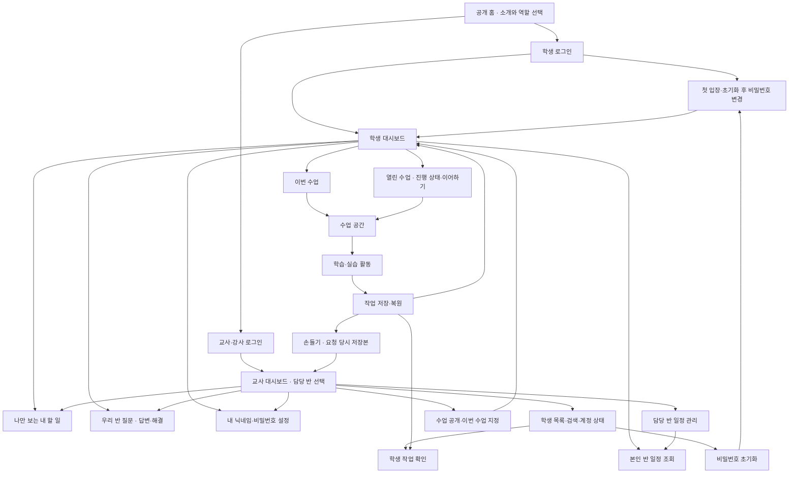

# CS Class 제품 방향

갱신: 2026-10-11(Asia/Seoul). 확정된 제품 정책과 제안·미결정을 구분해 기록합니다. 구현·검증·배포 상태와 날짜별 실행 기록은 [HANDOFF](HANDOFF.md#현재-작업-상태), 화면 표현은 [DESIGN](DESIGN.md)을 따릅니다.

## 목적과 첫 범위

**CS Class · 즐거운 정보 교실**은 설치 없이 브라우저로 시작하는 중학교 정보 학습 공간입니다. 학생이 생각을 표현하고 실행·수정하며 완성의 경험을 얻고, 교사는 불필요한 입력·채점 부담 없이 수업을 운영하도록 돕습니다.

**1차 완성형의 대상(2026-09-30 확정):** 선생님 본인 학교의 수업을 깊게 완성하는 공간을 목표로 합니다. 여러 선생님이 참여하는 플랫폼으로의 확장은 먼 미래의 구상입니다. 완성형의 구체적인 경험·성공 기준·기능 우선순위는 논의 중이며, 기능별 기존 합의와 구현 범위는 아래 각 절을 따릅니다.

현재 수업은 「강아지와 시작하는 프로그래밍」과 아래 세 선택 복습입니다. 초기 순서·순서도·엔트리봇은 테스트 수업이며 기존 기록 호환성을 유지합니다. 2026-10-04 사용자는 약 일주일 뒤 2학년 11개 반, 반별 최대 27명(전체 최대 297명)의 일반 수업 적용과 프로그래밍 13차시 완성을 함께 진행하기로 했습니다. 여러 반이 동시에 수업하는 경우는 거의 없으며 학생의 몰입과 UX 완성도를 우선합니다. 수행평가의 도움·채점 기준과 기존 평가 자료 이관은 후속 논의입니다. **기본 수업 틀은 개념–퀴즈–실습으로 유지합니다(2026-09-30 사용자 재확인).** 각 단계의 활동·소단위 구성과 수업 시간은 실제 수업 경험으로 다듬습니다.

### 공통 수업 탐색 — 2026-10-11 확정

정규·복습·추가 수업은 기존 LessonShell의 같은 헤더·개념/퀴즈/실습 탭을 사용합니다. 탭의 완료 수와 얇은 막대는 개념 확인·퀴즈 해결·필수 실습 제출만 계산하며 저장·검증·선택 도전은 제외합니다. 별도의 수업 안내/상세 진행 펼침은 제거하고 저장 실패·충돌 해결은 유지합니다. 다른 이번 수업은 제목 아래 작은 이동 링크로 표시하며 기존 입력 저장·탐색 보호를 거칩니다. 본문과 실습 작업실의 폭은 활동에 맞게 유지합니다.

### 알고리즘 선택 복습 — 2026-10-05 확정

원본 Algorithm Studio 운영 `bc8d51f`의 문제 추상화·알고리즘 설계·순서도 연구소를 cs-class의 선택 복습 공간으로 통합합니다. 원본 수업 활동과 전용 AI 역할을 유지합니다. 2026-10-05 공개 후 사용자 피드백에 따라 실습은 원작의 배치·그림·다채로운 색·동작을 최대한 재사용하며 로그인·저장·교사 조회는 현재 플랫폼을 따릅니다. 성적·평가 점수에는 반영하지 않습니다. 테스트 수업 세 ID는 새로 공개하지 않고 기존 기록을 보존하며, 새 ID `review-abstraction`·`review-sandwich`·`review-flowchart`를 씁니다. 강아지 수업·공개 프로토타입은 유지합니다.

수업의 공개 상태·배포·검증과 AI 오판 한계·첫 실제 수업의 후속 확인은 [HANDOFF](HANDOFF.md#현재-작업-상태)를 따릅니다.

| 수업 | 실습과 완료 |
| --- | --- |
| 문제 추상화 | 선택 맛보기 → 자유 이동 네 단계 워크북. 현재·목표·조건·핵심·해결 계획의 최소 요건을 검증하고 학생이 제출해 저장합니다. 후보·조건·핵심/노이즈·계획 추천은 학생이 선택하며 처방전·채택 결과를 보관합니다 |
| 알고리즘 설계 | 자연어로 준비·재료·조립 명령을 내리고 오류를 수정해 재실행합니다. 여러 레시피를 인정하며 서버가 서명된 명령 기록을 원본 규칙으로 재실행해 완성 판정 후 제출·저장합니다 |
| 순서도 연구소 | 순차·선택·반복 세 퍼즐과 자유 작품을 각각 검증·제출합니다. 예시 공방은 선택 연습입니다. 자유 작품은 목표·필수 조건·실제 연결을 리뷰하며 타당한 단계 묶음·표현·배치 차이는 조언으로 안내합니다 |

2026-10-11 확정: 추상화·샌드위치 실습은 현재 홈페이지의 시각 디자인 안에서 V1의 기능·구조·조작 흐름을 복원합니다. 추상화는 선택 맛보기와 상태 정의→조건 목록→생각 다이어트→처방전, 후보 채택·조건 추가/삭제·정보 버리기/복구·번호 계획 수정·복사/인쇄를 제공합니다. AI 생성·재생성·재시도는 학생의 명시적 요청에서만 수행하며 실패 때 입력/결과를 보존하고 늦은 응답은 새 수정을 덮지 않습니다. 샌드위치는 큰 조리대·오른쪽 명령 대화·누적 기록과 완성 결과 다시보기/명령·시식평 복사를 제공합니다. 글 입력·Enter/Shift+Enter/한글 조합 구분을 유지하며 음성은 추가하지 않습니다. 같은 수업의 단계 왕복에는 임시 상담·실패·확인 질문·읽던 위치를 유지하고 상담 전문을 서버에 새로 저장하지 않습니다.

**2026-10-11 후속 확정 — 순서도 실습의 V1 UI·기능:** 순서도 연구소의 실습 내부는 V1의 화면 배치·기호 표현·조작 흐름을 그대로 옮깁니다. 다른 수업과 공통 LessonShell·저장·검증·제출의 정책은 유지합니다.

- 실습은 순차(라면)·선택(놀이기구)·반복(비밀번호)·예시 공방·나만의 백지의 다섯 단계입니다. 퍼즐의 기호 보관함/조립 캔버스/실행 모니터, 예시 공방의 자연어 카드/다이어그램, 자유 공방의 기획서/보관함/캔버스/실행 모니터를 유지합니다. 퍼즐 조각은 한 칸에 배치·이동·제거하고 이전 버전의 중복 배치는 조회만으로 바꾸지 않습니다. 올바른 배치에서 실행하며 완료 설명은 제출을 대신하지 않습니다. 예시 공방은 단계별 조립·전체 완성·기존 작품을 보존하는 자유 캔버스 이동을 제공합니다. 이미 공개한 예시 카드를 다시 선택해도 뒤의 기호는 유지합니다.
- 자유 공방은 기획서 접기·순차/선택/반복 카드 편집, 기호 추가·내부 글 편집·이동·포트 연결, 캔버스 이동·정렬·휴지통 삭제를 제공합니다. 키보드로도 편집·연결합니다. 반복은 참인 동안의 지속 조건과 반복 행동으로 구분합니다.
- 처방전은 추천 문제/나만의 문제 탭에서 다섯 예시·빠른 시작·직접 작성·추상화 정의 가져오기·명시적 AI 제안의 후보를 확인·수정한 뒤 채택합니다. 현재 문제만 작성해도 AI가 목표·조건·핵심 정보와 계획 후보를 제안할 수 있습니다. 후보 생성만으로 저장된 작품을 바꾸지 않으며 기호·화살표 초기화는 별도로 선택합니다. 탭 이동·모달 재열기는 수정 후보를 보존하고, 다른 빠른 시작 문제를 명시적으로 고르면 이전 문제의 조건·핵심·계획 후보는 비웁니다. 늦은 제안은 재진입·새 수정을 덮지 않습니다.
- 실행/일시정지·한 단계·초기화/중지·속도·변수의 현재/직전값·출력·실행 과정을 유지합니다. 자유 작품은 숫자·문자 입력/비교/출력을 지원하고, 숫자 퍼즐과 문자 비밀번호 퍼즐의 입력 의미는 유지합니다. 입력 오류는 같은 기호에서 고쳐 재시도하며 직전값은 해당 변수가 다시 대입될 때 갱신합니다. 종료 뒤 다시 실행할 수 있고 입력·선택은 실행 기호 옆에서 조작합니다. 기본 구조 점검과 기호별 이동, 기존 AI 리뷰와 명시적 재점검을 제공합니다. 작품의 문제 정의·기획서·실제 순서도·내보내기 시점 점검 상태를 PNG로 미리보기·복사·다운로드합니다. 외부 게시판 연결은 추가하지 않습니다.
- 기호 문구는 실제 줄바꿈과 긴 글을 화면/PNG에 보존합니다. 입력 포트에서 새 연결을 시작하지 않으며 이미 사용 중인 논리 출구는 기존 화살표를 먼저 명시적으로 삭제한 뒤 연결합니다. 시작·종료 추가는 빠진 역할을 복원하고 두 역할이 모두 있으면 중복 추가를 안내합니다.
- 답안·저장은 기존 useWork가 소유합니다. 기존 text/yes/no·연결·좌표·제출본·완료 기록을 보존하며 보기·배치·연결점 위치 변경만으로 논리 검증을 무효화하지 않습니다. 이 후속 요구의 구현·검증·배포 상태는 HANDOFF에서 따로 기록합니다.

개념–퀴즈–실습의 자유 이동과 현재 해결·재도전 정책을 유지합니다. 추상화 정의를 학생이 순서도에 선택 복사하며 이후 두 작품은 독립입니다. 초안 수정은 현재 검증만 무효화하고 이전 제출·완료를 유지합니다. 검증·AI 리뷰·교사 요청은 작품 스냅샷에 연결합니다. 기본 검사를 통과했지만 AI가 보완·불확실·오류를 반환하면 교사 확인을 요청할 수 있습니다. 담당 교사는 고정 요청본을 승인하거나 수정 안내를 남기며 새 요청/제출은 이전 요청을 대체합니다.

전용 AI는 Upstage Solar `solar-pro4`, 출력 한도는 순서도 기획 제안1600토큰·나머지800토큰입니다. 제공자25초/서버45초/브라우저50초, 학생별 분당15회·한국 날짜 하루70회이며 실제 호출 시도만 차감합니다. 중복·구조화 결과 캐시는 재차감하지 않으며 자동 재시도하지 않습니다. 자유 상담 전문은 서버에 보관하지 않고 채택 결과·검증 피드백·호출/토큰/지연/실패 집계만 남깁니다. 월 AI 예산은 실측 후 별도로 정합니다. 범용 튜터·평가·띵커보드·원본 학생자료 이관은 제외합니다.

각 수업의 통합 검사·독립 리뷰 뒤 11개 반에 복습으로 열며 자동으로 이번 수업을 바꾸지 않습니다. 운영 반 설정의 백업·변경 계획 확인·복구와 공개 상태는 [개발 안내](DEVELOPMENT.md#알고리즘-복습-수업)·[HANDOFF](HANDOFF.md)를 따릅니다. 원본 이식·품질 검증 근거와 과거 이행 기록은 [참고 자료](reference/algorithm-review-integration.md)에 있습니다.

AI 판정은 성적이 아닌 학습 피드백이며 자연어 의미·조건 적용 범위를 완벽히 증명하지는 않습니다. 원문 근거나 필수 행동의 경로가 맞지 않으면 통과로 처리하지 않고 교사 확인을 허용합니다. 학생은 요청본을 보존한 채 계속 수정할 수 있습니다. 실제 제공자·운영 검증 결과와 이 한계는 HANDOFF에서 구분합니다.

### 프로그래밍 13차시 — 실제 수업 구성

2026-10-04 확정: PPT의 학습 목표를 골조로 사용하되 활동과 표현은 학생의 실험·실행·수정 경험에 맞춰 구성합니다. 아래 구성을 운영 학습 경로 `/classroom/programming-13`에 구현하며 실제 검증·배포 상태는 [HANDOFF](HANDOFF.md)를 따릅니다. 공개 프로토타입의 기존 체험 기록과 구분합니다.

- 개념 네 활동은 언어의 표현, 입력→처리→출력, 변수·연산, 시작 신호를 직접 바꾸며 확인합니다. 퀴즈 다섯 문항은 한 문제씩 제시하며 오답만 재도전합니다. 확인 답안·해결 기록은 서버에 저장하고 단계 이동은 자유롭게 유지합니다. 개념 실험값과 실행 중 무대는 일시적인 UI 상태입니다.
- 기본 미션은 이름 짓기, 곱셈 계산기, 시작 버튼 이동, 방향키로 움직임 개선의 네 개입니다. 평균 계산기는 선택 도전이며 기본 실습 완료율에 포함하지 않습니다. 모든 미션에 실제 EntryJS 편집기·무대·해당 목표에 필요한 팔레트를 제공합니다.
- 이름·곱셈·시작 버튼 이동·평균은 별도 작품입니다. 방향키 개선을 처음 열면 저장된 시작 버튼 이동 작품을 복사하고 코드를 더합니다. 이후 두 작품은 각각 저장되어 어느 쪽 편집도 다른 쪽을 덮어쓰지 않습니다. 먼저 방향키 미션을 연 경우 시작 블록에서 만들 수 있습니다.
- 이름은 서로 다른 이름으로 두 번 실행하고 대답을 말하기에 사용하도록 안내합니다. 현재 작품으로 질문·대답·말하기를 끝낸 서로 다른 입력만 0/2→1/2→2/2로 세며 같은 이름의 반복·중지한 실행은 늘리지 않습니다. 작품 내용이 바뀌면 실행 확인을 다시 시작하고, 재접속 후에도 기존 작품·완료 기록을 유지한 채 이 화면에서 두 이름을 다시 확인합니다. 실행 부족과 구조 오류의 안내를 구분하며 화면의 실제 실행 확인과 서버의 허용 블록·입력 의존 검증을 함께 사용합니다. 계산 미션은 A/B에 각 질문의 대답을 저장하고 여러 입력의 곱·평균을 출력해야 합니다. 이동은 시작 버튼으로 오른쪽 10, 방향키 개선은 이 동작을 유지하며 네 키로 각 방향 10씩 움직여야 합니다. 실행 중 질문 대기는 15초 실행 제한에서 제외합니다.
- 검증과 제출을 나눕니다. 최신 작품의 검증 통과 뒤 제출하며 미션별 최근 제출본을 교사가 확인합니다. 작품 수정은 해당 미션의 검증만 무효화하고 이전 제출과 완료 기록, 다른 미션의 기록을 보존합니다. 숫자 칸을 비운 편집 중 초안도 보존하고 실행·검증 시 유효성을 확인합니다. 발견 기록은 작품과 함께 저장합니다.
- Entry 실습은 실행 → 현재 작품 조건 검증 → 제출 순서와 다음 행동을 안내합니다. 빈 시작 블록에서는 해당 미션에 필요한 블록을 알려 주고, 이동 결과는 현재 위치 X·Y로 표시하며 좌표를 이동 거리로 부르지 않습니다. 검증 통과와 제출 완료, 실패 이유를 구분합니다.
- 이번 실사용 범위의 도움은 목표·작은 실험·힌트·실행·검증 피드백과 [저장본 손들기](#설정과-손들기--2026-10-07-기본-기능-확정)입니다. 작품에 남기는 교사 피드백·AI·평가 자동화·장면 편집·작품 파일 내려받기는 후속 결정입니다.

### 프로그래밍 13차시 — 경험 검토용 프로토타입

수업 PPT를 바탕으로 개념–퀴즈–실습을 체험하는 공개 프로토타입입니다. 아래 경험은 검토용이며 최종 수업·도움·평가 정책으로 확정하지 않았습니다. 실제 구현·검증·배포 상태는 [HANDOFF](HANDOFF.md#현재-작업-상태)를 따릅니다.

- 개념은 프로그래밍 언어·입력/처리/출력·변수와 연산·시작 신호를 직접 조작하고 짧게 확인합니다. 퀴즈는 다섯 문항을 하나씩 풀고 회차별 채점 뒤 오답만 재도전합니다. 단계 이동은 자유롭게 유지합니다.
- 실습은 이름 짓기·곱셈 계산기·방향키 움직임의 기본 세 미션, 추가 평균 계산기로 구성합니다. 첫 이름 미션은 실제 EntryJS 4.0.23, 나머지는 기존 미니 작업실을 사용합니다. 학생이 직접 조립하고 입력·순서·시작 신호와 실행 발자국을 확인합니다.
- 실습 도움은 작은 실험 힌트 → 요청 당시 코드/입력/실행의 예시 요청 → 교사 시점에서 직접 피드백 → 학생이 다시 시도하고 해결 표시하는 흐름을 체험합니다. 실제 교사 전송·AI 응답·학생 평가 기능은 연결하지 않습니다.
- 체험의 개념/퀴즈 답안·실습 초안·완료 표시·발견 기록은 해당 탭의 `sessionStorage`에 보관합니다. 도움 요청과 답변은 화면 메모리여서 새로고침 시 사라집니다. 실제 학생 작업의 저장 정책과 구분하며 공용 PC의 운영 저장 규칙을 변경하지 않습니다.
- 공개 경로는 `/prototype/programming`입니다. 기존 수업·인증·권한·서버 저장과 의존성은 유지합니다. 원본 PPT와 추출 미디어는 로컬 참고용이며 Git에 넣지 않습니다. 구현·검증 상태와 남은 한계는 [HANDOFF](HANDOFF.md)를 따릅니다.

**2026-10-01 확정한 이름 미션 파일럿:** 전반 구조와 이름을 유지하며 기존 iframe 작업실을 재사용합니다. 시작 블록만 있는 작품에서 질문·대답·말하기를 연결하고, 실제 질문창에 서로 다른 이름을 입력해 두 번 실행합니다. 말하기가 해당 대답 표현식의 실제 결과와 일치해야 완료 표시를 할 수 있습니다. 정해진 인사 문구·느낌표는 요구하지 않으며 상수 이름 출력은 통과하지 않습니다. 코드 수정은 실행 근거와 확인 결과를 무효화하고 이전 완료 기록은 남깁니다.

힌트는 다른 이름으로 다시 실행 → 질문 뒤 대답 관찰 → 말하기에 대답 연결 순서입니다. 질문 응답 대기는 실행 제한에서 제외합니다. 체험 저장은 v2 별도 키로 옮기며 v1 원문과 다른 답안·완료를 보존합니다. 변환할 수 없는 이름 초안은 읽기 전용으로 안내하고 새 작업실을 준비합니다. 이동 전 현재 작품 내보내기와 탭 저장에 실패하면 화면·입력을 유지합니다. 도움 문맥은 `mini | entry`로 구분해 요청 당시 작품·실행을 고정합니다.

위 공개 체험의 구성은 유지합니다. 운영 수업의 Entry 작업실·서버 제출은 [실제 수업 구성](#프로그래밍-13차시--실제-수업-구성)을 따릅니다. 공개 체험의 예시 도움은 실제 요청을 보내지 않으며 운영 수업의 도움 요청은 [손들기 기준](#설정과-손들기--2026-10-07-기본-기능-확정)으로 구분합니다. PPT 목표와 차이는 [13차시 자료](reference/programming-13.md), 구현 경계는 [개발 안내](DEVELOPMENT.md#운영-프로그래밍-수업), 최신 검증·배포 근거는 [HANDOFF](HANDOFF.md)를 따릅니다.

### 학교 수업 완성형의 경험 후보

2026-09-30 대화에서 탐색한 경험의 현재 기반과 **후속 후보**를 구분합니다. 손들기·반 질문의 기본 기능은 아래 확정 범위를 따르며 남은 후보를 일괄 구현 목록이나 최종 운영 정책으로 삼지 않습니다. 여러 선생님을 위한 서비스·요금제·범용 편집기는 현재 우선순위에 두지 않고 시간·유지보수·서버 비용을 함께 고려합니다.

| 장면 | 만들고 싶은 경험 | 현재 기반과 남은 결정 |
| --- | --- | --- |
| 학생이 실습하다 막혔을 때 | 하던 작품과 실행 결과를 보며 작은 도움을 받고, 친구·선생님에게 막힌 지점을 설명한 뒤 수정·검증·제출 | 운영 수업의 저장·실행·검증·제출, 저장본 손들기와 반 질문·답변을 구현. 작품에 남기는 교사 피드백·AI 정답/힌트 경계·평가 시 도움 기준은 후속 |
| 기본 활동을 마쳤을 때 | 관심 있는 심화 도전 → 자유 제작 → 설명·공유·이어 만들기 → 작품집·다음 프로젝트 | 기본 완료와 선택 활동을 구분하며 운영 프로그래밍 수업의 평균 도전을 구현. 심화 선택·자유 제작·작품집·반 공유는 후속 후보 |
| 선생님이 반 전체와 수업할 때 | 수업 열기 → 도움 상황 확인 → 학생 작품에서 피드백 → 좋은 질문 함께 보기 → 다음 수업 다듬기 | 반별 수업 지정·진행·제출 작품 조회, 손들기 확인·완료와 반 질문 교류를 구현. 작품에 남기는 교사 피드백·교사 수업 내용 편집은 후속 |

반 안의 질문은 [우리 반 질문 기준](#대시보드-탐색과-우리-반-질문--기본-기능-확정)을 따르며 작품 공유는 후속입니다. 도움 요청은 실습 제출이나 교사 승인 요청과 목적이 다르므로 해결 표시를 평가 완료로 연결하지 않습니다. AI 제공자·자동 답변·정답 제공 범위를 이번 기본 기능만으로 선정하지 않습니다.

## 개발 순서와 명세 진행

- **사용자 방향:** 계정·입장·반 관리·수업 배정 등 플랫폼 기능을 완성도 있게 마련한 뒤 수업을 순차적으로 추가합니다. 교사가 수업 준비·운영을 병행할 수 있는 개발·유지보수 규모를 고려합니다.
- **현재 기반과 후속 순서:** 계정·권한·수업 지정·저장·복원·교사 조회를 공통 기반으로 사용합니다. 프로그래밍 13차시와 세 복습의 실제 수업 경험을 확인하고, 추가 콘텐츠는 학습 목표와 완료 조건을 정한 뒤 진행합니다.
- 학생·교사의 수업 준비 → 입장 → 활동 → 저장·이어하기 → 교사 확인 흐름을 기준으로 범위를 정합니다. 공통 계정·반·저장을 재사용하고 개념–퀴즈–실습의 기본 틀 안에서 수업별 활동을 구성하며, 모든 수업을 위한 범용 편집기를 미리 만들지는 않습니다.
- 기능 명세에는 진입 목적, 표시 정보, 사용자 행동, 저장·반영 결과, 빈 상태·오류·권한 경계를 기록합니다. 확정 정책은 이 문서에 모으고, 제안·미결정·구현 상태는 구분합니다. 다음 논의 지점은 [HANDOFF](HANDOFF.md)에 연결합니다.

### 1차 구현 완료 목표 — 실제 계정과 저장 연결

- 사용자는 `실제 계정·저장까지 연결한 작은 버전`을 선택했습니다. 계정 입장 → 교사의 담당 반 수업 지정 → 학생 활동 → 서버 저장 → 재접속 복원 → 교사 확인이 완료할 흐름이며 화면 예시만으로 완료하지 않습니다.
- 최초 검증용 순서 수업은 개념 2개·퀴즈 3문항·순서 배열 실습 1개로 저장·완료 규칙을 확인하는 범위입니다. 이후 순서도·EntryJS 수업을 추가했으며 각 수업의 조건은 아래 학습 정책을 따릅니다.
- Firebase 대상은 `cs-class-f74c4`입니다. 예산·실학생 등록·후속 기능의 범위는 각각 [저장·비용](#작업-저장과-통신-비용)·[학생 계정](#학생-계정과-반-배정--인증-구현-실학생-등록-후속)·[다음 결정](#다음에-결정할-것)에서 관리합니다.
- 당시 구현 지시는 [보관함](archive/README.md)에, 현재 구현·검증·배포는 [HANDOFF](HANDOFF.md)에 있습니다. 과거 작업 승인을 후속 작업의 승인으로 적용하지 않습니다.

## 논의용 화면 지도

합의한 목표 구조를 반영한 화면 지도입니다. 각 상자는 별도 페이지 또는 화면 안의 영역·상태입니다. 아래 로그인·수업 운영·검증용 활동·저장·교사 조회 경로를 구현했고, 별도 지난 활동 영역은 열린 수업에 통합했습니다. 연결선은 검증 완료를 뜻하지 않으며 클라우드 환경의 최종 검증 상태는 HANDOFF를 따릅니다.

공개 수업 소개 경로 `/explore/[id]`도 현재 시안에 있으나 준비 안내 수준입니다. 공개 홈에서의 연결과 역할은 추후 검토합니다. 현재 코드 위치와 실행 상태는 [README](../README.md)와 HANDOFF를 따릅니다.

## 합의한 첫 경험

| 영역 | 방향 |
|---|---|
| 공개 화면 | 주제와 예시를 둘러보며 호기심을 느끼는 공간 |
| 로그인 후 | 학생·교사 공통 대시보드에서 개인 할 일·반 일정·다음 행동 확인. 수업·학생 상세는 해당 메뉴로 이동 |
| 학생 홈 | 전체 필수 활동 진도·**이번 수업** 바로가기와 할 일·일정. **열린 수업** 메뉴에 목록·격자 보기와 진행 상태·필터·이어하기·복습을 모음. 별도 지난 활동 영역은 통합 |
| 이번 수업 지정 | 교사가 반별로 직접 지정하며 바꾸기 전까지 유지 |
| 수업 공개·복습 | 반 전체에 공개하고, 이미 열린 수업은 자유롭게 복습 |
| 초기 제외 | 학생별 보충·심화 배정, 공지, 교사 수업 내용 편집기 |

## 학생 대시보드와 수업 전환

2026-09-28 합의한 수업 전환·저장·완료 기준은 유지합니다. 2026-09-30 [대시보드 파일럿](#대시보드-파일럿--방향과-로컬-완료-범위-확정)에서 첫 화면의 수업 밀도를 낮추고 열린 수업 목록을 별도 메뉴로 옮겼습니다. 구현·검증 범위는 HANDOFF에서 확인합니다.

- 교사가 이번 수업을 바꾸면 학생 대시보드의 우선 안내가 새 수업으로 바뀝니다. 이번 수업 변경만으로 이전 수업의 공개를 해제하거나 학생 작업을 삭제하지 않습니다. 이전 수업은 열린 수업에 유지하고 해당 수업 카드에서 기존 작업을 이어갈 수 있게 합니다.
- 학생이 다른 수업을 진행 중이면 작은 변경 안내와 새 수업으로 이동하는 버튼을 제공합니다. 강제로 화면을 전환하지 않고 학생이 직접 이동합니다.
- 수업을 이동해도 기존 작업을 보존합니다. 활동 중 저장 원칙에 더해, 이동 전 최신 변경 내용의 서버 저장 성공을 확인합니다. 변경이 없고 최신 저장이 확인된 경우 같은 내용을 다시 저장하지 않습니다. 저장에 실패하면 현재 작업을 유지하고 재시도를 안내하며, 저장 완료로 표시하거나 작업을 버린 채 이동하지 않습니다.
- **표시 명칭은 `이번 수업`으로 확정했습니다.** `실시간 수업`·`지금 수업`으로 바꾸지 않습니다. 수업 시작·종료를 관리하는 실시간 진행 기능을 뜻하지 않습니다.
- **목록 구성:** 대시보드의 작은 `이번 수업` 바로가기와 별도 `/student/lessons`의 `진행 상태와 이어하기가 있는 열린 수업 목록`으로 나눕니다. 별도 지난 활동 영역은 열린 수업에 통합하고 기존 작업과 이어갈 위치를 보존합니다. 단계별·단원 전체 완료는 [수업 단계와 완료 기준](#수업-단계와-완료-기준)을 따릅니다. 기본 활동만 완료 조건에 포함하며 단계는 퍼센트·완료 수, 전체는 `시작 전 / 진행 중 / 완료`로 표시합니다. 방문 기록을 실제 학습 진행률로 간주하지 않습니다.

### 열린 수업과 지난 활동 통합 — 구성·진행 표시 확정

이번 수업도 열린 수업 목록에 포함하고 표시로 구분합니다. 2026-10-05 개선에서는 이번 수업을 먼저, 이어서 진행 중·시작 전·완료 순으로 배치하며 같은 상태의 기존 순서는 유지합니다. 저장된 단계와 프로그래밍 미션으로 구체적인 이어갈 곳을 안내합니다. 전체·미완료·완료 필터, 미지정·빈 상태를 제공하며 행동은 `수업 시작 / 이어하기 / 다시 보기`입니다. 한 번 공개한 수업은 1차 범위에서 닫지 않습니다. 완료와 제출 후 수정은 [학습 정책](#수업-단계와-완료-기준)을 따릅니다. 향후 공개 해제 시 기존 작업 접근·여러 작품 중 이어갈 작업 선택은 별도 설계합니다.

2026-10-07 보완에서는 `/student/lessons`의 기본 보기를 작은 목록으로 두고 격자로 전환할 수 있게 합니다. 목록은 정규 수업의 개념·퀴즈·실습 막대, 격자는 해당 수업의 [필수 활동 합산 완료율](#대시보드의-전체-필수-활동-완료율)을 표시하는 원형을 사용합니다. 선택 복습에는 정규 수업의 완료율을 만들지 않습니다. 두 보기 모두 기존 필터·순서·구체적인 이어갈 곳과 출처에 따른 수업 복귀·저장 보호를 유지합니다. 보기와 필터는 현재 화면의 재조회·조회 실패에도 유지하며, 화면을 새로 열면 기본 목록에서 시작합니다. 보기 방식의 서버·브라우저 영속 저장은 추가하지 않습니다.

## 대시보드 탐색과 우리 반 질문 — 기본 기능 확정

- **사용자 요청:** 2026-09-28 참고 이미지의 좌측 메뉴·카드 구성을 학생·교사 대시보드에 응용하고 반 안의 커뮤니티·Q&A를 검토했습니다. 2026-10-07에는 아래 기본 질문·답변·해결 기능을 확정했습니다. 자세한 도구는 메뉴로 접근하고 기존 홈 스타일과 `이번 수업` 맥락을 유지합니다.
- **현재 배치:** 데스크톱은 좌측 메뉴와 넓은 본문, 상단의 현재 반·계정 맥락으로 구성합니다. 첫 화면은 개인 할 일·다음 학습/확인 행동·달력과 이번 수업의 합산 진도를 보여줍니다. 교사는 손든 학생의 저장본을 열고, 상세 진행·제출 작품과 우리 반 질문은 각 메뉴에서 확인합니다. 질문의 대시보드 요약은 후속입니다. 모바일에서는 메뉴를 접고 본문을 한 열로 보여줍니다. 참고 이미지의 출석·성적 차트·다운로드를 장식용 기능으로 추가하지 않습니다.
- **현재 메뉴(2026-10-07 기본 기능 확정):** 학생은 `대시보드 / 열린 수업 / 우리 반 질문 / 설정`, 교사·강사는 `대시보드 / 학생 현황·계정 / 수업 관리 / 우리 반 질문 / 설정`입니다. 반 일정은 대시보드 달력을 입구로 통합하며 ‘전체 보기’에서 상세 일정·교사 등록 기능을 유지합니다. 사이드바 아래에는 본인 닉네임·학번/역할과 설정 바로가기를 둡니다. 학생 수업의 수동 폭 선택과 초점 기준은 [DESIGN](DESIGN.md#수업-전용-공통-틀--2026-10-06-구현)을 따릅니다.
- **Q&A 연결:** 반 게시판에서 질문을 작성하고 해당 반에 열린 수업을 선택해 연결합니다. 학생 작품 검토 요청은 개인 작업에 연결된 별도 흐름이며 게시판에 자동 공개하지 않습니다. 수업 화면에서 직접 질문 보내기와 `나도 궁금해요` 참여는 후속입니다.
- **Q&A 답변 주체 확정:** 사용자는 같은 반 학생과 교사가 모두 답변하는 방식에 동의했습니다. 학생끼리 설명하고 교사가 답변·보충할 수 있으며, 교사 답변은 교사가 작성했음을 구분해 표시합니다. 교사·강사의 접근은 기존 담당 반 권한을 따릅니다. 교사의 게시글 숨김·관리 동작은 후속 설계합니다.
- **Q&A 해결 상태 확정:** 질문한 학생과 해당 반에 권한이 있는 교사 모두 질문을 `해결됨`으로 바꾸거나 다시 열 수 있습니다. 답변이 등록됐다는 이유만으로 자동 해결하지 않습니다. 해결됨은 질문자의 궁금증이 해소됐다는 표시이며, 게시된 모든 답변의 정답 여부를 공식 승인한 상태를 뜻하지 않습니다.
- **질문 필터의 조회 범위(2026-10-09 승인):** 필터는 현재 누적 조회한 질문에 적용합니다. 이전 페이지가 있으면 실제 누적 개수를 표시하고, 결과가 없으면 불러온 목록에 조건에 맞는 질문이 없다고 안내하며 더 보기를 유지합니다. 답변 대기는 답변0개이면서 미해결인 질문입니다. 반 전체 검색·전체 개수 조회는 추가하지 않습니다.
- **본인 질문 삭제(2026-10-09 확정):** 학생·교사·강사는 현재 접근할 수 있는 반에서 본인이 작성한 질문만 삭제합니다. 실행 전 질문과 모든 답변의 삭제·복구 불가를 확인하고, 서버는 작성자·반·세션을 검사하여 질문과 답변을 함께 삭제합니다. 교사의 다른 사람 질문 삭제 권한은 추가하지 않습니다. 실패하면 질문·답변과 작성 초안을 유지하며, 성공하면 해당 질문의 답변 초안만 정리하고 다른 작성 초안은 보존합니다. 이미 삭제된 질문의 재삭제는 찾을 수 없음으로 반환하며 화면은 이를 정리합니다. 삭제 후 과거 작성 요청을 다시 보내는 경우까지 막는 영구 요청 장부는 도입하지 않습니다.
- **커뮤니티 확장 제안:** 작품 공유·댓글은 이후 사용 경험을 보고 검토합니다. 작품 공유를 도입하더라도 학습용 제출과 공개 공유를 분리하는 방향을 제안합니다. 자유게시판·실시간 채팅·알림 기능은 아직 합의하지 않았습니다.
- **기본 기능과 한도(2026-10-07 확정):** 질문 제목80자·본문2000자·답변1500자·질문당40답변, 계정당 분당30회 작성 한도로 시작합니다. 목록은 메타 정보50개씩, 선택한 질문은 본문과 답변만 조회합니다. 같은 요청의 재전송은 중복 생성하지 않고 동시 답변을 보존하며 연결 수업이 닫힌 뒤에도 이미 등록한 동일 요청을 반환합니다. 작성 실패 초안은 계정·반별 현재 브라우저 탭에 보관합니다. ‘나도 궁금해요’·작품 공유·관리 숨김은 후속입니다.

기본 Q&A·설정·손들기의 구현·검증·운영 반영 상태는 [HANDOFF](HANDOFF.md#현재-작업-상태)에서 구분합니다.

### 설정과 손들기 — 2026-10-07 기본 기능 확정

- 설정에서 닉네임과 본인 비밀번호를 변경합니다. 닉네임은20자 이내의 일반 글자이며 학번·반·역할은 수정하지 않습니다. 비밀번호 계정은 현재 비밀번호를 확인하고 기존 개인 비밀번호 정책을 따릅니다. Google 계정은 Google에서 관리하도록 안내합니다. 잘못된 현재 비밀번호나 공급자 확인 실패로 유효한 접속을 종료하지 않고 입력을 보존합니다. 변경 확인은 계정당15분8회로 제한하며 성공하면 기존 인증 토큰과 앱 세션을 갱신하고 학습 기록은 유지합니다.
- 학생은 수업 상단의 손들기로 도움을 요청합니다. 기존 학습 저장이 성공한 뒤 요청하며 저장 실패에는 요청을 보내지 않습니다. 요청 당시의 저장된 작품·학습 단계/미션을 별도 저장본으로 보관하고, 담당 교사는 요청을 열어 읽기 전용으로 확인하거나 새로고침으로 이후 저장본을 확인합니다. 제출 전 작품도 도움 요청 범위에서 확인합니다. 동영상·실시간 화면 중계나 교사의 학생 초안 편집은 포함하지 않습니다.
- 학생은 손을 내리고 담당 교사는 도움 완료로 처리합니다. 새 요청 번호를 확인하여 이전 요청의 늦은 처리가 새 손들기를 닫지 않도록 합니다. 사용한 요청 번호도 서버에 보관하여 두 탭에서 이전 요청을 재전송해 새 요청·저장본을 덮어쓰는 것을 거부합니다. 계정당 손들기는 분당10회로 제한하되 같은 요청의 재전송은 추가 집계하지 않습니다. 반을 옮겼거나 비활성인 학생의 저장본을 이전 반 교사에게 제공하지 않습니다. 손들기는 질문 게시판에 자동 공개하지 않으며 AI 검토 승인·실습 제출·학습 완료와 별도입니다.
- **교사의 도움 확인(2026-10-09 구현):** 요청 목록에 기존 저장 정보의 수업·단계·실습 미션을 표시합니다. 정확한 개념 페이지·퀴즈 문항을 추정하지 않습니다. 마지막 확인 시각은 손들기 조회 성공 때만 바꾸며 최초 대기/실패는 0명으로 표시하지 않습니다. 재조회 실패는 마지막 목록·성공 시각과 실패 안내를 유지하고 반 전환 때 이전 반의 수치를 숨깁니다. 홈 상단의 `손든 학생 N명 보기`는 같은 조회 결과로 해당 패널의 제목에 이동·초점합니다.
- 교사 대시보드는 선택한 정규 수업의 학생별 필수 활동 개수를 합산한 전체 완료율·시작 전/진행 중/완료 인원을 보여줍니다. `교사가 확인할 일`의 개념·퀴즈·실습 막대는 **해당 단계의 필수 활동을 모두 완료한 학생 수 / 전체 등록 학생 수**로 표시합니다(2026-10-09 확정). 일부 활동만 마친 학생은 완료 인원에 포함하지 않고 선택 도전은 필수 완료 조건에서 제외합니다. 상단 원형의 활동 합산과 학생 개인 진도 계산은 유지합니다. 최근2분 활동은 기존 서버 세션의 마지막 활동 시각이며 출석 확정·등교 여부를 뜻하지 않습니다. 교사 현황과 손들기는 보이는 화면에서30초마다 저장된 기록을 다시 읽으며 과금액·화면 중계·실시간 출석을 보장하지 않습니다.

### 교사 대시보드의 1차 범위

2026-09-28 메타프롬프팅 협의에서 사용자는 **반 선택·이번 수업 지정·학생별 단계 진행·제출 작품 보기·계정 관리**까지 1차에 포함하는 안을 선택했습니다. 수업 설정·계정 관리만 만들고 진행·작품 조회를 뒤로 미루지 않습니다.

- 교사·강사는 기존 담당 반 권한 안에서 반을 선택하고 이번 수업을 지정합니다. 선택한 반은 같은 로그인에서 메뉴 이동·새로고침 동안 유지하고 실제 재로그인하면 첫 담당 반으로 돌아갑니다. 다른 계정·담당 범위 밖의 기억값은 사용하지 않으며 직접 URL의 권한은 서버에서 확인합니다.
- **집계 용어:** 제출 학생은 해당 수업에 저장된 작품이 하나 이상 있는 학생 수이고, 제출 작품은 각 미션의 최신 제출본 수입니다. 프로그래밍의 알려진 기본 네 미션과 선택 평균 도전의 제출본을 세되 기본 완료는 네 미션만 계산합니다. 수정 중인 초안이 있어도 이전 제출본을 집계에서 빼지 않습니다.
- **교사 확인 흐름(2026-10-09 승인):** 이번 수업 카드의 그래프는 실제 지정된 수업과 일치할 때만 표시합니다. 아래 조회 현황은 미지정 때의 대체 선택을 유지합니다. 최근 제출 학생은 알려진 제출본의 `submittedAt` 최댓값으로 최근 3명을 표시하고 동률은 학번순으로 정합니다. 초안 수정으로 순위를 바꾸지 않습니다. 선택 반·수업의 확인 요청 인원에서 학생 현황으로 연결하고, `확인 요청만`은 검색·진행 조건과 함께 적용하며 반·수업 전환과 초기화 시 URL 조건도 지웁니다.
- **열린 작품·계정 창:** 재조회나 요청 처리로 학생 행이 사라져도 창의 학생·수업·요청 대상과 안내 초안을 유지합니다. 다른 요청이 생기면 원래 요청을 자동으로 바꿔 승인하지 않고 명시적으로 최신 요청을 열도록 합니다. 닫을 때 원래 버튼이 사라졌으면 요청 조건 또는 화면 제목으로 초점을 복귀합니다.
- 학생 목록은 학번·닉네임의 공백을 제거한 부분 검색(영문 대소문자 구분 없음), 진행·확인 요청·비밀번호 변경 필요 조건을 AND로 적용합니다. 검색·계정 조건은 열린 수업이 없어도 작동하고 전체 집계는 필터 결과로 바꾸지 않습니다. 검색은 URL의 `q`, 계정은 `password=required`로 유지하며 기존 `studentId` 링크도 읽습니다. 빈 `q`가 있으면 이를 우선하고 중복 키는 첫 값을 사용합니다. 입력 변경은 낡은 `studentId`를 지우고 전체 초기화·반/수업 변경은 네 URL 조건을 모두 정리합니다. 기본 목록에는 학생별 세 가로 막대, 격자에는 필수 활동 합산 원형을 표시합니다. 선택 복습에는 정규 완료율을 만들지 않습니다. 계정·작품 대화상자는 보기 전환에도 유지하며 좁은 목록에서는 상세를 펼쳐 조작합니다.
- **수업 관리 화면(2026-10-03 요청):** 이번 수업을 강조하고 열린 수업 전체 목록을 함께 표시합니다. 목록에서도 이번 수업과 복습 가능한 수업을 구분하며 이번 수업을 지정하지 않아도 열린 목록은 유지합니다. 저장 성공은 잠시 표시되는 토스트로 알리고 저장 실패·충돌은 입력과 재시도 안내를 유지합니다. 학생 진행·제출·계정 화면 이동은 좌측 메뉴를 사용합니다.
- **담당 반 준비표(2026-10-09 구현):** 수업 관리에 조회된 담당 반의 이번 수업·열린 수업 수·설정 열기를 숫자 반순으로 표시합니다. 미지정·빈 공개 목록·알 수 없는 수업을 구분하고 설정 누락을 준비 완료로 추정하지 않습니다. 설정 링크의 단일 `classId`·`manage=1` 조건과 해당 반 데이터가 맞을 때만 기존 설정창을 자동으로 엽니다. 닫으면 자동 열기 조건을 지우고 수업 관리 버튼으로 초점을 돌려 재접속 때 다시 열리지 않게 합니다.
- **공개 전 요약(2026-10-09 승인):** 체크한 수업은 설정 저장 성공 때 공개됩니다. 저장 전 새 공개 수업의 이름·개수와 이번 수업의 유지/변경/미지정을 표시하고, 새 공개가 있으면 이 화면에서 공개를 취소할 수 없다고 안내합니다. 비교 기준은 창을 열 때의 공개 목록·이번 수업·revision이며 명시적 최신 설정 조회 성공 때 함께 갱신합니다. 충돌 후 다른 교사가 이미 공개한 수업은 신규에서 빼고 본인 선택은 보존하여 다시 확인·수동 저장합니다. 공개 취소 정책과 추가 확인창은 도입하지 않습니다.
- 학생별 개념·퀴즈·실습 진행과 제출된 작품을 확인합니다. 학생과 교사 화면은 같은 학습 기록·완료 규칙을 사용하며 방문 기록을 진행률로 바꾸지 않습니다.
- 계정 관리는 합의된 학생 검색·비밀번호 초기화·변경 필요 상태를 포함합니다. 실제 초기화 성공과 학습 기록 보존을 확인합니다.
- 반·수업 선택, 단계별 진행 표, 제출 작품 확인과 계정 관리 화면을 구현했습니다. 단계는 퍼센트·완료 수, 전체는 시작 전·진행 중·완료로 표시합니다. 학생 작업을 교사가 대신 수정하거나 완료시키는 일반 기능을 새로 합의한 것은 아닙니다. AI 검증의 예외 승인 정책은 해당 기능을 연결할 때 따릅니다.

### 교사 실제 수업 미리보기 — 2026-10-09 구현

교사·강사는 담당 반 권한으로 현재 카탈로그의 7수업을 공개 준비 전에 체험합니다. 수업 관리의 미리보기에서 실제 개념·퀴즈·실습 부품과 배치를 재사용하고 학생 계정으로 가장하지 않습니다. 공개 [경험 검토용 프로토타입](#프로그래밍-13차시--경험-검토용-프로토타입)은 별도의 체험 범위입니다.

- 답안·작품·체험 검증/제출 결과는 브라우저의 현재 화면 메모리에서만 유지하며 초기화·새로고침·수업 변경·나가기 때 비웁니다. 학생 학습 기록·실제 제출·손들기를 만들거나 학생의 추상화 기록을 가져오지 않습니다. 계속 보이는 `교사 미리보기 · 이 창에서만 체험`과 체험 표현으로 실제 저장/제출과 구분합니다.
- 개념·퀴즈·일반 실습 판정은 기존 서버의 순수 판정을 사용합니다. 전용 평가 요청은 교사/강사 세션·담당 반·실제 카탈로그 수업·입력을 확인하며 학습 저장을 호출하지 않습니다. 판정 실패에는 입력을 유지하고 체험 평가만 다시 요청합니다.
- AI 추천·AI 리뷰·선생님 확인 요청은 지원하지 않으며 제한을 표시합니다. 샌드위치는 AI 호출 없이 기존 로컬 규칙 해석을 체험하고 자유 순서도는 기본 구조 확인까지 제공합니다. 제한된 행동에 가짜 통과나 저장 성공을 표시하지 않습니다.

교사 미리보기의 구현·검증·운영 반영과 학교 환경 확인 상태는 [HANDOFF](HANDOFF.md#현재-작업-상태)에서 구분합니다.

## 대시보드 파일럿 — 방향과 로컬 완료 범위 확정

2026-09-30 사용자 요청에 따라 아래 기본안의 파일럿을 구현했습니다. 최초 완료 조건은 로컬 저장·재접속 복원이며 최종 운영 정책이나 실학생 적용 완료를 뜻하지 않습니다. 최신 [구현·검증·배포 상태](HANDOFF.md#현재-작업-상태), 시각·조작 기준은 [DESIGN](DESIGN.md#대시보드-파일럿--노션을-참고한-내-할-일)에 있습니다. 완료한 메타프롬프트 원문은 [보관함](archive/README.md)에 보존합니다.

### 확정한 방향과 완료 범위

- 대시보드의 다가오는 일정은 한국 날짜 기준의 직접 일정·학교 시간표를 합쳐 다음 5개를 보여주고 나머지 개수와 전체 보기로 연결합니다. 교사 첫 화면에서는 담당 반의 학습·제출 확인을 개인 할 일보다 먼저 배치합니다.

- **목적:** 로그인 후 일정과 다음 행동을 정리하고, 수업 안에서 학습 내용을 충분히 확인하도록 첫 화면의 정보 밀도를 조절합니다.
- **대상:** 학생·교사 모두를 대상으로 공통 틀부터 만듭니다. 기존 교사·강사와 학생의 계정·담당 반·학습 기록 접근은 유지합니다.
- **구성 방향:** 작은 `이번 수업` 바로가기, 수업 기록에 연결된 할 일/확인할 일, 개인 `내 할 일`, 다가오는 일정을 출발점으로 합니다. 수업 전체 목록과 단계별 진행, 교사의 수업 설정·학생 상세 현황은 별도 메뉴에서 제대로 확인하도록 분리합니다. 기존 `이번 수업` 명칭과 작업 이어하기·복습·학생 관리 기능은 유지합니다.
- **내 할 일:** 사용자는 노션 스타일을 참고하는 방향을 제안했습니다. 체크박스와 텍스트 중심의 간결한 목록을 기본으로 하고, 상세 조작은 DESIGN의 파일럿 기준을 따릅니다.
- **파일럿 완료:** 사용자가 `로컬 에뮬레이터에서 할 일·일정 저장과 재접속 복원까지 되는 작은 버전`을 선택했습니다. 화면 예시만으로 완료하지 않고, 로컬 계정의 추가·수정·완료·삭제와 반 일정 등록·조회, 저장 실패·권한 경계를 실제 저장 경로로 검증합니다. 브라우저 새로고침·로그아웃 후 재로그인에서 복원하며 에뮬레이터 프로세스를 계속 실행한 조건을 기록합니다. 에뮬레이터 종료 뒤 기록 유지까지 약속하는 것은 아닙니다.

### 파일럿 기본안 — 최종 운영 정책과 구분

아래는 이번 작은 버전을 구체화하기 위한 기본안입니다. 사용자가 모든 세부 정책을 개별 확정한 것으로 표현하지 않고, 구현 착수·완료 보고에 채택한 가정을 명시합니다.

- 배치는 논의 시안의 **할 일 중심**을 출발점으로 합니다. 학생·교사는 같은 기본 영역과 탐색 틀을 공유하고 할 일 내용과 수업 진입 목적을 역할에 맞게 바꿉니다.
- 개인 할 일은 학생·교사·강사가 본인 계정에 추가·수정·완료/해제·삭제하며 본인만 조회합니다. 개인 체크리스트의 완료는 수업 완료·제출 기록을 바꾸지 않습니다.
- 반 일정은 권한이 있는 교사·강사가 담당 반에 등록·수정·삭제하고, 학생은 본인 반의 일정을 조회하는 방식으로 시작합니다. 첫 버전은 제목·날짜와 선택적인 수업 연결로 충분합니다. 날짜는 `Asia/Seoul` 기준의 날짜로 다룹니다.
- `수업/제출 일정`은 안내입니다. 일정 등록이나 날짜 경과만으로 수업 공개·이번 수업 지정·제출 제한·기존 완료/학습 기록을 바꾸지 않습니다.
- 학생의 자동 할 일은 실제 열린 수업·미완료 기록과 이어갈 위치에서 계산합니다. 교사는 실제 담당 반·제출 기록으로 현황 바로가기를 구성합니다. 없는 마감·미열람·확인 완료 상태를 만들지 않습니다. 교사의 작품 확인 여부를 기록하는 정책은 후속입니다.
- 학생·교사에게 일정이나 할 일이 없으면 빈 상태를 보여줍니다. 샘플은 로컬 합성 계정에만 준비하고 실제 화면에서 가짜 일정·통계로 빈자리를 채우지 않습니다.
- 알림·반복 일정·외부 캘린더/노션 연결·범용 블록 편집기·개인 할 일의 공유/교사 열람은 후속 검토입니다. 기본 Q&A는 [확정 범위](#대시보드-탐색과-우리-반-질문--기본-기능-확정)로 구현하며 실학생 적용·운영 데이터 변경·병합·배포의 실제 상태는 HANDOFF에서 관리합니다.

### 작은 버전의 경계와 저장 동작

- 개인 할 일은 계정당 50개·한 줄 180자, 반 일정은 반당 50개·제목 120자까지 저장합니다. 날짜는 2000~2100년의 유효한 날짜, 수업 연결은 해당 반에 열린 수업만 허용합니다. 이는 요청 본문 크기와 간단한 목록 운영을 고려한 파일럿 구현값이며 최종 운영 한도는 후속입니다.
- 서버 응답 전에는 변경 의도와 `저장 중`을 표시하고, 성공 뒤에만 저장 완료를 표시합니다. 실패한 추가·텍스트·체크·삭제는 화면 메모리에 보관합니다. 이동 전 입력을 확정·저장하며 실패하면 현재 화면을 유지합니다.
- 개인 할 일에 낙관적 UI를 적용합니다. 추가·수정·완료 체크와 취소선은 즉시 반영하고 삭제 행은 즉시 숨깁니다. 저장 중인 항목만 조작을 제한하며 다른 항목과 새 입력은 계속 받습니다. 저장 실패 시 추가·수정·체크는 보존하고 삭제 행은 원래 위치에 복원하면서 삭제 의도를 유지합니다. 저장 실패가 해결될 때까지 새 변경은 보류하며 명시적 재시도로 최신 기록에 적용합니다. 반 일정의 삭제 행은 기존대로 성공까지 남깁니다.
- 다른 화면에서 변경한 목록은 덮어쓰지 않고 충돌을 알립니다. 사용자가 재시도를 선택하면 최신 목록에 해당 항목의 보관한 변경을 적용하고 다른 항목은 유지합니다. 같은 항목의 동시 수정은 재시도한 본인 변경을 적용하는 기본안입니다. 성공 응답 유실 뒤 같은 요청을 다시 보내도 항목을 중복 생성하지 않습니다.
- **지난 일정(2026-10-09 구현):** 전체 일정은 한국 날짜 기준 오늘 포함 이후 항목을 먼저 보여 주고, 지난 항목은 개수를 표시한 접힌 영역에서 조회·수정합니다. 지난 기록을 삭제하거나 날짜가 지났다는 이유로 학습/제출을 막지 않습니다. 교사의 상단 일정 등록은 기존 한 개 입력폼으로 이동·초점하며 작성/수정 입력을 지우지 않습니다. 홈의 다가오는 일정 최대5개와 달력은 유지합니다.
- 첫 조회 대기·조회 실패만으로 미편집 화면의 홈·메뉴·로그아웃을 막지 않습니다. 실제 미전송 입력·저장 실패는 이동 전에 저장을 확인합니다. 빈 목록·조회 실패·재조회 중 마지막 자료를 구분하며, 미전송 내용과 세션 종료 후 복구는 [저장 정책](#작업-저장과-통신-비용)을 따릅니다.

### 금옥중학교 정보 시간표 — 일일 갱신

2026-10-04 사용자는 서울 금옥중학교(컴시간 학교코드 `74022`)의 2학년 1~11반 정보 시간표와 매일 저녁 한 번의 갱신을 요청했습니다. 공개된 주간 시간표를 학교 단위로 가져와 반 일정·다가오는 일정·달력에 날짜·교시·시작 시각·변경 표시를 제공합니다. 기본 실행 시각은 한국 저녁 7시경이며 정확한 분 단위 실행을 약속하지 않습니다. 공개되지 않은 주·휴일의 수업을 기본 시간표로 추정해 만들지 않습니다.

학교 시간표는 공통 저장본에서 본인/담당 반만 조회합니다. 직접 작성한 `csSchedules`의 제목·날짜·수업 연결·revision은 유지하며 자동 갱신은 이를 수정하지 않습니다. 시간표 날짜만으로 수업 공개·이번 수업·제출 제한을 자동 변경하지 않습니다. 교사·강사는 담당 반 일정에서 `학교 시간표 지금 갱신`을 사용할 수 있고 학교 전체 요청의 5분 간격·동시 실행 제한을 적용합니다. 학생 입장·재조회는 컴시간을 호출하지 않습니다.

갱신은 공개된 주 전체를 검증한 뒤 한 번에 교체합니다. 조회 실패·구조 변경·중간 주 실패에서는 마지막 정상 시간표·확인 시각을 유지하며 오류를 알립니다. 교사 이름·학생 자료·원본 응답은 저장하지 않습니다. 운영 활성화·예약 실행 설정은 [서버 안내](FIREBASE_SETUP.md#학교-시간표-자동-갱신), 검사는 [개발 안내](DEVELOPMENT.md#학교-시간표-연동)를 따릅니다. 실제 구현·운영 반영 상태는 [HANDOFF](HANDOFF.md#현재-작업-상태)에서 구분합니다.

## 수업 단계와 완료 기준

2026-09-28 사용자는 V1처럼 `개념–퀴즈–실습`의 진행률을 각각 측정하고 모든 단계가 100%이면 수업 완료로 처리하는 구상을 설명했습니다. 이를 바탕으로 **개념 학습·퀴즈 흐름, 실습의 검증 후 제출, 기본 활동만으로 단원을 완료하는 원칙과 제출 후 수정 정책을 합의했습니다.** 2026-09-30에는 개념–퀴즈–실습을 기본 틀로 유지할 것을 재확인했습니다. 단계는 퍼센트와 완료 수를 표시하고 전체는 `시작 전 / 진행 중 / 완료`로 표시하며, 단계별 수치의 평균을 전체 퍼센트로 만들지 않기로 확정했습니다.

### 대시보드의 전체 필수 활동 완료율

2026-10-07 사용자는 학생 대시보드의 메인에 전체 진도를 원형으로, 수업별 개념·퀴즈·실습 진도를 막대로 표시하는 구성을 선택했습니다. 메인 원형은 **현재 열린 정규 수업에서 완료한 필수 활동 수 / 전체 필수 활동 수**로 계산합니다. 개념 확인 1개·퀴즈 해결 1문항·기본 실습 제출 1개를 각각 활동 1개로 합산하고 마지막에 퍼센트를 반올림합니다. 단계별 퍼센트의 평균은 사용하지 않습니다.

- 선택 복습 수업과 선택·심화 미션은 전체 집계에서 제외합니다. 초안 저장·실습 검증만으로 완료 수를 늘리지 않고 기존 단계별 완료 기록을 사용합니다. 제출 후 수정의 완료 유지도 기존 정책을 따릅니다.
- 원형 아래에는 `필수 활동 4/13개 완료`처럼 완료 수를 표시하고 `현재 열린 정규 수업 기준`은 접근성 설명으로 제공합니다. 이는 활동 개수의 완료 비율이며 학습 시간·난이도·이해도·성적의 비율은 아닙니다. 새 정규 수업이 열리면 분모가 늘어 비율이 내려갈 수 있습니다. 학년 전체 교육과정의 고정된 분모는 아직 없습니다.
- 원형 가까이의 `진도 계산 안내`에서 현재 열린 정규 수업의 필수 활동 합산, 새 수업 공개에 따른 분모 증가와 비율 하락, 완료 기록 유지, 선택 복습·도전 제외를 짧게 설명합니다. 집계 방식이나 기존 완료 기록은 바꾸지 않습니다.
- 한 원을 동일한 크기의 개념·퀴즈·실습 구간으로 나누고 각 구간은 완료 수/해당 단계의 전체 수만큼 채웁니다. 구간의 완료율과 가운데 전체 완료율은 분모가 다르며, 가운데 값은 계속 모든 활동 개수의 합산 비율입니다. 메인 원형에서는 마우스·키보드·터치로 단계별 완료 수와 퍼센트를 확인할 수 있습니다. 열린 수업 격자의 작은 원형은 같은 계산을 사용하되 범례·상세 조작 없이 전체 완료율만 표시합니다.
- 열린 정규 수업이 없으면 퍼센트 대신 수업을 기다리는 상태를 표시합니다. 첫 조회 대기·실패를 0%로 표현하지 않고 재조회 실패에는 마지막으로 확인한 기록을 유지합니다. 수업 자체의 `시작 전 / 진행 중 / 완료` 기준은 바뀌지 않습니다.

### 단원 완료와 심화 도전

- **단원 완료:** 해당 수업의 필수 기본 활동을 모두 완료하면 단원 완료입니다. 개념·퀴즈·실습으로 구성한 수업은 각 단계의 필수 활동이 모두 100%여야 합니다. 퀴즈를 남겨 두고 실습을 먼저 마친 경우 실습만 완료이며 단원은 진행 중입니다.
- **선택 활동 제외:** 선택·심화 도전은 기본 활동의 완료 조건과 진행률 집계 대상에서 제외합니다. 기본 활동을 모두 마친 학생은 심화를 하지 않아도 단원 완료이며, 이후에도 심화 도전에 참여할 수 있습니다. 심화의 진행·통과 여부는 기본 완료와 구분합니다.
- **운영 아이디어:** 사용자는 심화 도전까지 통과한 학생에게 자유시간을 주는 방안을 긍정적으로 제안했습니다. 단원 완료와 별도의 수업 운영 방안으로 기록하며, 심화의 구체적인 통과 조건·자유시간 허용 절차·자동 처리 여부는 아직 정하지 않았습니다. 학생별 심화 배정 기능을 새로 합의한 것은 아닙니다.

### 개념 학습

- **체험과 기록(2026-10-07 보완):** 추상화·순서도·프로그래밍 체험의 정보 선택, 예시 입력, 실행 위치와 초기화는 임시 UI 상태입니다. 학생은 다시 실행하거나 한 단계씩 관찰할 수 있으며 초기화로 확인 답안·완료·제출 작품을 지우지 않습니다. 추상화의 AI 후보는 학생이 채택한 뒤 작품에 반영하며 응답 대기·실패 중 직접 작성한 입력도 보존합니다. 구체적인 화면 배치는 [DESIGN](DESIGN.md#확정된-공통-기준)을 따릅니다.

- **표시와 위치(2026-10-06 구현):** 수업 개념은 한 개씩 표시하고 목록·이전/다음으로 자유롭게 이동합니다. 같은 수업에서 단계 왕복은 선택 위치를 유지하며 재접속은 첫 미완료 ID(모두 완료하면 첫 개념)로 시작합니다. 체험값과 정확한 위치는 일시적인 UI 상태이며 답안·완료·작품은 기존 서버 기록으로 보존합니다.
- 의미 있는 개념 묶음마다 설명·예시 바로 아래에 짧은 **개념 확인** 문항을 둡니다. 묶음당 1개를 출발점으로 하며 실제 개념·문항 수는 콘텐츠에 맞춰 정합니다.
- 학생이 답을 선택하고 확인하면 피드백을 제공합니다. 정답은 짧은 해설과 함께 해당 개념 완료로 처리합니다. 오답은 힌트나 설명을 보고 재도전하며, 시도 횟수 제한이나 감점은 두지 않습니다.
- **재도전을 포함해 필수 개념 확인 문항을 모두 해결하면 개념 단계가 자동으로 100%가 됩니다.** 응답만 하거나 정답 설명을 열기만 한 상태를 해결로 간주하지 않습니다. 별도 `학습했어요` 버튼은 두지 않습니다.
- 마지막 문항을 해결해도 자동으로 화면을 넘기지 않습니다. 학생이 해설을 읽고 `퀴즈로 이동` 등 다음 행동을 직접 선택합니다. 완료 전에도 다른 개념을 자유롭게 살펴볼 수 있습니다.
- `개념 4개 중 3개 확인 완료`처럼 완료 수와 전체 수를 표시하고 남은 개념으로 이동할 수 있게 합니다. 개념 100%는 확인 활동을 마쳤다는 기록이며, 이해도나 성적 100점을 의미하지 않습니다.
- 개념 확인은 방금 읽은 한 개념을 확인하고, 별도 **퀴즈**는 여러 개념을 구분하거나 새로운 상황에 적용합니다. 동일한 문항을 두 단계에서 반복하는 구성을 기본으로 삼지 않습니다.

### 퀴즈

- 일반·프로그래밍 채점 버튼은 `이번 회차 결과 확인`으로 표시합니다. 개별 문제 이동과 회차 전체 채점의 기존 동작은 유지합니다.

2026-10-09에는 일반 퀴즈 1열·프로그래밍 퀴즈의 넓은 창 2열 배치를 선택했습니다. 문항 선택과 채점은 별도 버튼으로 유지합니다. 대표 첫/마지막 문항의 문제·선택지·주행동을 함께 읽되, 좁은 창·확대·긴 해설·오류에서는 세로 스크롤을 허용합니다. 배치·폭 기준은 [DESIGN](DESIGN.md#수업-전용-공통-틀--2026-10-06-구현)을 따릅니다.

- **표시와 탐색(2026-10-06 구현):** 한 문항·번호 목록·미답변 바로가기·문항별 해설/오답 바로가기를 제공합니다. 재접속은 채점 전 첫 미답변, 채점 후 첫 오답(없으면 회차 첫 문항)으로 시작합니다. 왕복은 현재 문항을 유지하며 채점/재도전 실패 때 답안·위치를 바꾸지 않습니다.
- 처음에는 전체 문항을 한 차례 풀고 답을 확인합니다. 그다음은 틀린 문항만 모아 다시 풀며, 새로 맞힌 문항도 재도전 대상에서 제외합니다. 모든 문항을 해결할 때까지 남은 오답에 재도전할 수 있습니다.
- **재도전 힌트는 기본으로 접어 두고 학생이 필요할 때 `힌트 보기`로 엽니다.** 짧게 생각할 방향을 안내하며, 힌트 사용 때문에 완료나 진행률에 불이익을 주지 않습니다.
- 진행률은 **전체 문항 중 지금까지 정답으로 해결한 문항의 비율**입니다. 이번 재도전의 정답률로 분모를 바꾸지 않습니다. `6문제 중 4문제 해결`처럼 근거를 함께 표시하고, 모든 문항을 해결하면 퀴즈를 자동 완료·100%로 처리합니다.
- **첫 풀이·재도전 도중에도 실습으로 이동할 수 있습니다.** 퀴즈 완료 여부로 실습 진입을 막지 않으며, 실습으로 이동했다고 퀴즈를 완료 처리하지 않습니다. 기존 합의대로 최신 작업의 저장을 확인한 뒤 이동합니다.
- 맞힌 문항의 해결 상태와 진행 중인 풀이를 보존합니다. 아직 답하지 않은 문항을 오답으로 처리하지 않으며, 다시 돌아오면 중단한 풀이를 이어갑니다. 채점 후 틀린 문항은 재도전 대상으로 남깁니다. 이어하기에 필요한 상태와 별개로 성적·시도 횟수 등의 추가 통계 수집은 아직 확정하지 않았습니다.
- **세부 제안:** 한 차례 풀이 후 결과·해설을 함께 보여주고, 재도전 버튼은 `틀린 문제 다시 풀기`로 표현합니다. 완료 후 전체 문항을 다시 보는 선택 복습과 기존 완료 상태 유지도 제안했으며, 구체적인 복습 동작은 후속 논의합니다.

### 실습 검증과 제출

- 단계 이동 대기에는 기존 저장 상태 줄에서 목적지를 표시합니다. 저장 성공 전에 화면을 전환하지 않고 실패·충돌 때 입력과 오류를 보존하며 안내만 해제합니다. 복습 제출 성공은 `복습 작품을 제출했어요.`로 표시합니다.

- **수업 전용 공통 틀(2026-10-06 구현, 10/11 탐색 통일):** 학생의 `/classroom/[id]`는 좌측 대시보드 메뉴 없이 수업 나가기·제목·현재 저장 상태·학생 메뉴와 자유로운 개념/퀴즈/실습 탐색을 사용합니다. 단계의 실제 확인/해결 수·필수 실습 제출 수와 얇은 진도 막대는 위 공통 탐색 기준을 따릅니다. 저장 실패·충돌 안내는 계속 표시하고 다른 이번 수업은 제목 아래 이동 링크로 제공합니다. 대시보드에서 입장하면 대시보드로, 열린 수업에서 입장하면 열린 수업으로 돌아갑니다. 직접 입장·알 수 없는 출처는 열린 수업으로 돌아가며 임의 URL은 복귀 대상으로 사용하지 않습니다. 조회 대기·실패만으로 이동을 막지 않고 실제 미저장 입력은 기존 저장 보호를 거칩니다. [설계와 적용 기록](reference/student-lesson-shell-plan.md)은 당시 근거로 읽고 현재 표현은 이 문서를 따릅니다. 아래 저장·완료·수동 확대 정책을 유지합니다.

- **작업 화면(2026-10-06 구현):** 프로그래밍·세 복습·실제 EntryJS는 실습 진입 시 기본 폭으로 봅니다. 넓은 작업실은 학생이 ‘작업실 넓게 보기’로 선택합니다. 수동으로 고른 폭은 같은 사용자·수업의 단계 왕복·미션 이동·크기 변경에서 유지하고 새로고침/다른 수업 진입에서는 기본 폭으로 시작합니다. 개념·퀴즈는 읽기 배치로 돌아갑니다. 순서 배열 수업의 기본 폭은 유지합니다. CSS 폭 전환은 같은 편집기·작품을 보존하며 자동 전환은 초점을 빼앗지 않습니다. 수동 전환 버튼의 Escape만 기본 폭으로 복귀합니다. 실제 단계 저장 성공 뒤 폭을 적용하며 오류·저장 충돌과 이동 보호, 저장·검증·제출 상태를 유지합니다.
- **폭 조작 보완(2026-10-09 승인):** 실제 수업 셸에서 확장으로 작업 공간이 늘어날 때만 넓게 보기 버튼을 표시합니다. 이미 넓게 보기를 선택했다면 좁은 창에서도 원래대로 버튼을 유지합니다. 숨겨지는 버튼에 있던 초점만 안전한 작업실 조작으로 복구하고 편집기·입력·실행은 유지합니다.
- **실습 집중 모드(2026-10-09 구현):** 프로그래밍·일반 Entry·샌드위치·추상화·순서도의 주변 안내를 접는 선택입니다. 넓게 보기와 독립적으로 조작하며 같은 편집기/iframe·작품·실행·AI 대기·저장 실패와 필수 입력·실행·검증/제출·도움을 유지합니다. 같은 사용자·수업 화면에서 단계 왕복 시 선택을 기억하되 실습에서만 적용하고, 새로고침·다른 수업에서는 기본 상태로 시작합니다. 단계 바꾸기와 접힌 안내는 다시 펼칠 수 있으며 열린 메뉴/안내의 Escape를 먼저 처리한 뒤 집중 모드를 끝냅니다. 일반 순서 배열은 기존 배치를 사용합니다.
- **상태·행동 실패 보완(2026-10-09 승인):** 실습 탭은 필수 제출 수 또는 완료를 표시하며 다른 단계의 편집을 실습 시작으로 추정하지 않습니다. 초안 저장 실패와 채점·검증·제출 등 행동 실패를 구분합니다. 응답 유실처럼 결과가 불확실하면 입력을 보존하고 최신 기록을 확인합니다. 확인된 결과는 중복 실행하지 않으며 수동 재전송도 원래 저장 버전에 묶습니다. 최신 조회가 같은 버전이라는 이유만으로 미실행을 단정하거나 자동 재전송하지 않습니다. 다른 버전은 기존 충돌 비교로 처리하고 실제 미저장 입력·불확실한 결과의 이동 보호를 유지합니다. 복구 중 바꾼 퀴즈 선택도 보존하며, 개별 해설과 회차 결과는 채점 당시 저장된 답안 기준임을 표시합니다.

- **공통 완료 기준:** `검증 통과 → 학생이 제출 → 제출 저장 성공 시 완료`입니다. 검증 통과만으로 완료 처리하지 않습니다. 검사 후 작품 내용을 수정하면 변경한 작품으로 다시 검증하며, 제출 실패 시 작품을 보존하고 재시도를 안내합니다.
- **제출 후 수정·재제출:** 제출 후에도 작품을 수정할 수 있으며, 기존 제출본과 완료 기록을 유지한 채 수정본을 별도로 저장합니다. 수정하는 순간 실습·단원 완료를 취소하지 않습니다. 수정본을 다시 제출할 때는 해당 내용으로 재검증하고 제출 저장에 성공해야 새 제출본으로 반영합니다. 수정본의 검증 실패·확인 대기·저장 실패로 기존 완료 기록을 취소하거나 기존 제출본을 덮어쓰지 않습니다. 화면에서는 제출된 작품과 아직 제출하지 않은 수정 내용을 구분합니다.
- **정답이 있는 실습:** 과제의 명시된 실행·구조 조건을 자동 검사하고 통과한 작품을 학생이 제출하면 완료합니다. 순서·순서도 수업은 과제별 순서를, 아래 엔트리봇 수업은 블록 연결과 입력값을 검사합니다. 다른 과제의 검사 항목은 후속 설계합니다.
- **자유 제작:** 프로그램으로 확인할 수 있는 기본 조건을 검사하고 AI가 과제의 최소 요건을 확인한 뒤 제출할 수 있게 합니다. 단순히 너그럽게 판단하라는 지시 대신 과제 주제와 작품의 관련성·핵심 조건 등 좁고 명확한 기준을 사용합니다. 필수 조건은 제작 전에 학생에게 보여줍니다.
- AI는 학생 나름의 타당한 풀이를 인정합니다. 표현·배치가 투박하거나 더 좋은 풀이가 있다는 이유만으로 제출을 막지 않고 개선 의견으로 안내합니다. 핵심 조건을 명백하게 빠뜨렸다면 필요한 수정을 구체적으로 알립니다.
- **예외 경로:** AI가 판단하기 어렵거나 검증 서비스에 오류가 나면 작품을 보존하고 `선생님 확인 요청`으로 보낼 수 있습니다. 요청한 상태는 확인 대기이며, 권한이 있는 교사가 해당 작품을 확인·승인하면 완료합니다. AI 오류를 학생의 오답이나 자동 통과로 처리하지 않습니다. 복습 수업의 요청본·수정본 분리와 재요청 정책은 [알고리즘 복습](#알고리즘-선택-복습--2026-10-05-확정)을 따릅니다. EntryJS 자유 제작의 세부 경로는 후속 설계합니다.

### EntryJS 실습 방향과 구현 범위

- 사용자는 실습의 대부분을 **EntryJS 기반 블록코딩**으로 만들 계획이며, 2026-09-30에는 자체 블록 미리보기 보완 대신 실제 EntryJS 실습 하나의 구현을 요청했습니다.
- **현재 작은 과제:** `entry-bot-lab`에서 시작하기 신호 뒤 엔트리봇을 오른쪽으로 10만큼 이동시키고 ‘안녕!’을 2초 동안 말하게 합니다. 시작·이동·시간 동안 말하기 블록과 상수 입력을 지원합니다. 시작 블록 하나가 맨 위에 연결된 작품에서 총 이동 거리·인사말·시간·말하기 모드·동작 순서를 서버가 검사합니다. 이동을 여러 블록으로 나눠도 조건을 만족하면 인정합니다. 분리된 블록이나 입력값 변경을 블록 이름 목록만으로 통과시키지 않습니다.
- **저장·완료:** 실제 편집기의 작품을 저장·복원하며 검증 결과를 해당 코드와 입력값에 연결합니다. 실행 중 위치는 초안의 초기 위치를 덮어쓰지 않습니다. 숫자·말·연결을 수정하면 다시 검증하고, 화면 배치만 바꾼 경우에는 같은 작품으로 봅니다. 제출 후 수정과 기존 완료 유지에는 위 공통 정책을 적용합니다.
- **후속 과제의 제안:** 여러 입력·기대 결과를 비교하는 실행 검사와 학습 목표의 구조 검사를 결합합니다. 반복·조건·난수·시간·키보드·충돌은 별도 시나리오가 필요합니다. 자유 제작의 AI 최소 요건 확인·교사 예외 경로는 미구현이며, 현재 서버가 범용 EntryJS 실행기를 제공한다는 뜻은 아닙니다. 설치·실행 제한·검증 근거는 [DEVELOPMENT](DEVELOPMENT.md#entryjs-실습)와 HANDOFF를 따릅니다.

## 학생 계정과 반 배정 — 인증 구현, 실학생 등록 후속

- 교사가 준비한 스프레드시트의 시트별 명단으로 계정을 등록하고 반을 함께 배정합니다. 학생의 직접 회원가입·반 코드 입력 없이 배정된 반으로 입장합니다.
- 로그인 아이디는 전체 학생 사이에서 중복되지 않는 학번입니다. 실명·이메일 없이 사용하는 사전 발급 계정이며, 학습 기록은 학생별로 구분합니다.
- 최초 발급과 교사 초기화는 학생별 임시 비밀번호를 사용합니다. 첫 로그인 및 교사 초기화 후에는 새 비밀번호 설정을 완료해야 학생 홈으로 진입합니다. 초기화해도 기존 학습 기록은 보존합니다. 구체적인 동작은 아래 [로그인 정책](#로그인-정책)을 따릅니다.
- **등록·발급 기준(2026-10-04):** 기존 Git 제외 엑셀은 한 파일에 2학년의 `1반`~`11반` 시트와 첫 행 `번호`·`학번`을 사용합니다. 각 반 최대 27명, 전체 최대 297명이며 학번은 학년 1자리·반 2자리·번호 2자리입니다. 이름·기존 공통 비밀번호 열은 등록 자료에 복사하지 않습니다. 학년도를 명시하고 기존 다른 계정·다른 학년도의 동일 학번은 덮어쓰지 않습니다.
- 등록은 수업 전에 준비하되 임시값은 반별 수업 직전에 발급합니다. 발급 후 30분 만료·학생별 값·별도 Firebase 비밀번호·개인 비밀번호 변경 정책을 유지하며 이미 개인 비밀번호를 정한 계정은 일괄 재발급하지 않습니다. 실제 명부·학년도·대상·복구 범위를 확인한 승인 후 적용합니다. 변환·계획·등록·발급·제한된 학습 백업 절차는 [개발 안내](DEVELOPMENT.md#실학생-명부-준비와-반별-발급)에 모읍니다.

- **초기 일괄 등록 구현:** 번호·학번 변환, 중복·형식·기존 계정 충돌 사전 확인, 관리 스크립트의 등록·반별 발급을 구현했습니다. 이름·기존 비밀번호 열은 제외하며 완전히 빈 행은 건너뛰고 번호·학번의 일부 누락은 거절합니다. 교사 명단 업로드 화면은 초기 범위에서 제외합니다. 재실행·중단 복구·발급 원문 보호는 위 등록·발급 기준과 [개발 안내](DEVELOPMENT.md#실학생-명부-준비와-반별-발급)를 따릅니다. 현재 인증은 Firebase의 비밀번호 계정을 내부 식별자에 연결하며 익명 인증을 사용하지 않습니다. 실제 학생 계정 등록은 아직 하지 않았습니다.

## 교사 인증과 권한

- 선생님은 본인 Google 계정으로 로그인하고 전체 반을 관리하는 방향입니다. 지정된 계정만 관리자 권한을 받습니다.
- 강사님은 고정된 일반 계정에 비밀번호만 입력하는 로그인 방향입니다. **접근 가능 범위는 2학년 10·11반으로 확정**했습니다.
- 강사님의 학생 조회·학습 기록 조회·수업 운영·비밀번호 초기화는 모두 담당 두 반에 한정합니다. 다른 반 접근과 교사 권한 변경은 허용하지 않습니다.
- 화면뿐 아니라 서버와 직접 DB 접근에서도 동일한 범위를 강제합니다. 초기화는 서버에서 권한·대상 반을 확인한 뒤 처리하고 학생의 다음 로그인에 비밀번호 변경을 요구합니다.
- **연결 기준:** Firebase Authentication·서버 세션·Firestore의 역할과 반 정보를 사용합니다. 교사 허용 목록과 서버 자격 증명은 비밀 설정으로 관리합니다. 실제 연결·복구 절차는 [Firebase 설정 안내](FIREBASE_SETUP.md), 환경별 확인 결과는 [HANDOFF](HANDOFF.md)를 따릅니다.

## 로그인 정책

2026-09-28 합의한 제품 요구사항입니다. 실제 인증·세션 동작의 검증 범위와 한계는 [HANDOFF](HANDOFF.md)를 따릅니다.

홈의 교실 입장은 최초 서버 세션 확인 뒤 활성화합니다. 로그인한 학생은 학생 대시보드, 교사·강사는 교사 대시보드, 비밀번호 변경이 필요한 학생은 변경 화면으로 연결하며 비로그인 상태에서는 역할을 선택합니다. 확인 중 입력·홈 이동은 유지하고 처리 상태를 안내합니다. 시각적 대기 표현은 [DESIGN](DESIGN.md#확정된-공통-기준)을 따릅니다.

### 로컬 게스트 체험

학생·교사 로그인 카드 아래에 `게스트 학생`·`게스트 교사` 입장을 제공합니다. 로컬 demo 에뮬레이터에서만 표시·허용하며 Vercel에서는 버튼 표시와 서버 요청을 모두 차단합니다. 준비 조건과 실행 방법은 [개발 안내](DEVELOPMENT.md#로컬-게스트-입장)를 따릅니다.

별도 합성 학생 `21099`와 게스트 교사는 같은 10반을 사용합니다. 최초 비밀번호 설정을 완료한 테스트 계정으로 기존 인증·세션·권한·저장을 사용하며, 학생은 자기 기록을 저장하고 교사는 담당 10반만 관리합니다. 에뮬레이터가 실행 중이면 재로그인 후 기록을 복원하고 종료하면 기록이 사라집니다. 같은 역할의 버튼은 같은 계정을 공유하며 새 입장은 기존 접속을 종료합니다. 실제 학생·교사의 로그인 정책은 아래를 따릅니다. 계정 준비·초기화 후 복구는 [개발 안내](DEVELOPMENT.md#로컬-게스트-입장)에 있습니다.

### 운영 테스트 계정

2026-10-03 사용자가 배포 사이트 체험을 위해 학생 11개와 교사 비밀번호 계정 1개의 생성을 요청하고, 교사의 담당 범위를 2학년 1~11반 전체로 선택했습니다. 이 12개 계정에 한해 공통 개인 비밀번호와 첫 변경 없는 입장을 승인했습니다. 실학생의 학생별 임시 발급·초기화와 실강사의 10·11반 정책은 유지합니다.

- 학생 학번은 `20199`, `20299`, `20399`, `20499`, `20599`, `20699`, `20799`, `20899`, `20999`, `21099`, `21199`이며 각 반의 합성 99번입니다. 기존 실제 번호 1~27을 사용하지 않습니다.
- 교사 비밀번호 로그인은 기존 고정 계정 `instructor`와 역할을 사용합니다. 아이디 입력 없이 비밀번호로 입장하며 이번 테스트 계정의 담당 반은 1~11반입니다. 화면에는 기존 역할명 `강사님`이 표시됩니다. 실강사에게 해당 계정을 인계하기 전에는 담당 범위를 10·11반으로 돌리고 공통 비밀번호와 기존 세션을 폐기해야 합니다.
- 테스트 비밀번호 원문은 Git 제외 전달 파일에만 보관합니다. 기존 계정·비밀번호·반별 수업 설정은 덮어쓰지 않으며 교사 초기화 이후에는 기존 학생별 임시 입장 절차를 따릅니다.
- 운영 체험 계정은 반복 자동 검사나 에뮬레이터 시드에 연결하지 않습니다. 생성·검증 결과는 [HANDOFF](HANDOFF.md#103-운영-테스트-계정-발급), 로그인 절차는 [서버 안내](FIREBASE_SETUP.md#승인된-운영-테스트-계정)를 따릅니다.

### 학생 비밀번호와 초기화

| 항목 | 확정 정책 |
| --- | --- |
| 개인 비밀번호 | 새 설정은 영문·숫자를 포함한 8~128자이며 대표적인 흔한 비밀번호와 임시값을 거부합니다. 기존 개인 비밀번호는 강제로 바꾸지 않습니다. 특수문자는 필수가 아닙니다. |
| 임시 비밀번호 | 학생별 무작위 값으로 30분 안에 입장·개인 비밀번호 변경을 완료합니다. 성공하면 폐기하고 같은 값을 재사용하지 않습니다. |
| 최초 입장 | 수업 전에 계정을 사전 등록하고, 수업 직전 반별로 학생별 임시 검증값과30분 만료를 발급합니다. 등록·반별 발급 도구는 구현했으며 [개발 안내](DEVELOPMENT.md#실학생-명부-준비와-반별-발급)를 따릅니다. 공통값으로 된 기존 변경 필요 계정은 교사가 개별 재발급해야 합니다. |
| 분실·초기화 | 담당 교사·강사가 기존 초기화 버튼으로 학생별 임시값을 발급하고 결과 창에서 한 번 확인해 해당 학생에게만 전달합니다. 창을 닫았거나 만료됐다면 다시 발급합니다. |
| 기존 접속 | 초기화 성공 시 해당 학생의 기존 로그인을 종료하고 서버 접근 권한도 무효화합니다. |
| 초기화 후 입장 | 임시 비밀번호로 인증한 뒤 개인 비밀번호를 새로 설정해야 합니다. 학생 목록과 세션 응답에는 임시값을 포함하지 않습니다. |
| 교사 화면 상태 | 초기화 후에는 `비밀번호 변경 필요`를 표시합니다. 학생의 실제 변경 성공 후 표시를 해제하고 정상 상태로 갱신합니다. 로그인하거나 변경 화면을 여는 것만으로 해제하지 않습니다. |
| 기록·비밀번호 표시 | 비밀번호 초기화와 변경은 학습 기록을 삭제하지 않습니다. 교사에게 학생의 개인 비밀번호를 표시하지 않습니다. |

2026-10-02 보안 수정 요청에 따라 기존 공통 발급 정책을 위 학생별 방식으로 대체합니다. 서버 DB는 임시 검증값·만료만 저장하고 Firebase에는 별개의 비공개 무작위 비밀번호를 설정합니다. 교사의 발급 결과는 화면 메모리에서만 표시하며 저장·로그에 남기지 않습니다. 기존 등록 엑셀의 공통 비밀번호 열은 등록 자격 증명으로 사용하지 않습니다.

로그인 제한은 출처당 분당 600회와 계정·입력 비밀번호 조합당 15분에 12회입니다. Vercel의 신뢰 가능한 출처를 사용하고 로컬 전달 헤더는 신뢰하지 않습니다. 같은 학교의 동시 정상 입장을 고려하며 타인의 오답으로 계정 전체를 잠그지 않습니다. 존재하지 않거나 비활성인 계정은 공급자 호출 전에 거부합니다. 기존 접속은 로그인 실패로 종료하지 않습니다. 개인 비밀번호의 Firebase 직접 인증·변경은 공급자 정책·남용 방어가 별도로 적용되므로 앱 제한을 전체 인증 경로의 보장으로 표현하지 않습니다.

### 로그인 유지와 종료

학생은 공용 공간의 학교 PC를 번갈아 사용합니다. 학교 PC의 롤백 기능이 있더라도 컴퓨터를 켜 둔 경우의 접속은 아래 정책으로 처리합니다.

| 상황 | 확정 정책 |
| --- | --- |
| 화면 이동·새로고침 | 로그인 상태를 유지합니다. |
| 브라우저 종료 후 다시 접속 | 다시 로그인을 요구합니다. 브라우저의 이전 세션 복원에 대한 구현·검증 사항은 아래에 별도 기록합니다. |
| 학생 무활동 | 마지막 실제 활동부터 10분이 지나면 자동 로그아웃합니다. 쉬는시간표와 연동하지 않습니다. |
| 학생 종료 예고 | 9분 무활동 시 `1분 후 자동 로그아웃돼요.` 안내와 `계속 사용하기` 버튼을 표시합니다. 계속 사용하거나 실제 조작을 하면 시간을 갱신합니다. |
| 교사·강사 무활동 | 마지막 실제 활동부터 4시간이 지나면 자동 로그아웃합니다. 로그인 후 고정 4시간이 아니라 무활동 기준이며 사용 중에는 시간을 갱신합니다. |
| 활동의 의미 | 클릭·입력·스크롤·터치 등 사용자의 실제 조작입니다. 애니메이션·자동 저장·백그라운드 통신은 활동으로 계산하지 않습니다. |
| 명시적 로그아웃 | 로그인 화면으로 이동하고 이전 사용자의 화면·작업 내용이 다음 사용자에게 노출되지 않도록 처리합니다. |
| 저장된 기록 | 로그아웃해도 서버에 저장된 작업은 유지하며 본인이 다시 로그인하면 이어갈 수 있습니다. 미전송 작업까지 저장됐다고 간주하지 않습니다. |

### 동일 계정의 중복 로그인

- 학생·교사·강사 모두 동일 계정의 동시 접속은 허용하지 않습니다. **새로운 로그인에 성공하면 새 접속을 유지하고 기존 접속을 종료합니다.** 로그인 실패는 기존 접속에 영향을 주지 않습니다.
- 기존 접속에는 `다른 곳에서 로그인되어 로그아웃됐어요.`를 안내하고 로그인 화면으로 이동합니다. 화면 전환뿐 아니라 기존 세션의 서버 조회·저장 권한도 무효화합니다.
- 서버에 저장된 학습 기록은 보존합니다. 동일 브라우저의 여러 탭은 같은 서버 세션과 활동 시간을 공유합니다. 미저장 초안은 사용자·수업별 메모리에만 임시 보관하며 세션 종료·계정 교체 때 지웁니다. 종료 전에 전송하지 못한 입력까지 복원되는 것은 아닙니다.

### 연결·운영 전 확인과 검증

- 브라우저 종료 후 재로그인은 제품 요구사항입니다. 세션 쿠키 등 종료 시 삭제되는 저장 방식만으로 브라우저의 이전 세션 복원까지 항상 차단된다고 가정하지 않습니다. 학교에서 쓰는 브라우저의 일반 종료·창 복원·비정상 종료 후 복원을 확인하고, 요구사항을 충족하지 못하는 경우 보완 방식과 한계를 명시합니다. [브라우저 세션 복원 참고](https://developer.mozilla.org/en-US/docs/Web/HTTP/Guides/Cookies#creating_removing_and_updating_cookies)
- 반복 로그인 시도 제한과 여러 탭의 실제 활동 시간 공유를 구현했습니다. 운영 사용량에서 제한과 재시도 안내를 확인하고, 교사·강사 만료 전 별도 안내 방식은 후속 검토합니다.
- 타이머나 화면 표시만으로 권한을 판단하지 않습니다. 초기화·만료·중복 로그인 후 서버와 직접 DB 접근 경로에서도 권한이 종료되는지 확인합니다.
- 실패한 비밀번호 변경은 변경 필요 상태를 해제하지 않아야 합니다. 초기화·변경 성공 여부와 교사 화면 상태가 일치하고 학습 기록이 유지되는지 확인합니다.
- 새로고침 유지, 역할별 무활동 만료, 종료 예고와 연장, 자동 저장이 만료 시간을 연장하지 않는 경우, 새 로그인 성공·실패의 기존 접속 영향, 재접속 후 작업 복원을 검증합니다.

## 작업 저장과 통신 비용

2026-09-28 합의한 설계 기준입니다. **종료 순간에만 저장하지 않고 활동 중에 저장하며, 저장 안정성과 서버 통신 비용을 함께 고려합니다.** 유료 요금제 사용 가능성은 열어 두되 Vercel·Firebase의 불필요한 사용량을 줄입니다. 예산 합의 자체는 요금제 구매 승인이 아닙니다. Firebase 대상 사용 승인은 이후 별도로 받았습니다.

한 반 27명·전체 297명을 기준으로 계산한 [운영비 예상안](reference/OPERATING_COST_ESTIMATE.md)에 당시 공식 가격·사용량 가정·기본 플랫폼과 향후 AI 검증의 비용을 구분했습니다. 사용자는 월 4만 원을 참고 예산으로 수용했습니다. 2026-10-05 복습 수업의 제공자는 Upstage Solar로 확정했고 사용자가 Firebase 결제 계정을 직접 연결했습니다. 연결·TTL 설정은 [서버 기준](FIREBASE_SETUP.md#복습-ai-서버-설정)을 따르며, 월 AI 예산은 호출 실측 후 별도 결정합니다. 기존 유료 AI 비용과 월 10만 원 확대안은 비교 자료이며 채택한 예산이 아닙니다. 참고 예산은 자동 과금 한도가 아니며 별도 한도를 설정하지 않았습니다.

- 변경된 작업만 저장하고, 연속 입력·블록 이동은 모아서 처리합니다. 같은 내용의 반복 저장과 모든 조작마다의 서버 요청을 피합니다.
- 통신을 줄이더라도 미저장 상태가 무한히 길어지지 않도록 합니다. 검증용 수업은 연속 입력을 모아 직렬 저장하고 최대 지연을 제한합니다. 현재 간격은 `src/components/student/use-work.ts`의 구현값이며 모든 향후 실습에 적용할 고정 제품 정책은 아닙니다.
- 교사 화면의 불필요한 전체 작업 반복 조회를 줄입니다. 무활동 시간 계산이나 세션 확인도 사용자 조작마다 서버·DB에 기록하는 방식으로 정하지 않습니다.
- 학생 한 명의 수업당 저장·조회 횟수를 측정하고 예상 사용 규모로 비용을 계산합니다. 서비스별 실제 과금 기준은 설계 시점에 확인합니다.
- 저장 완료 표시는 서버의 실제 처리 결과와 일치해야 합니다. 저장 실패·충돌 때 화면 입력을 유지하고, 충돌은 서버 기록과 비교해 명시적으로 해결합니다. 공용 PC의 평문 영구 초안 저장은 하지 않으며 메모리 초안은 세션 종료·계정 교체 때 지웁니다. 새로고침·종료 시 미저장 경고를 제공하지만 미전송 작업의 영구 복구를 보장하지 않습니다.

## 디자인 합의

공개 홈의 승인된 스타일을 로그인·대시보드에 이어갑니다. 색·글꼴·문구·배치·모션과 참고 화면은 [DESIGN](DESIGN.md)에서 관리합니다. 개념–퀴즈–실습은 기본 수업 틀이며, 공개 시연의 문항 수·활동 예시는 모든 차시에 같은 수량을 요구하지 않습니다. 학생의 자유로운 단계 이동과 자동 전환을 하지 않는 원칙은 유지합니다. 참고 화면의 통계·달력·알림을 제품 기능으로 자동 도입하지 않습니다.

## 실제 사용 전 지킬 기준

- 공유 PC에서 학생의 세션·작업이 섞이지 않도록 인증 지속성·복구·사용 종료를 설계합니다. 실제 학생 자료의 지속적 브라우저 저장은 기본으로 삼지 않습니다.
- 인증·권한은 서버와 직접 DB 접근 경로에서 강제합니다. 비밀번호·비공개 평가 자료·학생 개인정보를 노출하지 않습니다.
- 저장·제출·AI 결과 표시는 실제 처리와 일치해야 합니다. 실패하면 작성 내용을 보존하고 다음 행동을 안내합니다.
- 기존 답안·제출본·확정 성적을 보존합니다. 실제 자료·평가 기준 변경 전 호환성·영향·복구 방법을 확인합니다.

## 다음에 결정할 것

- 실제 수업 적용: [프로그래밍 13차시](#프로그래밍-13차시--실제-수업-구성)와 세 선택 복습을 운영에 반영했습니다. [수업 전환](#학생-대시보드와-수업-전환)·단계별 진행·[제출 후 수정 시 완료 유지](#실습-검증과-제출)는 기존 기준을 따르며, 첫 실제 수업의 운영 준비와 관찰 항목은 [HANDOFF](HANDOFF.md#다음에-이어갈-작업)에 모읍니다.
- 교사 화면: 단계별 진행·제출 작품 확인·계정 관리와 저장본 손들기 확인·반 질문 답변을 구현했습니다. 작품에 남기는 교사 피드백, 심화 도전과 자유시간 연계의 구체적인 조건·자동 처리는 후속 논의합니다.
- 로그인·연결: [로그인 정책](#로그인-정책)을 유지하며 적용할 반·실학생 등록·초기 비밀번호 전달 방식과 학생 공개 범위를 정합니다. 배포·실제 로그인 확인 상태는 [HANDOFF](HANDOFF.md)를 따릅니다.
- 작업 저장: [저장·통신 비용 기준](#작업-저장과-통신-비용)에 따라 실제 수업의 호출량과 실패 복구를 측정합니다. 서버 저장 성공 전 입력·수업 이동·제출 상태를 혼동하지 않습니다.
- 기술·운영: 실학생 적용 전에 학년도·수업 버전·보관/삭제·조회/내보내기·백업·복구 정책을 정합니다. 전입이나 학생 교체는 같은 학번의 기존 학생과 새 식별자를 구분하고 기존 기록을 보존하는 방향으로 설계합니다. 현재 EntryJS는 학생의 브라우저에서 실행합니다. 후속 범용 실행 검사·범용 AI 튜터는 별도로 검토합니다. 복습 전용 AI는 위 확정 범위를 따릅니다.
