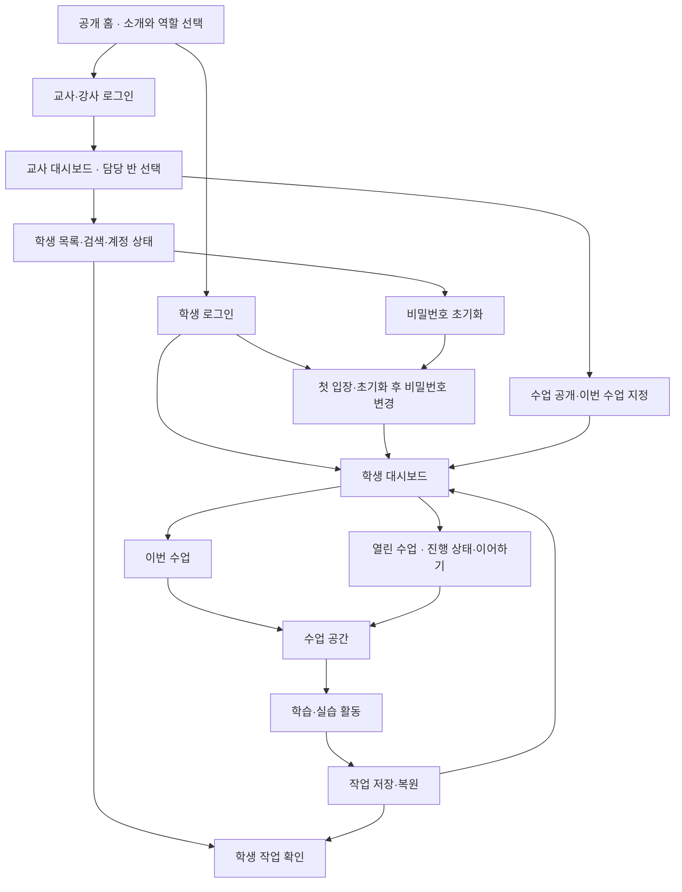

# CS Class 제품 방향

갱신: 2026-09-28. 기존 합의를 통합한 문서이며, 합의와 구현 완료는 다릅니다. 실제 구현 상태는 [README](../README.md)에 있습니다.

## 목적과 첫 범위

**CS Class · 즐거운 정보 교실**은 설치 없이 브라우저로 시작하는 중학교 정보 학습 공간입니다. 학생이 생각을 표현하고 실행·수정하며 완성의 경험을 얻고, 교사는 불필요한 입력·채점 부담 없이 수업을 운영하도록 돕습니다.

현재 개발 우선순위는 공개 홈·학생/교사 입장 첫 화면과 실제로 동작하는 플랫폼입니다. 수업 콘텐츠는 나중에 채웁니다. 향후 첫 적용은 한 반의 일반 학습, 첫 모듈 후보는 순서도 연구소입니다. 수행평가의 도움·채점 기준과 기존 평가 자료 이관은 후속 논의입니다. 수업 시간이나 단계 수를 고정하지 않고 실제 화면과 수업 경험으로 다듬습니다.

## 개발 순서와 명세 진행

- **사용자 방향:** 계정·입장·반 관리·수업 배정 등 플랫폼 기능을 완성도 있게 마련한 뒤 수업을 순차적으로 추가합니다. 사용자가 구현 진행을 승인했고 공통 기반과 학생·교사 화면을 구현했습니다. 클라우드 합성 계정 왕복과 전체 E2E를 통과했고 실제 허용 Google 계정으로 로컬 교사 대시보드에 들어가는 흐름도 사용자와 브라우저에서 확인했습니다. 교사가 수업 준비·운영을 병행할 수 있는 개발·유지보수 규모를 고려합니다.
- **개발 순서 제안:** 플랫폼 동작 규칙 → 수업을 식별하고 작업을 저장·복원하는 최소 연결 규칙 → 실제 계정·권한·대시보드 → 작은 활동으로 전체 흐름 검증 → 기반 안정화 → 정식 수업 순차 추가입니다. 실제 계정·저장과 작은 검증용 활동까지 연결하는 1차 완료 목표는 아래에서 확정했으며, 개념 2개·퀴즈 3문항·순서 배열 실습 1개를 검증용 수업으로 구현했습니다. 정식 콘텐츠는 이후 추가합니다.
- 학생·교사의 수업 준비 → 입장 → 활동 → 저장·이어하기 → 교사 확인 흐름을 기준으로 범위를 정합니다. 수업마다 공통 계정·반·저장을 다시 만들지 않되, 모든 수업을 위한 범용 편집기나 고정된 세 단계를 미리 강제하지 않습니다.
- 기능 명세에는 진입 목적, 표시 정보, 사용자 행동, 저장·반영 결과, 빈 상태·오류·권한 경계를 기록합니다. 확정 정책은 이 문서에 모으고, 제안·미결정·구현 상태는 구분합니다. 다음 논의 지점은 [HANDOFF](HANDOFF.md)에 연결합니다.

### 1차 구현 완료 목표 — 실제 계정과 저장 연결

- **사용자 선택:** 구현 방식 협의에서 A안인 `실제 계정·저장까지 연결한 작은 버전`을 선택했습니다. 대시보드 화면은 중간 결과이며, 예시 데이터로 화면만 동작하는 상태를 이번 구현의 완료로 간주하지 않습니다.
- **완료할 흐름:** 학생·교사가 실제 계정으로 로그인하고, 교사가 담당 반의 이번 수업을 지정하며, 학생이 해당 수업의 작은 검증용 활동을 진행합니다. 학생별 작업·진행 기록을 서버에 저장하고, 재접속 후 본인의 기록과 이어갈 위치를 복원합니다.
- **기존 정책 적용:** 로그인·역할과 반별 권한·작업 보존·단계별 완료에 관해 이미 합의한 정책을 유지합니다. 저장 실패를 성공으로 표시하지 않고 다른 학생·담당 밖 반의 비공개 기록에 접근하지 못하는지도 검증합니다.
- **검증용 수업 확정:** 사용자는 개념 2개·퀴즈 3문항·간단한 순서 배열 실습 1개로 전체 흐름을 검증하는 안을 선택했습니다. 저장·이어하기·완료 규칙을 확인하기 위한 작은 수업이며 설명·문항은 현재 공통 카탈로그에 구현했습니다. EntryJS와 AI는 이후 연결합니다.
- **서비스 대상과 후속 범위:** 사용자가 새 Firebase 프로젝트 `cs-class-f74c4` 사용을 승인했습니다. AI·EntryJS·Q&A·정식 콘텐츠는 후속 작업입니다. 월 4만 원은 참고 예산이며 구매·배포나 실학생 일괄 등록 승인은 아닙니다.
- **협업 방식 확정:** 사용자는 메인 에이전트가 공통 구조·데이터 규칙·통합을 맡고, 공통 기반 마련 후 학생·교사 화면을 서브에이전트 2명에게 나누는 방식에 동의했습니다. [작업 지시문](BUILD_BRIEF.md)에 공통 준비 조건·파일 담당 범위·입출력·완료 조건을 정리합니다. 공통 계약을 전달한 뒤 학생·교사 담당 에이전트의 구현과 개별 검증을 마쳤으며 메인이 전체 E2E 27개를 포함한 통합 검증을 완료했습니다.
- **현재 단계:** 사전 메타프롬프팅과 진행 표시 협의를 마친 뒤 사용자가 완성도 있게 구현해 달라고 승인했습니다. 로그인·서버 권한·개인 저장 API·대시보드·검증용 수업을 구현했고 승인된 클라우드에서 합성 계정의 로그인·저장·재접속·제출 조회 왕복을 검증했습니다. 최종 lint·typecheck·build와 프로덕션 빌드·로컬 에뮬레이터를 사용하는 CI 방식 전체 E2E 27개를 통과했습니다. 실제 허용 Google 계정으로 `localhost`에서 로그인해 교사 대시보드에 진입한 것을 사용자와 브라우저에서 확인했습니다. 호스팅 환경 검증은 후속 작업입니다. 최신 근거와 남은 작업은 [HANDOFF](HANDOFF.md)에 기록합니다.

## 논의용 화면 지도

합의한 목표 구조를 반영한 화면 지도입니다. 각 상자는 별도 페이지 또는 화면 안의 영역·상태입니다. 아래 로그인·수업 운영·검증용 활동·저장·교사 조회 경로를 구현했고, 별도 지난 활동 영역은 열린 수업에 통합했습니다. 연결선은 검증 완료를 뜻하지 않으며 클라우드 환경의 최종 검증 상태는 HANDOFF를 따릅니다.

공개 수업 소개 경로 `/explore/[id]`도 현재 시안에 있으나 준비 안내 수준입니다. 공개 홈에서의 연결과 역할은 추후 검토합니다. 현재 코드 위치와 실행 상태는 [README](../README.md)와 HANDOFF를 따릅니다.

## 합의한 첫 경험

| 영역 | 방향 |
|---|---|
| 공개 화면 | 주제와 예시를 둘러보며 호기심을 느끼는 공간 |
| 로그인 후 | 학생은 본인 학습 대시보드, 교사는 담당 반 관리 화면 |
| 학생 홈 | 위에 **이번 수업**, 아래에 **진행 상태·이어하기가 있는 열린 수업 목록**. 별도 지난 활동 영역은 열린 수업에 통합 |
| 이번 수업 지정 | 교사가 반별로 직접 지정하며 바꾸기 전까지 유지 |
| 수업 공개·복습 | 반 전체에 공개하고, 이미 열린 수업은 자유롭게 복습 |
| 초기 제외 | 학생별 보충·심화 배정, 공지, 교사 수업 내용 편집기 |

## 학생 대시보드와 수업 전환

2026-09-28 기능 명세 논의에서 합의한 방향이며 현재 학생·교사 화면과 공통 저장 API에 반영했습니다.

- 교사가 이번 수업을 바꾸면 학생 대시보드의 우선 안내가 새 수업으로 바뀝니다. 이번 수업 변경만으로 이전 수업의 공개를 해제하거나 학생 작업을 삭제하지 않습니다. 이전 수업은 열린 수업에 유지하고 해당 수업 카드에서 기존 작업을 이어갈 수 있게 합니다.
- 학생이 다른 수업을 진행 중이면 작은 변경 안내와 새 수업으로 이동하는 버튼을 제공합니다. 강제로 화면을 전환하지 않고 학생이 직접 이동합니다.
- 수업을 이동해도 기존 작업을 보존합니다. 활동 중 저장 원칙에 더해, 이동 전 최신 변경 내용의 서버 저장 성공을 확인합니다. 변경이 없고 최신 저장이 확인된 경우 같은 내용을 다시 저장하지 않습니다. 저장에 실패하면 현재 작업을 유지하고 재시도를 안내하며, 저장 완료로 표시하거나 작업을 버린 채 이동하지 않습니다.
- **표시 명칭은 `이번 수업`으로 확정했습니다.** `실시간 수업`·`지금 수업`으로 바꾸지 않습니다. 수업 시작·종료를 관리하는 실시간 진행 기능을 뜻하지 않습니다.
- **목록 구성 확정:** 위에 `이번 수업`, 아래에 `진행 상태와 이어하기가 있는 열린 수업 목록`을 둡니다. 별도 지난 활동 영역을 열린 수업에 통합하고, 학생이 수업별 진행 상태를 보며 자율적으로 이어가게 합니다. 기존 작업과 이어갈 위치는 보존합니다. 단계별·단원 전체 완료는 [수업 단계와 완료 기준](#수업-단계와-완료-기준)을 따릅니다. 기본 활동만 완료 조건에 포함합니다. 단계는 퍼센트와 완료 수, 전체는 `시작 전 / 진행 중 / 완료`로 표시하기로 확정했습니다. 방문 기록을 실제 학습 진행률로 간주하지 않습니다.

### 열린 수업과 지난 활동 통합 — 구성·진행 표시 확정

- **합의 배경:** 두 영역에 같은 수업이 중복되고, 어떤 수업을 지난 활동에 넣을지 기준이 모호하다는 사용자 제안에서 시작했습니다. 2026-09-28 다른 PC에서 논의를 재개한 뒤 사용자가 `이번 수업 + 진행 상태와 이어하기가 있는 열린 수업 목록` 방향에 동의했습니다. 목록 통합 뒤 단계별 퍼센트·완료 수와 전체 상태 표시도 사용자와 확정했습니다.
- **세부 표시 확정:** 수업 전체는 `시작 전 / 진행 중 / 완료`, 각 단계는 퍼센트와 완료 수를 표시합니다. 구현된 카드 행동은 `수업 시작 / 이어하기 / 다시 보기`입니다. 전체 퍼센트를 단계별 퍼센트의 단순 평균으로 만들지 않습니다.
- **완료 기준:** 개념·퀴즈와 실습의 검증·제출 원칙, 기본 활동만으로 단원을 완료하는 기준은 아래에서 합의했습니다. 샘플 실습의 순서 검사 항목은 구현했고 EntryJS 등 정식 실습의 검사 항목은 후속 설계합니다. 방문 횟수나 페이지를 연 비율을 이해도·완료율로 표시하지 않습니다. 진행률에는 완료한 개념·문항·과제 수처럼 근거를 함께 보여주는 방향입니다. 구체적인 개수는 수업마다 정합니다.
- **현재 목록과 후속 사항:** 이번 수업도 열린 수업 목록에 포함하되 표시로 구분합니다. 전체·미완료·완료 필터와 수업 미지정·빈 상태를 구현했습니다. 1차에서는 한 번 공개한 수업을 닫지 않습니다. 향후 공개 해제 시 기존 작업 접근과 여러 작품 중 이어갈 작업 선택은 별도 설계합니다. 완료한 수업은 복습할 수 있으며 제출 후 수정 시 기존 제출본·완료 기록을 유지합니다.
- **후속 논의:** 교사의 학생별 단계 진행·제출 작품 확인은 1차 구현에 포함했습니다. 도움 개입·확인 요청의 상세 운영과 EntryJS 실습 자동 검사 범위는 후속 설계합니다.

## 대시보드 탐색과 우리 반 질문 — 구성 제안

- **사용자 요청:** 2026-09-28 제공한 참고 이미지의 좌측 메뉴·카드 구성을 학생·교사 대시보드에 맞게 응용합니다. 자세한 도구는 메뉴로 접근하고, 같은 수업을 공유하는 반 안에서 커뮤니티·Q&A를 활용하는 방향을 검토합니다. 기존 홈 스타일과 학생 홈의 `이번 수업 + 열린 수업` 구성을 유지합니다.
- **배치 제안:** 데스크톱은 좌측 메뉴와 넓은 본문, 상단의 현재 반·계정 맥락으로 구성합니다. 학생은 이번 수업과 단계별 진행·이어하기, 교사는 담당 반의 진행 상황·검토 요청·미답변 질문을 우선합니다. 모바일에서는 메뉴를 접고 본문을 한 열로 보여줍니다. 참고 이미지의 출석·성적 차트·일정·다운로드를 장식용 기능으로 추가하지 않습니다.
- **메뉴 제안:** 학생은 `대시보드 / 열린 수업 / 우리 반 질문`, 교사는 `수업 현황 / 수업 관리 / 학생 관리 / 우리 반 질문`을 출발점으로 합니다. 계정 조작은 하단에 묶고, EntryJS 실습 중에는 작업 공간을 넓게 쓸 수 있도록 탐색 영역을 축소하는 방향을 검토합니다. 최종 명칭·배치는 아직 확정하지 않았습니다.
- **Q&A 구성 제안:** 반과 수업에 연결된 `우리 반 질문`으로 시작합니다. 수업 화면에서 질문하면 수업 맥락을 붙이고, 같은 반 학생이 질문·답변을 보며 `나도 궁금해요`로 같은 질문에 참여할 수 있습니다. 학생 작품 검토 요청은 개인 작업에 연결된 별도 흐름이며 게시판에 자동 공개하지 않습니다.
- **Q&A 답변 주체 확정:** 사용자는 같은 반 학생과 교사가 모두 답변하는 방식에 동의했습니다. 학생끼리 설명하고 교사가 답변·보충할 수 있으며, 교사 답변은 교사가 작성했음을 구분해 표시합니다. 교사·강사의 접근은 기존 담당 반 권한을 따릅니다. 교사의 게시글 숨김·관리 동작은 후속 설계합니다.
- **Q&A 해결 상태 확정:** 질문한 학생과 해당 반에 권한이 있는 교사 모두 질문을 `해결됨`으로 바꾸거나 다시 열 수 있습니다. 답변이 등록됐다는 이유만으로 자동 해결하지 않습니다. 해결됨은 질문자의 궁금증이 해소됐다는 표시이며, 게시된 모든 답변의 정답 여부를 공식 승인한 상태를 뜻하지 않습니다.
- **커뮤니티 확장 제안:** 작품 공유·댓글은 이후 사용 경험을 보고 검토합니다. 작품 공유를 도입하더라도 학습용 제출과 공개 공유를 분리하는 방향을 제안합니다. 자유게시판·실시간 채팅·알림 기능은 아직 합의하지 않았습니다.
- **구현 상태:** 학생·교사 대시보드와 서버의 반별 권한·학습 기록 조회를 구현했습니다. 초기 대화용 시안의 예시 데이터와 구분합니다. Q&A의 게시글 저장·답변·해결 처리는 후속 연결이며 현재 작동하는 기능으로 표시하지 않습니다.

### 교사 대시보드의 1차 범위

2026-09-28 메타프롬프팅 협의에서 사용자는 **반 선택·이번 수업 지정·학생별 단계 진행·제출 작품 보기·계정 관리**까지 1차에 포함하는 안을 선택했습니다. 수업 설정·계정 관리만 만들고 진행·작품 조회를 뒤로 미루지 않습니다.

- 교사·강사는 기존 담당 반 권한 안에서 반을 선택하고 이번 수업을 지정합니다.
- 학생별 개념·퀴즈·실습 진행과 제출된 작품을 확인합니다. 학생과 교사 화면은 같은 학습 기록·완료 규칙을 사용하며 방문 기록을 진행률로 바꾸지 않습니다.
- 계정 관리는 합의된 학생 검색·비밀번호 초기화·변경 필요 상태를 포함합니다. 실제 초기화 성공과 학습 기록 보존을 확인합니다.
- 반·수업 선택, 단계별 진행 표, 제출 작품 확인과 계정 관리 화면을 구현했습니다. 단계는 퍼센트·완료 수, 전체는 시작 전·진행 중·완료로 표시합니다. 학생 작업을 교사가 대신 수정하거나 완료시키는 일반 기능을 새로 합의한 것은 아닙니다. AI 검증의 예외 승인 정책은 해당 기능을 연결할 때 따릅니다.

## 수업 단계와 완료 기준

2026-09-28 사용자는 V1처럼 `개념–퀴즈–실습`의 진행률을 각각 측정하고 모든 단계가 100%이면 수업 완료로 처리하는 구상을 설명했습니다. 이를 바탕으로 **개념 학습·퀴즈 흐름, 실습의 검증 후 제출, 기본 활동만으로 단원을 완료하는 원칙과 제출 후 수정 정책을 합의했습니다.** 모든 수업에 고정된 세 단계를 강제하지 않는 기존 방향은 유지합니다. 단계는 퍼센트와 완료 수를 표시하고 전체는 `시작 전 / 진행 중 / 완료`로 표시하며, 단계별 수치의 평균을 전체 퍼센트로 만들지 않기로 확정했습니다.

### 단원 완료와 심화 도전

- **단원 완료:** 해당 수업의 필수 기본 활동을 모두 완료하면 단원 완료입니다. 개념·퀴즈·실습으로 구성한 수업은 각 단계의 필수 활동이 모두 100%여야 합니다. 퀴즈를 남겨 두고 실습을 먼저 마친 경우 실습만 완료이며 단원은 진행 중입니다.
- **선택 활동 제외:** 선택·심화 도전은 기본 활동의 완료 조건과 진행률 집계 대상에서 제외합니다. 기본 활동을 모두 마친 학생은 심화를 하지 않아도 단원 완료이며, 이후에도 심화 도전에 참여할 수 있습니다. 심화의 진행·통과 여부는 기본 완료와 구분합니다.
- **운영 아이디어:** 사용자는 심화 도전까지 통과한 학생에게 자유시간을 주는 방안을 긍정적으로 제안했습니다. 단원 완료와 별도의 수업 운영 방안으로 기록하며, 심화의 구체적인 통과 조건·자유시간 허용 절차·자동 처리 여부는 아직 정하지 않았습니다. 학생별 심화 배정 기능을 새로 합의한 것은 아닙니다.

### 개념 학습

- 의미 있는 개념 묶음마다 설명·예시 바로 아래에 짧은 **개념 확인** 문항을 둡니다. 묶음당 1개를 출발점으로 하며 실제 개념·문항 수는 콘텐츠에 맞춰 정합니다.
- 학생이 답을 선택하고 확인하면 피드백을 제공합니다. 정답은 짧은 해설과 함께 해당 개념 완료로 처리합니다. 오답은 힌트나 설명을 보고 재도전하며, 시도 횟수 제한이나 감점은 두지 않습니다.
- **재도전을 포함해 필수 개념 확인 문항을 모두 해결하면 개념 단계가 자동으로 100%가 됩니다.** 응답만 하거나 정답 설명을 열기만 한 상태를 해결로 간주하지 않습니다. 별도 `학습했어요` 버튼은 두지 않습니다.
- 마지막 문항을 해결해도 자동으로 화면을 넘기지 않습니다. 학생이 해설을 읽고 `퀴즈로 이동` 등 다음 행동을 직접 선택합니다. 완료 전에도 다른 개념을 자유롭게 살펴볼 수 있습니다.
- `개념 4개 중 3개 확인 완료`처럼 완료 수와 전체 수를 표시하고 남은 개념으로 이동할 수 있게 합니다. 개념 100%는 확인 활동을 마쳤다는 기록이며, 이해도나 성적 100점을 의미하지 않습니다.
- 개념 확인은 방금 읽은 한 개념을 확인하고, 별도 **퀴즈**는 여러 개념을 구분하거나 새로운 상황에 적용합니다. 동일한 문항을 두 단계에서 반복하는 구성을 기본으로 삼지 않습니다.

### 퀴즈

- 처음에는 전체 문항을 한 차례 풀고 답을 확인합니다. 그다음은 틀린 문항만 모아 다시 풀며, 새로 맞힌 문항도 재도전 대상에서 제외합니다. 모든 문항을 해결할 때까지 남은 오답에 재도전할 수 있습니다.
- **재도전 힌트는 기본으로 접어 두고 학생이 필요할 때 `힌트 보기`로 엽니다.** 짧게 생각할 방향을 안내하며, 힌트 사용 때문에 완료나 진행률에 불이익을 주지 않습니다.
- 진행률은 **전체 문항 중 지금까지 정답으로 해결한 문항의 비율**입니다. 이번 재도전의 정답률로 분모를 바꾸지 않습니다. `6문제 중 4문제 해결`처럼 근거를 함께 표시하고, 모든 문항을 해결하면 퀴즈를 자동 완료·100%로 처리합니다.
- **첫 풀이·재도전 도중에도 실습으로 이동할 수 있습니다.** 퀴즈 완료 여부로 실습 진입을 막지 않으며, 실습으로 이동했다고 퀴즈를 완료 처리하지 않습니다. 기존 합의대로 최신 작업의 저장을 확인한 뒤 이동합니다.
- 맞힌 문항의 해결 상태와 진행 중인 풀이를 보존합니다. 아직 답하지 않은 문항을 오답으로 처리하지 않으며, 다시 돌아오면 중단한 풀이를 이어갑니다. 채점 후 틀린 문항은 재도전 대상으로 남깁니다. 이어하기에 필요한 상태와 별개로 성적·시도 횟수 등의 추가 통계 수집은 아직 확정하지 않았습니다.
- **세부 제안:** 한 차례 풀이 후 결과·해설을 함께 보여주고, 재도전 버튼은 `틀린 문제 다시 풀기`로 표현합니다. 완료 후 전체 문항을 다시 보는 선택 복습과 기존 완료 상태 유지도 제안했으며, 구체적인 복습 동작은 후속 논의합니다.

### 실습 검증과 제출

- **공통 완료 기준:** `검증 통과 → 학생이 제출 → 제출 저장 성공 시 완료`입니다. 검증 통과만으로 완료 처리하지 않습니다. 검사 후 작품 내용을 수정하면 변경한 작품으로 다시 검증하며, 제출 실패 시 작품을 보존하고 재시도를 안내합니다.
- **제출 후 수정·재제출:** 제출 후에도 작품을 수정할 수 있으며, 기존 제출본과 완료 기록을 유지한 채 수정본을 별도로 저장합니다. 수정하는 순간 실습·단원 완료를 취소하지 않습니다. 수정본을 다시 제출할 때는 해당 내용으로 재검증하고 제출 저장에 성공해야 새 제출본으로 반영합니다. 수정본의 검증 실패·확인 대기·저장 실패로 기존 완료 기록을 취소하거나 기존 제출본을 덮어쓰지 않습니다. 화면에서는 제출된 작품과 아직 제출하지 않은 수정 내용을 구분합니다.
- **정답이 있는 실습:** 과제의 명시된 실행·구조 조건을 자동 검사하고 통과한 작품을 학생이 제출하면 완료합니다. 샘플 수업은 시작·이름 입력·인사말 만들기·출력·종료의 순서를 검사합니다. 정식 과제별 검사 항목은 후속 설계합니다.
- **자유 제작:** 프로그램으로 확인할 수 있는 기본 조건을 검사하고 AI가 과제의 최소 요건을 확인한 뒤 제출할 수 있게 합니다. 단순히 너그럽게 판단하라는 지시 대신 과제 주제와 작품의 관련성·핵심 조건 등 좁고 명확한 기준을 사용합니다. 필수 조건은 제작 전에 학생에게 보여줍니다.
- AI는 학생 나름의 타당한 풀이를 인정합니다. 표현·배치가 투박하거나 더 좋은 풀이가 있다는 이유만으로 제출을 막지 않고 개선 의견으로 안내합니다. 핵심 조건을 명백하게 빠뜨렸다면 필요한 수정을 구체적으로 알립니다.
- **예외 경로:** AI가 판단하기 어렵거나 검증 서비스에 오류가 나면 작품을 보존하고 `선생님 확인 요청`으로 보낼 수 있습니다. 요청한 상태는 확인 대기이며, 권한이 있는 교사가 해당 작품을 확인·승인하면 완료합니다. AI 오류를 학생의 오답이나 자동 통과로 처리하지 않습니다. 확인 요청 후 수정·재요청과 교사 화면의 세부 동작은 후속 설계합니다.

### EntryJS 실습 방향과 기술 검토

- 사용자는 앞으로 실습의 대부분을 **EntryJS 기반 블록코딩**으로 만들 계획이라고 설명했습니다. 이 방향과 자동채점 가능성을 검토하며, 모든 과제 종류·사용 버전·설치·구현·외부 연결을 확정한 것은 아닙니다.
- **공식 문서·소스 확인:** [핵심 API](https://docs.playentry.org/entryjs/api/2024-02-29-api.html)는 프로젝트 내보내기·불러오기와 실행·중지 이벤트를 제공합니다. [Object Data](https://docs.playentry.org/entryjs/typedef/2024-03-15-object-data.html)에는 블록 스크립트가 포함되며, [실행 엔진 소스](https://github.com/entrylabs/entryjs/blob/develop/src/class/engine.js)에는 실행·중지와 오브젝트·변수 상태 복원 처리가 있습니다. 이를 이용해 과제별 구조 검사와 실행 결과 검사를 추가할 수 있다는 기술적 판단입니다. CS Class에 연동하거나 실제 채점 실험을 완료한 것은 아닙니다.
- **구현 방향 제안:** 조건이 명확한 문제는 여러 입력·기대 결과로 검사하고, 반복·조건 블록 사용 등 학습 목표가 있을 때 구조 검사도 결합합니다. 블록을 놓았는지만 보거나 모범답안의 블록 배열과 일치해야 통과하도록 만들지 않습니다. 자유 제작은 기본 자동 검사와 AI 최소 요건 확인, 교사 예외 경로를 조합합니다.
- **구현 전 검증:** 고정한 EntryJS 버전에서 검사마다 초기 상태 복원, 입력 공급, 실행 중 결과 수집, 시간·실행량 제한을 검증합니다. 현재 소스의 중지 처리는 변수·오브젝트를 실행 전 상태로 되돌리므로 결과를 수집하는 시점을 확인해야 합니다. 난수·시간·키보드·충돌 등 상호작용이 있는 과제는 재현 가능한 별도 검사 시나리오가 필요합니다. 브라우저의 통과 표시와 서버의 제출·완료 판정을 연결하는 방식, 실행 환경·비용은 아직 미정입니다.

### 다음에 정할 것

- **실습 구현 준비:** EntryJS에서 우선 지원할 과제 유형과 검사 조건, 작은 검증 예제를 정합니다. 정식 수업 내용·교사 콘텐츠 편집기·검사 도구 구현을 임의로 시작하지 않습니다.
- **수업 전체 표시 확정:** 기본 활동만 완료 조건에 포함하고 제출 후 수정 시 완료를 유지합니다. 단계별 퍼센트·완료 수와 전체 `시작 전 / 진행 중 / 완료`를 사용하며 전체 평균 퍼센트는 표시하지 않습니다. 완료 후 선택 복습의 확장은 후속 설계입니다.
- **교사 운영:** 학생별 단계 진행·제출 작품 조회는 위 1차 범위에 포함하기로 확정했습니다. 구체적인 표시·확인 요청·도움 개입과 심화 도전 통과 후 자유시간 운영은 후속 논의합니다.

## 학생 계정과 반 배정 — 인증 구현, 실학생 등록 후속

- 교사가 준비한 스프레드시트의 시트별 명단으로 계정을 등록하고 반을 함께 배정합니다. 학생의 직접 회원가입·반 코드 입력 없이 배정된 반으로 입장합니다.
- 로그인 아이디는 전체 학생 사이에서 중복되지 않는 학번입니다. 실명·이메일 없이 사용하는 사전 발급 계정이며, 학습 기록은 학생별로 구분합니다.
- 최초 발급과 교사 초기화에는 서로 다른 공통 비밀번호를 사용합니다. 첫 로그인 및 교사 초기화 후에는 새 비밀번호 설정을 완료해야 학생 홈으로 진입합니다. 초기화해도 기존 학습 기록은 보존합니다. 구체적인 동작은 아래 [로그인 정책](#로그인-정책)을 따릅니다.
- **등록 양식 초안:** 학생 계정 등록 엑셀(초기 비밀번호가 있어 Git 제외, 원래 PC의 위치는 HANDOFF 참고). 한 파일에 한 학년, 시트명은 `1반`, `2반` 형식이며 첫 행은 `번호`, `학번`, `비밀번호`입니다. 2학년 1~11반에 각각 27명(총 297명), 학번은 학년 1자리·반 2자리·번호 2자리로 채웠고 비밀번호 열은 요청한 공통 초기값을 사용합니다. 학번은 앞자리 0을 보존하는 텍스트로 입력합니다. 초기 비밀번호는 파일에서 읽습니다. 학년도·학년은 초기 등록 시 확인하는 방향입니다.

- **초기 일괄 등록 기준 제안:** A~C열을 등록 자료로 읽고 안내 영역은 제외합니다. 완전히 빈 행은 건너뛰되 번호·학번·비밀번호 중 하나라도 빠지면 누락으로 표시합니다. 반 안의 번호 중복·파일 전체 학번 중복·기존 계정 충돌을 미리 보여주며, 재실행으로 기존 계정이나 비밀번호를 덮어쓰지 않습니다. 관리용 스크립트로 미리 등록하고 교사 명단 업로드 화면은 초기 범위에서 제외하는 방향이며, 아직 미구현입니다. 비밀번호 원문은 일반 DB·로그에 보관하지 않으며 계정 자료 파일은 Git에서 제외합니다. 현재 인증은 Firebase의 비밀번호 계정을 내부 식별자에 연결하며 익명 인증을 사용하지 않습니다. 실제 학생 계정 등록은 아직 하지 않았습니다.

## 교사 인증과 권한 — 서버 권한 구현, 로컬 Google 로그인 확인

- 선생님은 본인 Google 계정으로 로그인하고 전체 반을 관리하는 방향입니다. 지정된 계정만 관리자 권한을 받습니다.
- 강사님은 고정된 일반 계정에 비밀번호만 입력하는 로그인 방향입니다. **접근 가능 범위는 2학년 10·11반으로 확정**했습니다.
- 강사님의 학생 조회·학습 기록 조회·수업 운영·비밀번호 초기화는 모두 담당 두 반에 한정합니다. 다른 반 접근과 교사 권한 변경은 허용하지 않습니다.
- 화면뿐 아니라 서버와 직접 DB 접근에서도 동일한 범위를 강제합니다. 초기화는 서버에서 권한·대상 반을 확인한 뒤 처리하고 학생의 다음 로그인에 비밀번호 변경을 요구합니다.
- **인증 구현:** Firebase Authentication과 서버 세션, Firestore의 역할·반·변경 필요 상태를 연결했습니다. 교사 Google 허용 목록과 서버 자격 증명은 Git 제외된 `.env.local`에서 관리합니다. 승인된 `cs-class-f74c4`에서 이메일·비밀번호 및 Google 제공자 활성화, 2학년 1~11반의 빈 반 준비와 Firestore 보안 규칙 배포를 확인했습니다. 임시 합성 계정으로 실제 Auth 로그인·수업 지정·학습 검증과 제출·재로그인 복원·교사 제출 조회 및 익명 Firestore 요청 거부(403)를 검증했습니다. 시험 계정 2개·작업·요청 제한 기록을 삭제하고 시험 반을 빈 설정으로 복원했습니다. 실학생은 등록하지 않았습니다. 제공자 설정·에뮬레이터 토큰 교환 검사에 더해 실제 허용 Google 계정으로 `localhost`에서 로그인하고 교사 대시보드로 진입한 것을 사용자와 브라우저에서 확인했습니다. 담당 반 11개와 등록 학생 0명 상태를 확인했으며 운영 주소의 실제 Google 로그인·교사 대시보드 조회도 확인했습니다. 연결 절차는 [Firebase 설정 안내](FIREBASE_SETUP.md)를 따릅니다.

## 로그인 정책

2026-09-28 대화에서 합의한 제품 요구사항입니다. 실제 인증·서버 세션·반별 권한을 구현했으며 에뮬레이터에서 실패·권한 경계를 검증했습니다. 클라우드의 합성 계정 왕복 검증도 통과했습니다. 전체 E2E 27개를 통과했으며 실제 교사 Google 팝업 로그인과 브라우저 종료·복원의 검증 범위는 HANDOFF를 따릅니다.

### 학생 비밀번호와 초기화

| 항목 | 확정 정책 |
| --- | --- |
| 개인 비밀번호 | 6자 이상이며 영문과 숫자를 각각 1개 이상 포함합니다. 특수문자는 필수가 아닙니다. |
| 공통 비밀번호 | 최초 발급용과 초기화용을 서로 다른 값으로 관리합니다. 개인 비밀번호로 두 공통값을 재사용할 수 없습니다. |
| 최초 입장 | 최초 발급용 비밀번호로 인증한 뒤 개인 비밀번호 설정을 완료해야 학생 대시보드로 진입합니다. |
| 분실·초기화 | 교사·강사가 권한 범위 안의 해당 학생만 초기화용 공통 비밀번호로 변경합니다. 학생별 임시 비밀번호 발급 방식은 채택하지 않습니다. |
| 기존 접속 | 초기화 성공 시 해당 학생의 기존 로그인을 종료하고 서버 접근 권한도 무효화합니다. |
| 초기화 후 입장 | 초기화용 비밀번호로 인증한 뒤 개인 비밀번호를 새로 설정해야 합니다. |
| 교사 화면 상태 | 초기화 후에는 `비밀번호 변경 필요`를 표시합니다. 학생의 실제 변경 성공 후 표시를 해제하고 정상 상태로 갱신합니다. 로그인하거나 변경 화면을 여는 것만으로 해제하지 않습니다. |
| 기록·비밀번호 표시 | 비밀번호 초기화와 변경은 학습 기록을 삭제하지 않습니다. 교사에게 학생의 개인 비밀번호를 표시하지 않습니다. |

공통 초기화 방식은 전달 편의성을 우선한 합의입니다. 공통값이 알려지면 초기화된 계정에 다른 학생이 먼저 입장할 위험은 남습니다. 실제 비밀번호와 대화에서 나온 예시 문자열은 이 문서·코드·로그에 기록하지 않고 별도 설정으로 관리합니다. 초기화용 실제 값은 아직 확정하지 않았습니다.

### 로그인 유지와 종료

학생은 공용 공간의 학교 PC를 번갈아 사용합니다. 학교 PC의 롤백 기능이 있더라도 컴퓨터를 켜 둔 경우의 접속은 아래 정책으로 처리합니다.

| 상황 | 확정 정책 |
| --- | --- |
| 화면 이동·새로고침 | 로그인 상태를 유지합니다. |
| 브라우저 종료 후 다시 접속 | 다시 로그인을 요구합니다. 브라우저의 이전 세션 복원에 대한 구현·검증 사항은 아래에 별도 기록합니다. |
| 학생 무활동 | 마지막 실제 활동부터 10분이 지나면 자동 로그아웃합니다. 쉬는시간표와 연동하지 않습니다. |
| 학생 종료 예고 | 9분 무활동 시 `1분 후 자동 로그아웃돼요.` 안내와 `계속 사용하기` 버튼을 표시합니다. 계속 사용하거나 실제 조작을 하면 시간을 갱신합니다. |
| 교사·강사 무활동 | 마지막 실제 활동부터 4시간이 지나면 자동 로그아웃합니다. 로그인 후 고정 4시간이 아니라 무활동 기준이며 사용 중에는 시간을 갱신합니다. |
| 활동의 의미 | 클릭·입력·스크롤·터치 등 사용자의 실제 조작입니다. 애니메이션·자동 저장·백그라운드 통신은 활동으로 계산하지 않습니다. |
| 명시적 로그아웃 | 로그인 화면으로 이동하고 이전 사용자의 화면·작업 내용이 다음 사용자에게 노출되지 않도록 처리합니다. |
| 저장된 기록 | 로그아웃해도 서버에 저장된 작업은 유지하며 본인이 다시 로그인하면 이어갈 수 있습니다. 미전송 작업까지 저장됐다고 간주하지 않습니다. |

### 동일 계정의 중복 로그인

- 학생·교사·강사 모두 동일 계정의 동시 접속은 허용하지 않습니다. **새로운 로그인에 성공하면 새 접속을 유지하고 기존 접속을 종료합니다.** 로그인 실패는 기존 접속에 영향을 주지 않습니다.
- 기존 접속에는 `다른 곳에서 로그인되어 로그아웃됐어요.`를 안내하고 로그인 화면으로 이동합니다. 화면 전환뿐 아니라 기존 세션의 서버 조회·저장 권한도 무효화합니다.
- 서버에 저장된 학습 기록은 보존합니다. 동일 브라우저의 여러 탭은 같은 서버 세션과 활동 시간을 공유합니다. 미저장 초안은 사용자·수업별 메모리에만 임시 보관하며 세션 종료·계정 교체 때 지웁니다. 종료 전에 전송하지 못한 입력까지 복원되는 것은 아닙니다.

### 연결·운영 전 확인과 검증

- 브라우저 종료 후 재로그인은 제품 요구사항입니다. 세션 쿠키 등 종료 시 삭제되는 저장 방식만으로 브라우저의 이전 세션 복원까지 항상 차단된다고 가정하지 않습니다. 학교에서 쓰는 브라우저의 일반 종료·창 복원·비정상 종료 후 복원을 확인하고, 요구사항을 충족하지 못하는 경우 보완 방식과 한계를 명시합니다. [브라우저 세션 복원 참고](https://developer.mozilla.org/en-US/docs/Web/HTTP/Guides/Cookies#creating_removing_and_updating_cookies)
- 반복 로그인 시도 제한과 여러 탭의 실제 활동 시간 공유를 구현했습니다. 운영 사용량에서 제한과 재시도 안내를 확인하고, 교사·강사 만료 전 별도 안내 방식은 후속 검토합니다.
- 타이머나 화면 표시만으로 권한을 판단하지 않습니다. 초기화·만료·중복 로그인 후 서버와 직접 DB 접근 경로에서도 권한이 종료되는지 확인합니다.
- 실패한 비밀번호 변경은 변경 필요 상태를 해제하지 않아야 합니다. 초기화·변경 성공 여부와 교사 화면 상태가 일치하고 학습 기록이 유지되는지 확인합니다.
- 새로고침 유지, 역할별 무활동 만료, 종료 예고와 연장, 자동 저장이 만료 시간을 연장하지 않는 경우, 새 로그인 성공·실패의 기존 접속 영향, 재접속 후 작업 복원을 검증합니다.

## 작업 저장과 통신 비용

2026-09-28 합의한 설계 기준입니다. **종료 순간에만 저장하지 않고 활동 중에 저장하며, 저장 안정성과 서버 통신 비용을 함께 고려합니다.** 유료 요금제 사용 가능성은 열어 두되 Vercel·Firebase의 불필요한 사용량을 줄입니다. 예산 합의 자체는 요금제 구매 승인이 아닙니다. Firebase 대상 사용 승인은 이후 별도로 받았습니다.

한 반 27명·전체 297명을 기준으로 계산한 [운영비 예상안](OPERATING_COST_ESTIMATE.md)에 공식 가격·사용량 가정·기본 플랫폼과 향후 AI 검증의 비용을 구분했습니다. 사용자는 월 4만 원을 참고 예산으로 수용했으며 예산 논의보다 구현 준비를 우선합니다. AI는 별도로 무료 사용 가능한 API가 있다고 했고 연결은 이후로 미룹니다. 기존 유료 AI 비용과 월 10만 원 확대안은 비교 자료이며 채택한 예산이 아닙니다. 특정 요금제를 구매하거나 자동 과금 한도를 설정한 것은 아닙니다. 승인된 Firebase 대상과 연결 상태는 위 인증 절을 따릅니다.

- 변경된 작업만 저장하고, 연속 입력·블록 이동은 모아서 처리합니다. 같은 내용의 반복 저장과 모든 조작마다의 서버 요청을 피합니다.
- 통신을 줄이더라도 미저장 상태가 무한히 길어지지 않도록 합니다. 검증용 수업은 연속 입력을 모아 직렬 저장하고 최대 지연을 제한합니다. 현재 간격은 `src/components/student/use-work.ts`의 구현값이며 모든 향후 실습에 적용할 고정 제품 정책은 아닙니다.
- 교사 화면의 불필요한 전체 작업 반복 조회를 줄입니다. 무활동 시간 계산이나 세션 확인도 사용자 조작마다 서버·DB에 기록하는 방식으로 정하지 않습니다.
- 학생 한 명의 수업당 저장·조회 횟수를 측정하고 예상 사용 규모로 비용을 계산합니다. 서비스별 실제 과금 기준은 설계 시점에 확인합니다.
- 저장 완료 표시는 서버의 실제 처리 결과와 일치해야 합니다. 저장 실패·충돌 때 화면 입력을 유지하고, 충돌은 서버 기록과 비교해 명시적으로 해결합니다. 공용 PC의 평문 영구 초안 저장은 하지 않으며 메모리 초안은 세션 종료·계정 교체 때 지웁니다. 새로고침·종료 시 미저장 경고를 제공하지만 미전송 작업의 영구 복구를 보장하지 않습니다.

## 디자인 합의

- 공개 홈은 사용자 만족을 확인했습니다. 토스 메인의 색·여백·사용 과정을 보여주는 전개를 참고하며 구체적인 색·글꼴·문구·배치·모션은 [DESIGN](DESIGN.md)에 통합했습니다. 대시보드의 기존 Designo LMS 참고는 보조 자료이며 현재 홈 스타일을 우선 계승합니다.
- 감성 과잉·상투적인 교육 홍보 문구를 줄이고 사용 방법을 담백한 존댓말로 소개합니다. Pretendard, 흰색·옅은 회색·은은한 파랑, 절제된 하늘색·살구·라일락을 사용합니다. 민트·네온은 비선호입니다.
- 개념학습 → 퀴즈 → 실습은 한 수업의 예시이며 전체 수업의 단계 수·진입 순서를 강제하지 않습니다. 순서도 등 한 단원을 플랫폼 전체의 정체성으로 내세우지 않습니다.
- 공개 홈의 움직임은 기본 켜짐이고 사용자가 상단에서 줄일 수 있습니다. 로그인 후에는 수업·관리에 집중합니다. 참고 화면에 있는 통계·달력·알림 등의 기능은 자동 도입하지 않습니다.
- **로그인은 중앙 집중형으로 확정:** 무엇을 어디에 입력하는지 직관적으로 보이게 합니다. 학생·교사 로그인과 대시보드에 홈 스타일을 적용했습니다. 확정한 구성과 상세 컴포넌트 기준은 DESIGN을 따릅니다.
- 특정 수업 콘텐츠를 구현할 때 순서도 기호 색은 단말 보라·자료 초록·판단 주황·처리 파랑을 출발점으로 검토합니다. 외부 자산 재사용 시 라이선스를 확인합니다.
## 기존 기능 구상 — 상세 구현 전 재검토

아래는 이전 논의를 보존한 구상입니다. 확정된 세부 명세나 일괄 구현 목록으로 취급하지 않습니다.

| 영역 | 논의한 내용 |
|---|---|
| 개념·응용 | 순서도 기호, 개념 퀴즈 4문항, 순차·선택·반복·흐름 오류 해석 4문항, 불빛 시뮬레이터 |
| 실습 | 라면·놀이기구·비밀번호·등교·백지 콘텐츠. 학생이 조립·실행·수정을 주도 |
| 학습 이동·기록 | 열린 수업 안에서는 자유 이동. 퀴즈는 정답 완료 여부만 기록하고 답안·점수·시도 횟수는 추가 수집하지 않는 방향 |
| 교사 관리 | 담당 반의 열린 수업, 진행·제출 상태, 마감·재개방 |
| 학생 변경 | 전입·비밀번호 재발급 시 작업 보존. 같은 번호의 학생 교체는 새 식별자로 구분 |
| 초안·제출 | 서버 자동 저장, 초안과 제출본 분리, 마감 전 재제출과 이전 제출본 조회 |
| 기록 조회 | 연도·반·번호로 조회·내보내기 검토. 보관·삭제 기간은 학교 규정과 협의로 결정 |

**학생용 AI:** 간단한 문답형 챗봇은 여전히 검토 중이며 정답·힌트 제공 범위는 미정입니다. 자유 제작의 AI 최소 요건 확인·검증 후 제출·교사 예외 경로는 위 [실습 검증과 제출](#실습-검증과-제출)에서 합의했습니다. 작품 내용을 바꾼 뒤 이전 검사 결과를 재사용하지 않습니다.

## 실제 사용 전 지킬 기준

- 공유 PC에서 학생의 세션·작업이 섞이지 않도록 인증 지속성·복구·사용 종료를 설계합니다. 실제 학생 자료의 지속적 브라우저 저장은 기본으로 삼지 않습니다.
- 인증·권한은 서버와 직접 DB 접근 경로에서 강제합니다. 비밀번호·비공개 평가 자료·학생 개인정보를 노출하지 않습니다.
- 저장·제출·AI 결과 표시는 실제 처리와 일치해야 합니다. 실패하면 작성 내용을 보존하고 다음 행동을 안내합니다.
- 기존 답안·제출본·확정 성적을 보존합니다. 실제 자료·평가 기준 변경 전 호환성·영향·복구 방법을 확인합니다.

## 다음에 결정할 것

- 학생 홈: [수업 전환 합의](#학생-대시보드와-수업-전환), 단계별 진행·전체 상태와 [제출 후 수정 시 완료 유지](#실습-검증과-제출)를 구현했습니다. 검증용 수업은 1개이며 정식 콘텐츠와 EntryJS의 과제별 검사 범위는 후속 설계합니다.
- 교사 화면: 단계별 진행·제출 작품 확인·계정 관리를 구현했습니다. 도움 개입, 심화 도전과 자유시간 연계의 구체적인 조건·자동 처리는 후속 논의합니다.
- 로그인·연결: 확정된 [로그인 정책](#로그인-정책)을 유지하며 승인된 Firebase 대상의 제공자 설정·합성 계정 클라우드 왕복 검증은 완료했습니다. 전체 E2E 27개와 로컬의 실제 허용 Google 계정 로그인·교사 대시보드 진입을 확인했습니다. main 병합·운영 배포와 운영 주소의 실제 Google 로그인·교사 조회를 완료했습니다. Vercel 접근 보호를 유지하며, 실학생 등록·학생 공개와 운영 데이터의 추가 저장 시험은 별도입니다. 상세 배포 기록은 HANDOFF를 따릅니다.
- 작업 저장: [저장·통신 비용 기준](#작업-저장과-통신-비용)에 따라 실제 수업의 호출량과 실패 복구를 측정합니다. 서버 저장 성공 전 입력·수업 이동·제출 상태를 혼동하지 않습니다.
- 기술·운영: Firebase 연결 완료 여부를 실제 근거로 확인하고 데이터 보관·백업·복구 정책을 정합니다. AI 제공자와 EntryJS 실행 환경은 이후 검토하며 비용 예상만으로 자동 선정하지 않습니다.
